# Polyglot Codebase Knowledge Graph

> Generated offline by **readmenator**. 23 files, 407 symbols, 213 imports. Supports C, C++, Python, Go, Rust, JS/TS, Java, C#, Shell, PHP, Dart, GDScript, Nim, ASM, Ruby, Swift, Kotlin, Scala, Lua, Elixir.
> No LLMs. No tokens. Pure static analysis. See more [here](https://github.com/grisuno/ReadMenator)

**Start here:** Statistics Dashboard for scope, God Nodes for blast radius, Architecture Reference for per-file API. Agents: prefer `readmenator-agent/INDEX.md` + `SYMBOLS.md`.

**Wiki:** prefer `readmenator-wiki/index.md` for progressive disclosure: one synthesis page per community, `connections.json` with EXTRACTED vs INFERRED confidence, `queries.md` log, `REPORT.md` audit.

**Confidence:** EXTRACTED = parsed from source, INFERRED = heuristic bridge, AMBIGUOUS = reported, never hidden. See `readmenator-wiki/REPORT.md`.

**Total Files Parsed:** 23 | **Total Symbols Extracted:** 407 | **Total Imports:** 213
 | **Resolved Imports:** 30

<!-- ranking_model: v1.0 | weights: {ppr:0.45,auth:0.2,test:0.15,doc:0.1,fresh:0.1} | alpha:0.85 | commit:fcaae06 | date:2026-07-18 -->


## Table of Contents

1. [Statistics Dashboard](#statistics-dashboard)
2. [Architectural Layers](#architectural-layers)
3. [Architecture Overview](#architecture-overview)
4. [Execution Flows](#execution-flows)
5. [Ranked Context](#ranked-context)
6. [God Nodes](#god-nodes)
7. [Community Analysis](#community-analysis)
8. [Surprising Connections](#surprising-connections)
9. [Suggested Questions](#suggested-questions)
10. [Force-Graph Explorer](#force-graph-explorer)
11. [Corpus Analytics](#corpus-analytics)
12. [Taint Propagation Map](#taint-propagation-map)
13. [Hotspot Analysis](#hotspot-analysis)
14. [Change Impact Analysis](#change-impact-analysis)
15. [Architecture Violations](#architecture-violations)
16. [Suggested Linting Rules](#suggested-linting-rules)
17. [Concept Graph](#concept-graph)
18. [Orphans](#orphans)
19. [Query Recipes](#query-recipes)
20. [Structural Knowledge Map](#structural-knowledge-map)
21. [UML Class Diagram](#uml-class-diagram)
22. [Code Property Graph](#code-property-graph)
23. [Architecture Reference](#architecture-reference)
    - [JS (3 files)](#js-3-files)
    - [PY (19 files)](#py-19-files)
    - [SH (1 files)](#sh-1-files)

---

## Statistics Dashboard

| Metric | Value |
|--------|-------|
| Total Files | 23 |
| Total Symbols | 407 |
| Total Imports | 213 |
| Call Edges | 3352 |
| Inheritance Edges | 7 |
| Languages | 3 |
| Avg Symbols/File | 17.7 |
| Avg Imports/File | 9.3 |
| Resolved Imports | 30 |

### Top Files by Import Count (Fan-Out)

| File | Imports | Symbols | Language |
|------|---------|---------|----------|
| `app.py` | 61 | 193 | py |
| `conftest.py` | 26 | 77 | py |
| `lazyownbt_mcp.py` | 20 | 13 | py |
| `web.py` | 15 | 15 | py |
| `main.py` | 14 | 16 | py |
| `audit.py` | 11 | 8 | py |
| `test_production.py` | 11 | 8 | py |
| `config.py` | 9 | 8 | py |
| `test_configuration.py` | 9 | 7 | py |
| `handlers.py` | 7 | 8 | py |

---

## Architectural Layers

Auto-detected from path patterns, naming conventions, and imported frameworks.

| Layer | Files |
|-------|-------|
| utility | 9 |
| testing | 9 |
| presentation | 4 |
| infrastructure | 1 |

### utility

- `app.py` (py, 193 symbols)
- `install.sh` (sh, 0 symbols)
- `__init__.py` (py, 0 symbols)
- `audit.py` (py, 8 symbols)
- `security.py` (py, 6 symbols)
- `lazyownbt_mcp.py` (py, 13 symbols)
- `auth.js` (js, 6 symbols)
- `commands.js` (js, 3 symbols)
- `table-filter.js` (js, 2 symbols)

### presentation

- `actions.py` (py, 10 symbols)
- `handlers.py` (py, 8 symbols)
- `web.py` (py, 15 symbols)
- `main.py` (py, 16 symbols)

### infrastructure

- `config.py` (py, 8 symbols)

### testing

- `conftest.py` (py, 77 symbols)
- `test_command_execution.py` (py, 14 symbols)
- `test_command_execution_bdd.py` (py, 0 symbols)
- `test_configuration.py` (py, 7 symbols)
- `test_configuration_bdd.py` (py, 0 symbols)
- `test_production.py` (py, 8 symbols)
- `test_production_bdd.py` (py, 0 symbols)
- `test_secrets_bdd.py` (py, 0 symbols)
- `test_security.py` (py, 13 symbols)

---

## Architecture Overview

7 components stacked in 3 dependency tiers (weighted Eades-Lin-Smyth ordering: arrows point from dependent to dependency, top to bottom). Labels are import counts, thick arrows the top quartile; 0 transitively implied edges are omitted. Dashed red arrows are upward dependencies: the smallest set of imports that closes every cycle and breaks the layering. Cyan components hold entry points. Interactive version: `readmenator-apidocs/index.html#/flows`.

Upward dependencies to fix first: `lazyownbt: web` -> `lazyownbt: main` (1 imports)

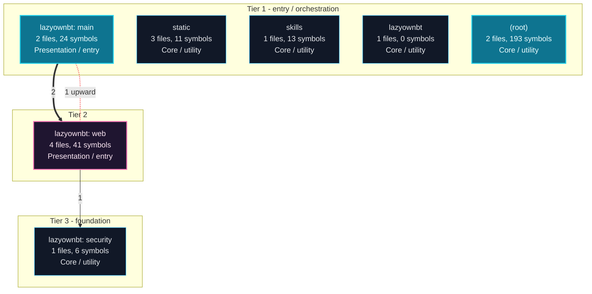

---

## Execution Flows

Entry points are scored from `__main__` guards, `main` functions, entry-style names and files, and call-graph sources. Each flow walks resolved calls in call-site order (depth <= 4, <= 40 steps); numbers give the call order, dashed arrows revisit an already expanded callee, red arrows are recursion. Interactive version with zoom and per-node docs: `readmenator-apidocs/index.html#/flows`.

### `app (__main__)`

`app.py:5313`, score 8: `if __name__ == "__main__"` guard.

Control flow:

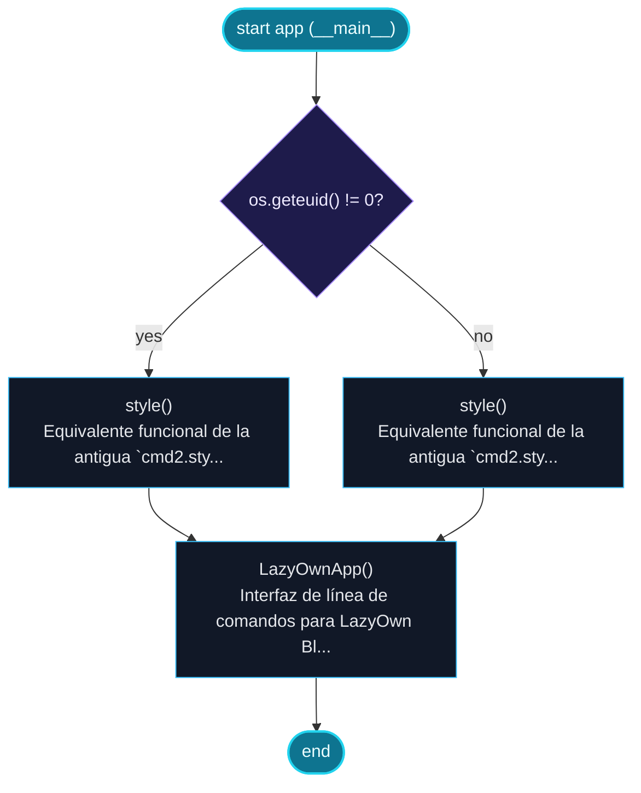

Call tree:

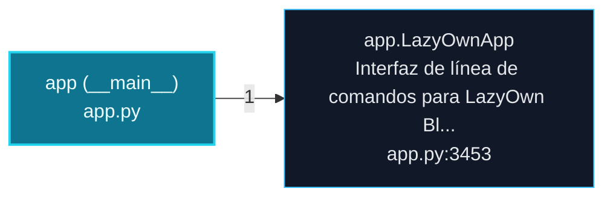

### `web (__main__)`

`lazyownbt/web.py:258`, score 8: `if __name__ == "__main__"` guard.

Call tree:

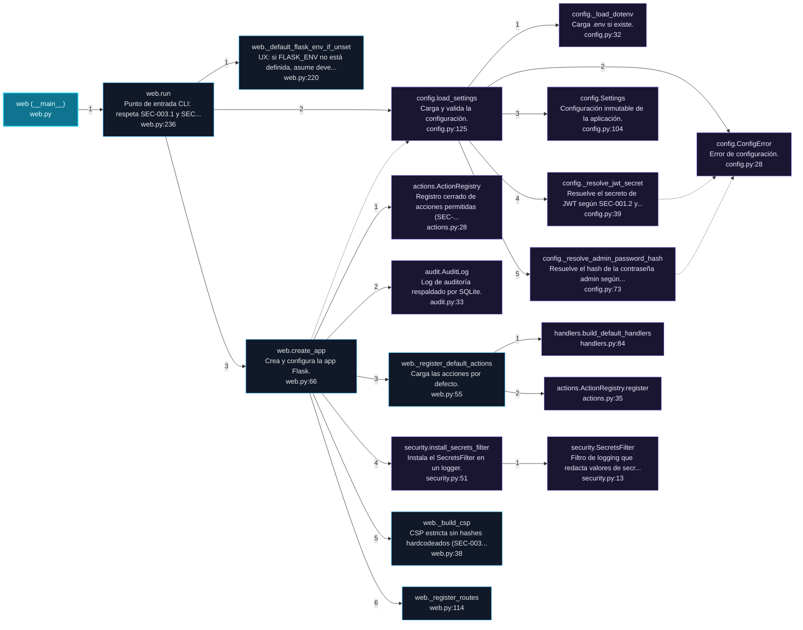

Cross-file sequence:

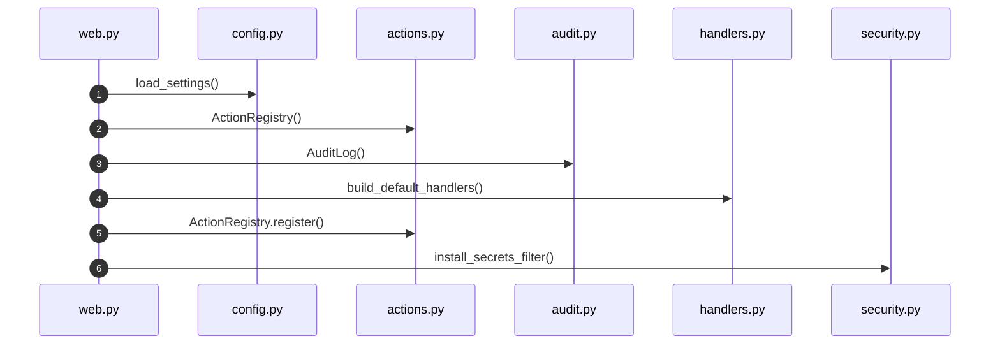

### `main (__main__)`

`main.py:287`, score 8: `if __name__ == "__main__"` guard.

Control flow:

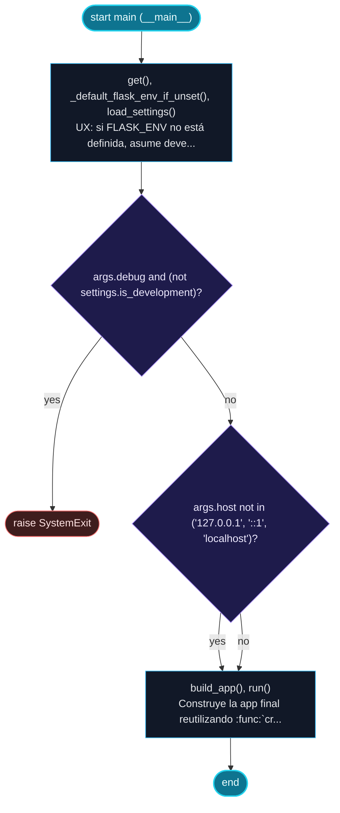

Call tree:

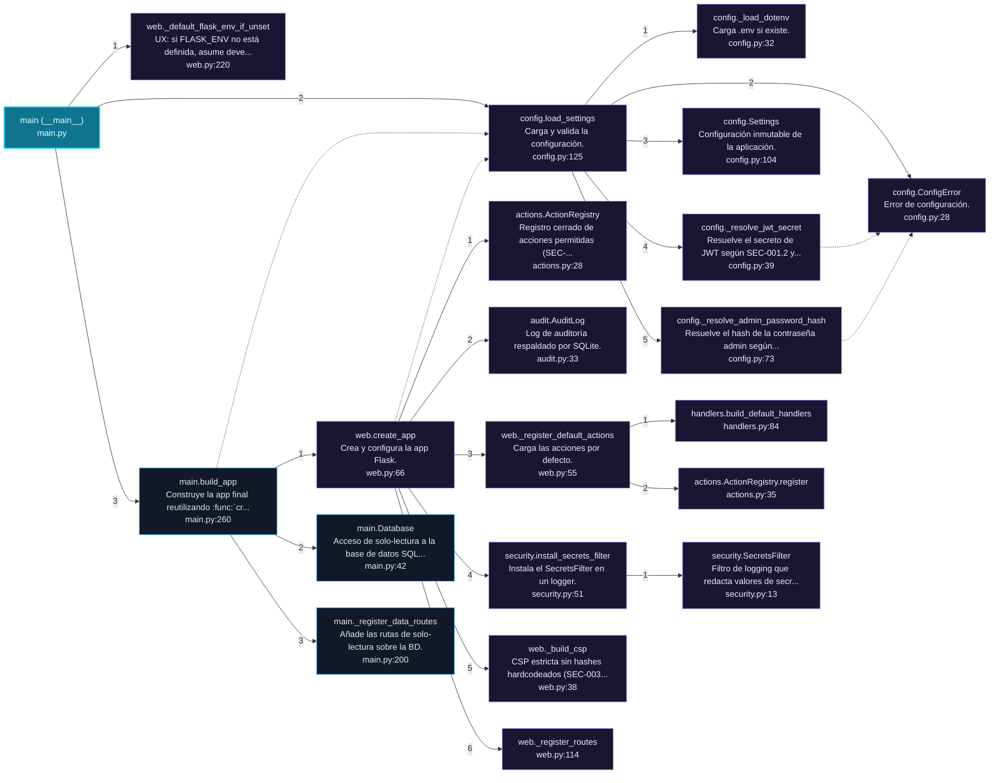

Cross-file sequence:

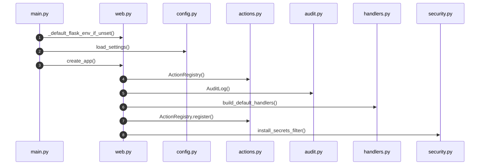

---

## Ranked Context

Files ranked by composite score for the current query context. The ranking combines Personalized PageRank (query relevance), global authority, test coverage, documentation coverage, and code freshness. Model: v1.0.

| Rank | File | Composite | PPR | Authority | Test | Doc |
|------|------|-----------|-----|-----------|------|-----|
| 1 | `config.py` | 0.1943 | 0.1643 | 0.1643 | 0.00 | 0.88 |
| 2 | `web.py` | 0.1522 | 0.1521 | 0.1521 | 0.00 | 0.53 |
| 3 | `actions.py` | 0.1510 | 0.1554 | 0.1554 | 0.00 | 0.50 |
| 4 | `security.py` | 0.1305 | 0.0983 | 0.0983 | 0.00 | 0.67 |
| 5 | `test_configuration.py` | 0.1022 | 0.0473 | 0.0473 | 0.00 | 0.71 |
| 6 | `test_command_execution_bdd.py` | 0.1000 | 0.0000 | 0.0000 | 0.00 | 1.00 |
| 7 | `test_configuration_bdd.py` | 0.1000 | 0.0000 | 0.0000 | 0.00 | 1.00 |
| 8 | `test_production_bdd.py` | 0.1000 | 0.0000 | 0.0000 | 0.00 | 1.00 |
| 9 | `test_secrets_bdd.py` | 0.1000 | 0.0000 | 0.0000 | 0.00 | 1.00 |
| 10 | `audit.py` | 0.0850 | 0.0731 | 0.0731 | 0.00 | 0.38 |

**Query anchors:** app.py

---

## God Nodes

Most architecturally central files ranked by combined import/export degree and symbol richness.

| File | Score | Connections | PageRank |
|------|-------|-------------|----------|
| `web.py` | 19.5 | | 0.1521 |
| `app.py` | 19.3 | | 0.0000 |
| `conftest.py` | 13.7 | | 0.0000 |
| `config.py` | 12.8 | | 0.1643 |
| `actions.py` | 7.0 | | 0.1554 |
| `security.py` | 6.6 | | 0.0983 |
| `main.py` | 5.6 | | 0.0000 |
| `test_command_execution.py` | 5.4 | | 0.0000 |
| `test_security.py` | 5.3 | | 0.0000 |
| `handlers.py` | 4.8 | | 0.0000 |

---

## Community Analysis

Files grouped by import-based community detection. Cohesion measures how tightly connected each community is internally.

### lazyownbt: web (Cohesion: 0.55)

**5 files** in this community:

- `actions.py` (py, 10 symbols)
- `audit.py` (py, 8 symbols)
- `handlers.py` (py, 8 symbols)
- `web.py` (py, 15 symbols)
- `test_command_execution.py` (py, 14 symbols)

### lazyownbt: main (Cohesion: 0.38)

**4 files** in this community:

- `config.py` (py, 8 symbols)
- `main.py` (py, 16 symbols)
- `test_configuration.py` (py, 7 symbols)
- `test_production.py` (py, 8 symbols)

### lazyownbt: security (Cohesion: 0.33)

**3 files** in this community:

- `security.py` (py, 6 symbols)
- `conftest.py` (py, 77 symbols)
- `test_security.py` (py, 13 symbols)

---

## Surprising Connections

Files in different communities connected through 3+ indirect hops.

- `actions.py` <-> `test_configuration.py` (3 hops, across 2 communities)
- `actions.py` <-> `test_security.py` (3 hops, across 3 communities)
- `audit.py` <-> `test_configuration.py` (3 hops, across 2 communities)
- `audit.py` <-> `test_security.py` (3 hops, across 3 communities)
- `handlers.py` <-> `test_configuration.py` (3 hops, across 2 communities)

---

## Suggested Questions

Auto-generated exploration prompts based on graph structure:

- What does web.py depend on, and what depends on it? (9 connections)
- What does app.py depend on, and what depends on it? (0 connections)
- What does conftest.py depend on, and what depends on it? (3 connections)
- How are the 5 files in 'lazyownbt: web' related to each other?
- Why are actions.py and test_configuration.py connected through 3 hops across 2 communities?

---

## Force-Graph Explorer

Heterogeneous explorer payload (files, communities, layers, externals) rendered with force-graph physics, stable family colors, log2 node sizing, and convex-hull community overlays. Open `readmenator-maps/graph-force.html` (linked from the maps gallery) or run `explorer`.

- Nodes: 100 (community: 3, external: 70, file: 23, layer: 4)
- Edges: 248

---

## Corpus Analytics

Attribution funnel and distributions for the explorer dashboard.

- Files: 23 | With symbols: 17 | Attributed: 12 | God nodes: 10 | Symbols: 407

- Layer `testing`: 9 files
- Layer `utility`: 9 files
- Layer `presentation`: 4 files
- Layer `infrastructure`: 1 files

- Language `py`: 19 files
- Language `js`: 3 files
- Language `sh`: 1 files

---

## Taint Propagation Map

Taint analysis traces how dangerous imports propagate through the codebase via transitive dependencies. Source files import dangerous modules directly; sink files receive the danger indirectly.

**Taint Sources:** 3 | **Taint Sinks:** 4 | **Propagation Paths:** 5

- `app.py` imports `subprocess` (0 hop to `app.py`) [high]
  Path: app.py
- `app.py` imports `requests` (0 hop to `app.py`) [medium]
  Path: app.py
- `handlers.py` imports `subprocess` (0 hop to `handlers.py`) [high]
  Path: handlers.py
- `handlers.py` imports `subprocess` (1 hop to `actions.py`) [high]
  Path: handlers.py -> actions.py
- `lazyownbt_mcp.py` imports `subprocess` (0 hop to `lazyownbt_mcp.py`) [high]
  Path: lazyownbt_mcp.py

---

## Hotspot Analysis

Files ranked by combined complexity (symbol count) and centrality (connection count). High-scoring files are architecturally critical and may need refactoring attention.

| File | Complexity | Centrality | Combined | Symbols | Connections |
|------|-----------|------------|----------|---------|-------------|
| `config.py` | 0.042 | 0.262 | 0.174 | 8 | 16 |
| `web.py` | 0.078 | 0.574 | 0.375 | 15 | 35 |
| `actions.py` | 0.052 | 0.098 | 0.080 | 10 | 6 |
| `security.py` | 0.031 | 0.131 | 0.091 | 6 | 8 |
| `test_configuration.py` | 0.036 | 0.164 | 0.113 | 7 | 10 |
| `test_command_execution_bdd.py` | 0.000 | 0.033 | 0.020 | 0 | 2 |
| `test_configuration_bdd.py` | 0.000 | 0.033 | 0.020 | 0 | 2 |
| `test_production_bdd.py` | 0.000 | 0.033 | 0.020 | 0 | 2 |
| `test_secrets_bdd.py` | 0.000 | 0.033 | 0.020 | 0 | 2 |
| `audit.py` | 0.042 | 0.197 | 0.135 | 8 | 12 |
| `app.py` | 1.000 | 1.000 | 1.000 | 193 | 61 |
| `conftest.py` | 0.399 | 0.557 | 0.494 | 77 | 34 |
| `commands.js` | 0.015 | 0.508 | 0.311 | 3 | 31 |
| `lazyownbt_mcp.py` | 0.067 | 0.328 | 0.224 | 13 | 20 |
| `main.py` | 0.083 | 0.295 | 0.210 | 16 | 18 |

---

## Concept Graph

Semantic second-brain layer: nouns are concept nodes, verbs are edges. Each noun maps atomically to a file set (EXTRACTED); each verb aggregates structural imports, calls, and inherits into consumes, invokes, extends, depends_on, or bridges (INFERRED).

**50 concepts, 100 relations.**

| Concept | Files | Mentions |
|---------|-------|----------|
| `para` | 12 | 40 |
| `sec` | 9 | 30 |
| `lazyownbt` | 9 | 24 |
| `contrato` | 9 | 10 |
| `una` | 8 | 28 |
| `app` | 8 | 23 |
| `env` | 8 | 22 |
| `debe` | 8 | 12 |
| `que` | 8 | 12 |
| `los` | 7 | 34 |
| `con` | 7 | 23 |
| `config` | 7 | 22 |
| `audit` | 7 | 17 |
| `lazy` | 7 | 16 |
| `own` | 7 | 13 |
| `acciones` | 7 | 11 |
| `cli` | 7 | 9 |
| `command` | 6 | 32 |
| `jwt` | 6 | 15 |
| `desde` | 6 | 12 |
| `hash` | 6 | 12 |
| `security` | 6 | 10 |
| `default` | 6 | 9 |
| `error` | 6 | 9 |
| `comandos` | 6 | 8 |
| `handler` | 6 | 7 |
| `del` | 5 | 23 |
| `bdd` | 5 | 19 |
| `configuraci` | 5 | 18 |
| `load` | 5 | 17 |

### Verb Edges

| Source | Verb | Target | Strength | Evidence |
|--------|------|--------|----------|----------|
| `para` | `depends_on` | `lazyownbt` | 1.00 | 10 |
| `para` | `depends_on` | `contrato` | 0.94 | 10 |
| `para` | `depends_on` | `sec` | 0.94 | 10 |
| `debe` | `depends_on` | `lazyownbt` | 0.88 | 10 |
| `env` | `depends_on` | `lazyownbt` | 0.88 | 10 |
| `app` | `depends_on` | `lazyownbt` | 0.82 | 10 |
| `debe` | `depends_on` | `contrato` | 0.82 | 10 |
| `debe` | `depends_on` | `sec` | 0.82 | 10 |
| `env` | `depends_on` | `contrato` | 0.82 | 10 |
| `env` | `depends_on` | `sec` | 0.82 | 10 |
| `jwt` | `depends_on` | `lazyownbt` | 0.82 | 10 |
| `app` | `depends_on` | `contrato` | 0.76 | 10 |
| `app` | `depends_on` | `sec` | 0.76 | 10 |
| `con` | `depends_on` | `lazyownbt` | 0.76 | 10 |
| `jwt` | `depends_on` | `contrato` | 0.76 | 10 |
| `jwt` | `depends_on` | `sec` | 0.76 | 10 |
| `que` | `depends_on` | `lazyownbt` | 0.76 | 10 |
| `sec` | `depends_on` | `lazyownbt` | 0.76 | 10 |
| `audit` | `depends_on` | `lazyownbt` | 0.71 | 10 |
| `con` | `depends_on` | `contrato` | 0.71 | 10 |
| `con` | `depends_on` | `sec` | 0.71 | 10 |
| `contrato` | `depends_on` | `lazyownbt` | 0.71 | 10 |
| `debug` | `depends_on` | `lazyownbt` | 0.71 | 10 |
| `error` | `depends_on` | `lazyownbt` | 0.71 | 10 |
| `flask` | `depends_on` | `lazyownbt` | 0.71 | 10 |
| `los` | `depends_on` | `lazyownbt` | 0.71 | 10 |
| `para` | `depends_on` | `error` | 0.71 | 10 |
| `que` | `depends_on` | `contrato` | 0.71 | 10 |
| `que` | `depends_on` | `sec` | 0.71 | 10 |
| `sec` | `depends_on` | `contrato` | 0.71 | 10 |

### Dialectic Prompts

- Thesis: `acciones` centralizes 7 files; Antithesis: `action` pulls 5 files with 4 shared (Jaccard 0.50); Synthesis: should they merge, split by layer, or keep `bridges` explicit?
- Thesis: `acciones` centralizes 7 files; Antithesis: `app` pulls 8 files with 4 shared (Jaccard 0.36); Synthesis: should they merge, split by layer, or keep `bridges` explicit?
- Thesis: `acciones` centralizes 7 files; Antithesis: `audit` pulls 7 files with 5 shared (Jaccard 0.56); Synthesis: should they merge, split by layer, or keep `bridges` explicit?
- Thesis: `acciones` centralizes 7 files; Antithesis: `carga` pulls 4 files with 3 shared (Jaccard 0.38); Synthesis: should they merge, split by layer, or keep `bridges` explicit?
- Thesis: `acciones` centralizes 7 files; Antithesis: `comandos` pulls 6 files with 4 shared (Jaccard 0.44); Synthesis: should they merge, split by layer, or keep `bridges` explicit?
- Thesis: `acciones` centralizes 7 files; Antithesis: `commands` pulls 5 files with 3 shared (Jaccard 0.33); Synthesis: should they merge, split by layer, or keep `bridges` explicit?
- Thesis: `acciones` centralizes 7 files; Antithesis: `con` pulls 7 files with 4 shared (Jaccard 0.40); Synthesis: should they merge, split by layer, or keep `bridges` explicit?
- Thesis: `acciones` centralizes 7 files; Antithesis: `create` pulls 4 files with 3 shared (Jaccard 0.38); Synthesis: should they merge, split by layer, or keep `bridges` explicit?
- Thesis: `acciones` centralizes 7 files; Antithesis: `debe` pulls 8 files with 4 shared (Jaccard 0.36); Synthesis: should they merge, split by layer, or keep `bridges` explicit?
- Thesis: `acciones` centralizes 7 files; Antithesis: `debug` pulls 5 files with 3 shared (Jaccard 0.33); Synthesis: should they merge, split by layer, or keep `bridges` explicit?

---

## Change Impact Analysis

Files sorted by how many other files would be affected if they changed. High-impact files should be changed with caution.

| File | Direct Dependents | Transitive Dependents | Total Impact |
|------|------------------|----------------------|--------------|
| `config.py` | 6 | 1 | 7 |
| `actions.py` | 3 | 3 | 6 |
| `security.py` | 3 | 3 | 6 |
| `audit.py` | 1 | 4 | 5 |
| `handlers.py` | 1 | 4 | 5 |
| `web.py` | 4 | 0 | 4 |
| `app.py` | 0 | 0 | 0 |
| `install.sh` | 0 | 0 | 0 |
| `__init__.py` | 0 | 0 | 0 |
| `main.py` | 0 | 0 | 0 |
| `lazyownbt_mcp.py` | 0 | 0 | 0 |
| `auth.js` | 0 | 0 | 0 |
| `commands.js` | 0 | 0 | 0 |
| `table-filter.js` | 0 | 0 | 0 |
| `conftest.py` | 0 | 0 | 0 |

---

## Architecture Violations

Violations of architectural layer rules detected in the import graph. **14 strict violations, 0 warnings.**

| Source | Source Layer | Target | Target Layer | Description | Severity |
|--------|-------------|--------|-------------|-------------|----------|
| `conftest.py` | testing | `web.py` | presentation | testing must not import presentation | strict |
| `conftest.py` | testing | `web.py` | presentation | testing must not import presentation | strict |
| `conftest.py` | testing | `web.py` | presentation | testing must not import presentation | strict |
| `conftest.py` | testing | `web.py` | presentation | testing must not import presentation | strict |
| `conftest.py` | testing | `web.py` | presentation | testing must not import presentation | strict |
| `conftest.py` | testing | `web.py` | presentation | testing must not import presentation | strict |
| `test_command_execution.py` | testing | `actions.py` | presentation | testing must not import presentation | strict |
| `test_command_execution.py` | testing | `web.py` | presentation | testing must not import presentation | strict |
| `test_production.py` | testing | `web.py` | presentation | testing must not import presentation | strict |
| `test_production.py` | testing | `web.py` | presentation | testing must not import presentation | strict |
| `test_production.py` | testing | `web.py` | presentation | testing must not import presentation | strict |
| `test_production.py` | testing | `web.py` | presentation | testing must not import presentation | strict |
| `test_production.py` | testing | `web.py` | presentation | testing must not import presentation | strict |
| `test_production.py` | testing | `web.py` | presentation | testing must not import presentation | strict |

---

## Suggested Linting Rules

Automatically suggested linting and security rules based on patterns detected in the codebase. These can be exported as Semgrep rules using the `--export-rules` flag.

| Rule ID | Severity | Description | Language | Matches |
|---------|----------|-------------|----------|---------|
| `RM003` | warning | Bare except clause catches all exceptions including SystemExit | python | 3 |
| `RM001` | info | Large number of functions in py: 367 total | py | 367 |
| `RM002` | info | Large number of functions in js: 11 total | js | 11 |
| `RM004` | info | Print statement found (consider logging instead) | python | 108 |

---

## Orphans

Files with no documentation or low connectivity. These are candidates for documentation investment or cleanup.

- `install.sh` (0 symbols, no doc)

---

## Query Recipes

Example queries you can run against this knowledge base using the ranking engine:

```
# Find files most relevant to a concept
readmenator query "Where is the import resolver implemented?"

# Rank files by relevance to a topic
readmenator query "How does documentation generation work?"

# Explain why a file ranks highly
readmenator query "explain readmenator/_documentation.py"

# Trace dependency paths with ranked context
readmenator query "path from CLI to exporter"
```

The ranking model uses the following signals:

- **Personalized PageRank** (45% weight): query-specific relevance via seed propagation
- **Global Authority** (20% weight): structural importance via standard PageRank
- **Test Coverage** (15% weight): fraction of symbols referenced in test files
- **Doc Coverage** (10% weight): presence of docstrings and file-level docs
- **Freshness** (10% weight): recent modification activity

Results include score decomposition and justification paths for each ranked item.

---

## Structural Knowledge Map

> **Note:** The visual graph below has been intelligently pruned to the top 300 most relevant nodes to prevent rendering crashes. Full details of all files are documented in the Architecture Reference.

```mermaid
graph LR
    classDef mod fill:#1e1e1e,stroke:#ff6666,stroke-width:2px,color:#fff;
    classDef cls fill:#2d2d2d,stroke:#4ec9b0,stroke-width:2px,color:#fff;
    classDef fn fill:#333,stroke:#dcdcaa,stroke-width:1px,color:#dcdcaa;
    classDef ext fill:#111,stroke:#666,stroke-dasharray:5 5,color:#aaa;
    app_py["app.py (py)"]
    class app_py mod;
    app_py_Fg["Fg"]
    class app_py_Fg cls;
    app_py --> app_py_Fg
    app_py_style["style"]
    class app_py_style fn;
    app_py --> app_py_style
    app_py_replace_command_placeholders["replace_command_placeholders"]
    class app_py_replace_command_placeholders fn;
    app_py --> app_py_replace_command_placeholders
    app_py_FgColor["FgColor"]
    class app_py_FgColor cls;
    app_py --> app_py_FgColor
    app_py_Cyan["Cyan"]
    class app_py_Cyan cls;
    app_py --> app_py_Cyan
    subgraph community_2 ["lazyownbt: security"]
    tests_conftest_py["conftest.py (py)"]
    class tests_conftest_py mod;
    static_js_commands_js["commands.js (js)"]
    class static_js_commands_js mod;
    end
    subgraph community_0 ["lazyownbt: web"]
    lazyownbt_web_py["web.py (py)"]
    class lazyownbt_web_py mod;
    skills_lazyownbt_mcp_py["lazyownbt_mcp.py (py)"]
    class skills_lazyownbt_mcp_py mod;
    end
    subgraph community_1 ["lazyownbt: main"]
    main_py["main.py (py)"]
    class main_py mod;
    tests_test_production_py["test_production.py (py)"]
    class tests_test_production_py mod;
    static_js_auth_js["auth.js (js)"]
    class static_js_auth_js mod;
    static_js_table_filter_js["table-filter.js (js)"]
    class static_js_table_filter_js mod;
    lazyownbt_audit_py["audit.py (py)"]
    class lazyownbt_audit_py mod;
    tests_test_configuration_py["test_configuration.py (py)"]
    class tests_test_configuration_py mod;
    tests_test_command_execution_py["test_command_execution.py (py)"]
    class tests_test_command_execution_py mod;
    tests_test_security_py["test_security.py (py)"]
    class tests_test_security_py mod;
    lazyownbt_config_py["config.py (py)"]
    class lazyownbt_config_py mod;
    lazyownbt_handlers_py["handlers.py (py)"]
    class lazyownbt_handlers_py mod;
    lazyownbt_security_py["security.py (py)"]
    class lazyownbt_security_py mod;
    lazyownbt_actions_py["actions.py (py)"]
    class lazyownbt_actions_py mod;
    tests_test_command_execution_bdd_py["test_command_execution_bdd.py (py)"]
    class tests_test_command_execution_bdd_py mod;
    tests_test_configuration_bdd_py["test_configuration_bdd.py (py)"]
    class tests_test_configuration_bdd_py mod;
    tests_test_production_bdd_py["test_production_bdd.py (py)"]
    class tests_test_production_bdd_py mod;
    tests_test_secrets_bdd_py["test_secrets_bdd.py (py)"]
    class tests_test_secrets_bdd_py mod;
    install_sh["install.sh (sh)"]
    class install_sh mod;
    lazyownbt___init___py["__init__.py (py)"]
    class lazyownbt___init___py mod;
    end
    app_py ~~~ tests_test_configuration_bdd_py
    static_js_commands_js ~~~ tests_test_production_bdd_py
    skills_lazyownbt_mcp_py ~~~ tests_test_secrets_bdd_py
    static_js_auth_js ~~~ install_sh
    static_js_table_filter_js ~~~ lazyownbt___init___py
    lazyownbt_handlers_py -- resolved_imports --> lazyownbt_actions_py
    lazyownbt_web_py -- resolved_imports --> lazyownbt_actions_py
    lazyownbt_web_py -- resolved_imports --> lazyownbt_audit_py
    lazyownbt_web_py -- resolved_imports --> lazyownbt_config_py
    lazyownbt_web_py -- resolved_imports --> lazyownbt_security_py
    lazyownbt_web_py -- resolved_imports --> lazyownbt_handlers_py
    main_py -- resolved_imports --> lazyownbt_config_py
    main_py -- resolved_imports --> lazyownbt_web_py
    main_py -- resolved_imports --> lazyownbt_config_py
    main_py -- resolved_imports --> lazyownbt_web_py
    tests_conftest_py -- resolved_imports --> lazyownbt_config_py
    tests_conftest_py -- resolved_imports --> lazyownbt_security_py
    tests_conftest_py -- resolved_imports --> lazyownbt_web_py
    tests_conftest_py -- resolved_imports --> lazyownbt_web_py
    tests_conftest_py -- resolved_imports --> lazyownbt_web_py
    tests_conftest_py -- resolved_imports --> lazyownbt_web_py
    tests_conftest_py -- resolved_imports --> lazyownbt_web_py
    tests_conftest_py -- resolved_imports --> lazyownbt_web_py
    tests_test_command_execution_py -- resolved_imports --> lazyownbt_actions_py
    tests_test_command_execution_py -- resolved_imports --> lazyownbt_web_py
    tests_test_configuration_py -- resolved_imports --> lazyownbt_config_py
    tests_test_production_py -- resolved_imports --> lazyownbt_web_py
    tests_test_production_py -- resolved_imports --> lazyownbt_web_py
    tests_test_production_py -- resolved_imports --> lazyownbt_config_py
    tests_test_production_py -- resolved_imports --> lazyownbt_web_py
    tests_test_production_py -- resolved_imports --> lazyownbt_web_py
    tests_test_production_py -- resolved_imports --> lazyownbt_web_py
    tests_test_production_py -- resolved_imports --> lazyownbt_web_py
    tests_test_security_py -- resolved_imports --> lazyownbt_config_py
    tests_test_security_py -- resolved_imports --> lazyownbt_security_py
    ext_cmd2["cmd2"]
    class ext_cmd2 ext;
    app_py -.->|imports| ext_cmd2
    ext_json["json"]
    class ext_json ext;
    app_py -.->|imports| ext_json
    ext_psutil["psutil"]
    class ext_psutil ext;
    app_py -.->|imports| ext_psutil
    ext_os["os"]
    class ext_os ext;
    app_py -.->|imports| ext_os
    ext_sys["sys"]
    class ext_sys ext;
    app_py -.->|imports| ext_sys
    ext_re["re"]
    class ext_re ext;
    app_py -.->|imports| ext_re
    ext_yaml["yaml"]
    class ext_yaml ext;
    app_py -.->|imports| ext_yaml
    ext_datetime["datetime"]
    class ext_datetime ext;
    app_py -.->|imports| ext_datetime
    ext_logging["logging"]
    class ext_logging ext;
    app_py -.->|imports| ext_logging
    ext_threading["threading"]
    class ext_threading ext;
    app_py -.->|imports| ext_threading
    ext_sqlite3["sqlite3"]
    class ext_sqlite3 ext;
    app_py -.->|imports| ext_sqlite3
    ext_hashlib["hashlib"]
    class ext_hashlib ext;
    app_py -.->|imports| ext_hashlib
    ext_socket["socket"]
    class ext_socket ext;
    app_py -.->|imports| ext_socket
    ext_subprocess["subprocess"]
    class ext_subprocess ext;
    app_py -.->|imports| ext_subprocess
    ext_platform["platform"]
    class ext_platform ext;
    app_py -.->|imports| ext_platform
    ext_time["time"]
    class ext_time ext;
    app_py -.->|imports| ext_time
    ext_shutil["shutil"]
    class ext_shutil ext;
    app_py -.->|imports| ext_shutil
    ext_joblib["joblib"]
    class ext_joblib ext;
    app_py -.->|imports| ext_joblib
    ext_pandas["pandas"]
    class ext_pandas ext;
    app_py -.->|imports| ext_pandas
    ext_sklearn_feature_extraction_text["sklearn.feature_extraction.text"]
    class ext_sklearn_feature_extraction_text ext;
    app_py -.->|imports| ext_sklearn_feature_extraction_text
    ext_signal["signal"]
    class ext_signal ext;
    app_py -.->|imports| ext_signal
    ext_pwd["pwd"]
    class ext_pwd ext;
    app_py -.->|imports| ext_pwd
    ext_grp["grp"]
    class ext_grp ext;
    app_py -.->|imports| ext_grp
    ext_csv["csv"]
    class ext_csv ext;
    app_py -.->|imports| ext_csv
```

---

## UML Class Diagram

Auto-generated Mermaid class diagrams from parsed class-level symbols, split into groups of at most 6 classes so each diagram stays readable. Per-module class diagrams with exact members live in `readmenator-apidocs/modules/`.

#### `app.py`

```mermaid
classDiagram
  direction LR
  class app_py_Fg {
    <<class>>
    +style(text, fg, bold)
    +replace_command_placeholders(command, params)
    +sanitize_content(text)
    +replace_match(match)
    +__init__(self, model_name, cache_size)
    +initialize_cache_table(self)
    +get_cache_key(self, content)
    +load_existing_vectorstore(self)
    +ollama_llm(self, question, context)
    +process_file_to_rag(self, file_path)
  }
  class app_py_FgColor {
    <<class>>
    +style(text, fg, bold)
    +replace_command_placeholders(command, params)
    +sanitize_content(text)
    +replace_match(match)
    +__init__(self, model_name, cache_size)
    +initialize_cache_table(self)
    +get_cache_key(self, content)
    +load_existing_vectorstore(self)
    +ollama_llm(self, question, context)
    +process_file_to_rag(self, file_path)
  }
  class app_py_Cyan {
    <<class>>
    +style(text, fg, bold)
    +replace_command_placeholders(command, params)
    +sanitize_content(text)
    +replace_match(match)
    +__init__(self, model_name, cache_size)
    +initialize_cache_table(self)
    +get_cache_key(self, content)
    +load_existing_vectorstore(self)
    +ollama_llm(self, question, context)
    +process_file_to_rag(self, file_path)
  }
  class app_py_Red {
    <<class>>
    +style(text, fg, bold)
    +replace_command_placeholders(command, params)
    +sanitize_content(text)
    +replace_match(match)
    +__init__(self, model_name, cache_size)
    +initialize_cache_table(self)
    +get_cache_key(self, content)
    +load_existing_vectorstore(self)
    +ollama_llm(self, question, context)
    +process_file_to_rag(self, file_path)
  }
  class app_py_RAGManager {
    <<class>>
    +style(text, fg, bold)
    +replace_command_placeholders(command, params)
    +sanitize_content(text)
    +replace_match(match)
    +__init__(self, model_name, cache_size)
    +initialize_cache_table(self)
    +get_cache_key(self, content)
    +load_existing_vectorstore(self)
    +ollama_llm(self, question, context)
    +process_file_to_rag(self, file_path)
  }
  class app_py_Database {
    <<class>>
    +style(text, fg, bold)
    +replace_command_placeholders(command, params)
    +sanitize_content(text)
    +replace_match(match)
    +__init__(self, model_name, cache_size)
    +initialize_cache_table(self)
    +get_cache_key(self, content)
    +load_existing_vectorstore(self)
    +ollama_llm(self, question, context)
    +process_file_to_rag(self, file_path)
  }
  class app_py_Alert {
    <<class>>
    +style(text, fg, bold)
    +replace_command_placeholders(command, params)
    +sanitize_content(text)
    +replace_match(match)
    +__init__(self, model_name, cache_size)
    +initialize_cache_table(self)
    +get_cache_key(self, content)
    +load_existing_vectorstore(self)
    +ollama_llm(self, question, context)
    +process_file_to_rag(self, file_path)
  }
  class app_py_SystemUtils {
    <<class>>
    +style(text, fg, bold)
    +replace_command_placeholders(command, params)
    +sanitize_content(text)
    +replace_match(match)
    +__init__(self, model_name, cache_size)
    +initialize_cache_table(self)
    +get_cache_key(self, content)
    +load_existing_vectorstore(self)
    +ollama_llm(self, question, context)
    +process_file_to_rag(self, file_path)
  }
  class app_py_ProcessMonitor {
    <<class>>
    +style(text, fg, bold)
    +replace_command_placeholders(command, params)
    +sanitize_content(text)
    +replace_match(match)
    +__init__(self, model_name, cache_size)
    +initialize_cache_table(self)
    +get_cache_key(self, content)
    +load_existing_vectorstore(self)
    +ollama_llm(self, question, context)
    +process_file_to_rag(self, file_path)
  }
  class app_py_NetworkMonitor {
    <<class>>
    +style(text, fg, bold)
    +replace_command_placeholders(command, params)
    +sanitize_content(text)
    +replace_match(match)
    +__init__(self, model_name, cache_size)
    +initialize_cache_table(self)
    +get_cache_key(self, content)
    +load_existing_vectorstore(self)
    +ollama_llm(self, question, context)
    +process_file_to_rag(self, file_path)
  }
  class app_py_FileIntegrityMonitor {
    <<class>>
    +style(text, fg, bold)
    +replace_command_placeholders(command, params)
    +sanitize_content(text)
    +replace_match(match)
    +__init__(self, model_name, cache_size)
    +initialize_cache_table(self)
    +get_cache_key(self, content)
    +load_existing_vectorstore(self)
    +ollama_llm(self, question, context)
    +process_file_to_rag(self, file_path)
  }
  class app_py_LogAnalyzer {
    <<class>>
    +style(text, fg, bold)
    +replace_command_placeholders(command, params)
    +sanitize_content(text)
    +replace_match(match)
    +__init__(self, model_name, cache_size)
    +initialize_cache_table(self)
    +get_cache_key(self, content)
    +load_existing_vectorstore(self)
    +ollama_llm(self, question, context)
    +process_file_to_rag(self, file_path)
  }
  class app_py_RealTimeLogMonitor {
    <<class>>
    +style(text, fg, bold)
    +replace_command_placeholders(command, params)
    +sanitize_content(text)
    +replace_match(match)
    +__init__(self, model_name, cache_size)
    +initialize_cache_table(self)
    +get_cache_key(self, content)
    +load_existing_vectorstore(self)
    +ollama_llm(self, question, context)
    +process_file_to_rag(self, file_path)
  }
  class app_py_SystemHardener {
    <<class>>
    +style(text, fg, bold)
    +replace_command_placeholders(command, params)
    +sanitize_content(text)
    +replace_match(match)
    +__init__(self, model_name, cache_size)
    +initialize_cache_table(self)
    +get_cache_key(self, content)
    +load_existing_vectorstore(self)
    +ollama_llm(self, question, context)
    +process_file_to_rag(self, file_path)
  }
  class app_py_IncidentResponder {
    <<class>>
    +style(text, fg, bold)
    +replace_command_placeholders(command, params)
    +sanitize_content(text)
    +replace_match(match)
    +__init__(self, model_name, cache_size)
    +initialize_cache_table(self)
    +get_cache_key(self, content)
    +load_existing_vectorstore(self)
    +ollama_llm(self, question, context)
    +process_file_to_rag(self, file_path)
  }
  class app_py_ReportGenerator {
    <<class>>
    +style(text, fg, bold)
    +replace_command_placeholders(command, params)
    +sanitize_content(text)
    +replace_match(match)
    +__init__(self, model_name, cache_size)
    +initialize_cache_table(self)
    +get_cache_key(self, content)
    +load_existing_vectorstore(self)
    +ollama_llm(self, question, context)
    +process_file_to_rag(self, file_path)
  }
  class app_py_MemoryScanner {
    <<class>>
    +style(text, fg, bold)
    +replace_command_placeholders(command, params)
    +sanitize_content(text)
    +replace_match(match)
    +__init__(self, model_name, cache_size)
    +initialize_cache_table(self)
    +get_cache_key(self, content)
    +load_existing_vectorstore(self)
    +ollama_llm(self, question, context)
    +process_file_to_rag(self, file_path)
  }
  class app_py_LazySentinelHandler {
    <<class>>
    +style(text, fg, bold)
    +replace_command_placeholders(command, params)
    +sanitize_content(text)
    +replace_match(match)
    +__init__(self, model_name, cache_size)
    +initialize_cache_table(self)
    +get_cache_key(self, content)
    +load_existing_vectorstore(self)
    +ollama_llm(self, question, context)
    +process_file_to_rag(self, file_path)
  }
  class app_py_LazySentinel {
    <<class>>
    +style(text, fg, bold)
    +replace_command_placeholders(command, params)
    +sanitize_content(text)
    +replace_match(match)
    +__init__(self, model_name, cache_size)
    +initialize_cache_table(self)
    +get_cache_key(self, content)
    +load_existing_vectorstore(self)
    +ollama_llm(self, question, context)
    +process_file_to_rag(self, file_path)
  }
  class app_py_LazyOwnApp {
    <<class>>
    +style(text, fg, bold)
    +replace_command_placeholders(command, params)
    +sanitize_content(text)
    +replace_match(match)
    +__init__(self, model_name, cache_size)
    +initialize_cache_table(self)
    +get_cache_key(self, content)
    +load_existing_vectorstore(self)
    +ollama_llm(self, question, context)
    +process_file_to_rag(self, file_path)
  }
```

#### `lazyownbt/actions.py`, `lazyownbt/audit.py`

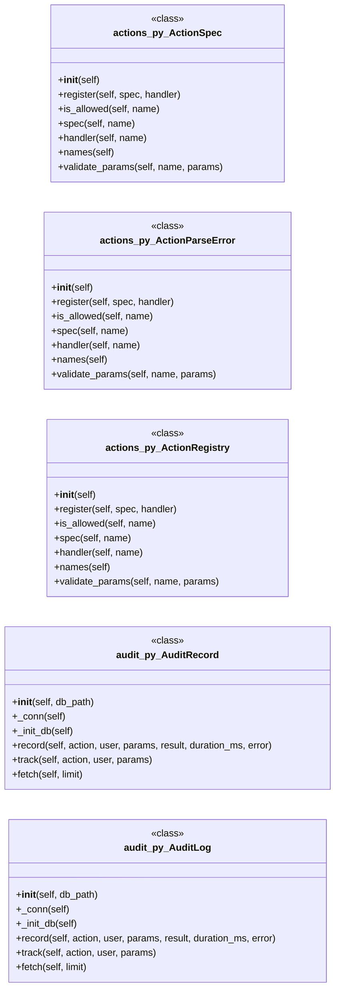

#### `lazyownbt/config.py`, `lazyownbt/security.py`, `main.py`

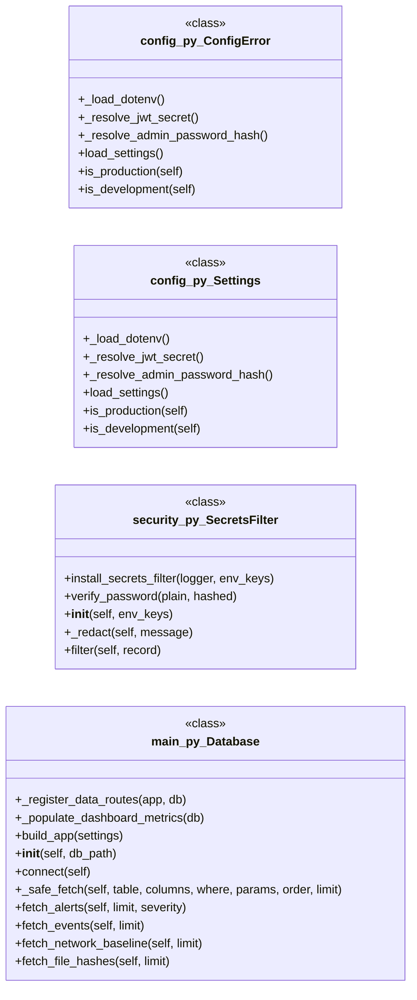

---

## Code Property Graph

Machine-readable Code Property Graph (CPG) in JSON-LD format. This block allows AI agents to parse the full structural graph without additional file reads. Compatible with GraphRAG pipelines.

```json
{"@context": "https://schema.org", "analysis": {"communities": [{"cohesion": 0.545, "id": 0, "label": "lazyownbt: web", "size": 5}, {"cohesion": 0.375, "id": 1, "label": "lazyownbt: main", "size": 4}, {"cohesion": 0.333, "id": 2, "label": "lazyownbt: security", "size": 3}], "god_nodes": [{"node_id": "lazyownbt/web.py", "score": 19.5}, {"node_id": "app.py", "score": 19.3}, {"node_id": "tests/conftest.py", "score": 13.7}, {"node_id": "lazyownbt/config.py", "score": 12.8}, {"node_id": "lazyownbt/actions.py", "score": 7.0}, {"node_id": "lazyownbt/security.py", "score": 6.6}, {"node_id": "main.py", "score": 5.6}, {"node_id": "tests/test_command_execution.py", "score": 5.4}, {"node_id": "tests/test_security.py", "score": 5.3}, {"node_id": "lazyownbt/handlers.py", "score": 4.8}], "surprising_connections": [{"hops": 3, "source": "lazyownbt/actions.py", "target": "tests/test_configuration.py"}, {"hops": 3, "source": "lazyownbt/actions.py", "target": "tests/test_security.py"}, {"hops": 3, "source": "lazyownbt/audit.py", "target": "tests/test_configuration.py"}, {"hops": 3, "source": "lazyownbt/audit.py", "target": "tests/test_security.py"}, {"hops": 3, "source": "lazyownbt/handlers.py", "target": "tests/test_configuration.py"}]}, "edges": [{"confidence": "EXTRACTED", "relation": "imports", "source": "app.py", "target": "cmd2"}, {"confidence": "EXTRACTED", "relation": "imports", "source": "app.py", "target": "json"}, {"confidence": "EXTRACTED", "relation": "imports", "source": "app.py", "target": "psutil"}, {"confidence": "EXTRACTED", "relation": "imports", "source": "app.py", "target": "os"}, {"confidence": "EXTRACTED", "relation": "imports", "source": "app.py", "target": "sys"}, {"confidence": "EXTRACTED", "relation": "imports", "source": "app.py", "target": "re"}, {"confidence": "EXTRACTED", "relation": "imports", "source": "app.py", "target": "yaml"}, {"confidence": "EXTRACTED", "relation": "imports", "source": "app.py", "target": "datetime"}, {"confidence": "EXTRACTED", "relation": "imports", "source": "app.py", "target": "logging"}, {"confidence": "EXTRACTED", "relation": "imports", "source": "app.py", "target": "threading"}, {"confidence": "EXTRACTED", "relation": "imports", "source": "app.py", "target": "sqlite3"}, {"confidence": "EXTRACTED", "relation": "imports", "source": "app.py", "target": "hashlib"}, {"confidence": "EXTRACTED", "relation": "imports", "source": "app.py", "target": "socket"}, {"confidence": "EXTRACTED", "relation": "imports", "source": "app.py", "target": "subprocess"}, {"confidence": "EXTRACTED", "relation": "imports", "source": "app.py", "target": "platform"}, {"confidence": "EXTRACTED", "relation": "imports", "source": "app.py", "target": "time"}, {"confidence": "EXTRACTED", "relation": "imports", "source": "app.py", "target": "shutil"}, {"confidence": "EXTRACTED", "relation": "imports", "source": "app.py", "target": "joblib"}, {"confidence": "EXTRACTED", "relation": "imports", "source": "app.py", "target": "pandas"}, {"confidence": "EXTRACTED", "relation": "imports", "source": "app.py", "target": "sklearn.feature_extraction.text"}, {"confidence": "EXTRACTED", "relation": "imports", "source": "app.py", "target": "signal"}, {"confidence": "EXTRACTED", "relation": "imports", "source": "app.py", "target": "pwd"}, {"confidence": "EXTRACTED", "relation": "imports", "source": "app.py", "target": "grp"}, {"confidence": "EXTRACTED", "relation": "imports", "source": "app.py", "target": "csv"}, {"confidence": "EXTRACTED", "relation": "imports", "source": "app.py", "target": "argparse"}, {"confidence": "EXTRACTED", "relation": "imports", "source": "app.py", "target": "lupa"}, {"confidence": "EXTRACTED", "relation": "imports", "source": "app.py", "target": "concurrent.futures"}, {"confidence": "EXTRACTED", "relation": "imports", "source": "app.py", "target": "collections"}, {"confidence": "EXTRACTED", "relation": "imports", "source": "app.py", "target": "typing"}, {"confidence": "EXTRACTED", "relation": "imports", "source": "app.py", "target": "tabulate"}, {"confidence": "EXTRACTED", "relation": "imports", "source": "app.py", "target": "pathlib"}, {"confidence": "EXTRACTED", "relation": "imports", "source": "app.py", "target": "os"}, {"confidence": "EXTRACTED", "relation": "imports", "source": "app.py", "target": "time"}, {"confidence": "EXTRACTED", "relation": "imports", "source": "app.py", "target": "cmd2"}, {"confidence": "EXTRACTED", "relation": "imports", "source": "app.py", "target": "logging"}, {"confidence": "EXTRACTED", "relation": "imports", "source": "app.py", "target": "json"}, {"confidence": "EXTRACTED", "relation": "imports", "source": "app.py", "target": "requests"}, {"confidence": "EXTRACTED", "relation": "imports", "source": "app.py", "target": "sqlite3"}, {"confidence": "EXTRACTED", "relation": "imports", "source": "app.py", "target": "datetime"}, {"confidence": "EXTRACTED", "relation": "imports", "source": "app.py", "target": "re"}, {"confidence": "EXTRACTED", "relation": "imports", "source": "app.py", "target": "queue"}, {"confidence": "EXTRACTED", "relation": "imports", "source": "app.py", "target": "tempfile"}, {"confidence": "EXTRACTED", "relation": "imports", "source": "app.py", "target": "hashlib"}, {"confidence": "EXTRACTED", "relation": "imports", "source": "app.py", "target": "watchdog.observers"}, {"confidence": "EXTRACTED", "relation": "imports", "source": "app.py", "target": "watchdog.events"}, {"confidence": "EXTRACTED", "relation": "imports", "source": "app.py", "target": "pathlib"}, {"confidence": "EXTRACTED", "relation": "imports", "source": "app.py", "target": "typing"}, {"confidence": "EXTRACTED", "relation": "imports", "source": "app.py", "target": "cachetools"}, {"confidence": "EXTRACTED", "relation": "imports", "source": "app.py", "target": "rich.console"}, {"confidence": "EXTRACTED", "relation": "imports", "source": "app.py", "target": "rich.panel"}, {"confidence": "EXTRACTED", "relation": "imports", "source": "app.py", "target": "rich.markdown"}, {"confidence": "EXTRACTED", "relation": "imports", "source": "app.py", "target": "langchain_community.document_loaders"}, {"confidence": "EXTRACTED", "relation": "imports", "source": "app.py", "target": "langchain_text_splitters"}, {"confidence": "EXTRACTED", "relation": "imports", "source": "app.py", "target": "langchain_chroma"}, {"confidence": "EXTRACTED", "relation": "imports", "source": "app.py", "target": "langchain_ollama"}, {"confidence": "EXTRACTED", "relation": "imports", "source": "app.py", "target": "cmd2.styles"}, {"confidence": "EXTRACTED", "relation": "imports", "source": "app.py", "target": "ollama"}, {"confidence": "EXTRACTED", "relation": "imports", "source": "app.py", "target": "chromadb"}, {"confidence": "EXTRACTED", "relation": "imports", "source": "app.py", "target": "cachetools"}, {"confidence": "EXTRACTED", "relation": "imports", "source": "app.py", "target": "rich"}, {"confidence": "EXTRACTED", "relation": "imports", "source": "app.py", "target": "re"}, {"confidence": "EXTRACTED", "relation": "imports", "source": "lazyownbt/actions.py", "target": "__future__"}, {"confidence": "EXTRACTED", "relation": "imports", "source": "lazyownbt/actions.py", "target": "dataclasses"}, {"confidence": "EXTRACTED", "relation": "imports", "source": "lazyownbt/actions.py", "target": "typing"}, {"confidence": "EXTRACTED", "relation": "imports", "source": "lazyownbt/audit.py", "target": "__future__"}, {"confidence": "EXTRACTED", "relation": "imports", "source": "lazyownbt/audit.py", "target": "json"}, {"confidence": "EXTRACTED", "relation": "imports", "source": "lazyownbt/audit.py", "target": "logging"}, {"confidence": "EXTRACTED", "relation": "imports", "source": "lazyownbt/audit.py", "target": "sqlite3"}, {"confidence": "EXTRACTED", "relation": "imports", "source": "lazyownbt/audit.py", "target": "threading"}, {"confidence": "EXTRACTED", "relation": "imports", "source": "lazyownbt/audit.py", "target": "time"}, {"confidence": "EXTRACTED", "relation": "imports", "source": "lazyownbt/audit.py", "target": "contextlib"}, {"confidence": "EXTRACTED", "relation": "imports", "source": "lazyownbt/audit.py", "target": "dataclasses"}, {"confidence": "EXTRACTED", "relation": "imports", "source": "lazyownbt/audit.py", "target": "datetime"}, {"confidence": "EXTRACTED", "relation": "imports", "source": "lazyownbt/audit.py", "target": "pathlib"}, {"confidence": "EXTRACTED", "relation": "imports", "source": "lazyownbt/audit.py", "target": "typing"}, {"confidence": "EXTRACTED", "relation": "imports", "source": "lazyownbt/config.py", "target": "__future__"}, {"confidence": "EXTRACTED", "relation": "imports", "source": "lazyownbt/config.py", "target": "os"}, {"confidence": "EXTRACTED", "relation": "imports", "source": "lazyownbt/config.py", "target": "secrets"}, {"confidence": "EXTRACTED", "relation": "imports", "source": "lazyownbt/config.py", "target": "sys"}, {"confidence": "EXTRACTED", "relation": "imports", "source": "lazyownbt/config.py", "target": "dataclasses"}, {"confidence": "EXTRACTED", "relation": "imports", "source": "lazyownbt/config.py", "target": "pathlib"}, {"confidence": "EXTRACTED", "relation": "imports", "source": "lazyownbt/config.py", "target": "typing"}, {"confidence": "EXTRACTED", "relation": "imports", "source": "lazyownbt/config.py", "target": "dotenv"}, {"confidence": "EXTRACTED", "relation": "imports", "source": "lazyownbt/config.py", "target": "bcrypt"}, {"confidence": "EXTRACTED", "relation": "imports", "source": "lazyownbt/handlers.py", "target": "__future__"}, {"confidence": "EXTRACTED", "relation": "imports", "source": "lazyownbt/handlers.py", "target": "os"}, {"confidence": "EXTRACTED", "relation": "imports", "source": "lazyownbt/handlers.py", "target": "re"}, {"confidence": "EXTRACTED", "relation": "imports", "source": "lazyownbt/handlers.py", "target": "socket"}, {"confidence": "EXTRACTED", "relation": "imports", "source": "lazyownbt/handlers.py", "target": "subprocess"}, {"confidence": "EXTRACTED", "relation": "imports", "source": "lazyownbt/handlers.py", "target": "typing"}, {"confidence": "EXTRACTED", "relation": "imports", "source": "lazyownbt/handlers.py", "target": "lazyownbt.actions"}, {"confidence": "EXTRACTED", "relation": "imports", "source": "lazyownbt/security.py", "target": "__future__"}, {"confidence": "EXTRACTED", "relation": "imports", "source": "lazyownbt/security.py", "target": "logging"}, {"confidence": "EXTRACTED", "relation": "imports", "source": "lazyownbt/security.py", "target": "re"}, {"confidence": "EXTRACTED", "relation": "imports", "source": "lazyownbt/security.py", "target": "typing"}, {"confidence": "EXTRACTED", "relation": "imports", "source": "lazyownbt/security.py", "target": "bcrypt"}, {"confidence": "EXTRACTED", "relation": "imports", "source": "lazyownbt/web.py", "target": "__future__"}, {"confidence": "EXTRACTED", "relation": "imports", "source": "lazyownbt/web.py", "target": "logging"}, {"confidence": "EXTRACTED", "relation": "imports", "source": "lazyownbt/web.py", "target": "os"}, {"confidence": "EXTRACTED", "relation": "imports", "source": "lazyownbt/web.py", "target": "pathlib"}, {"confidence": "EXTRACTED", "relation": "imports", "source": "lazyownbt/web.py", "target": "typing"}, {"confidence": "EXTRACTED", "relation": "imports", "source": "lazyownbt/web.py", "target": "flask"}, {"confidence": "EXTRACTED", "relation": "imports", "source": "lazyownbt/web.py", "target": "flask_jwt_extended"}, {"confidence": "EXTRACTED", "relation": "imports", "source": "lazyownbt/web.py", "target": "flask_talisman"}, {"confidence": "EXTRACTED", "relation": "imports", "source": "lazyownbt/web.py", "target": "lazyownbt.actions"}, {"confidence": "EXTRACTED", "relation": "imports", "source": "lazyownbt/web.py", "target": "lazyownbt.audit"}, {"confidence": "EXTRACTED", "relation": "imports", "source": "lazyownbt/web.py", "target": "lazyownbt.config"}, {"confidence": "EXTRACTED", "relation": "imports", "source": "lazyownbt/web.py", "target": "lazyownbt.security"}, {"confidence": "EXTRACTED", "relation": "imports", "source": "lazyownbt/web.py", "target": "lazyownbt.handlers"}, {"confidence": "EXTRACTED", "relation": "imports", "source": "lazyownbt/web.py", "target": "flask_jwt_extended"}, {"confidence": "EXTRACTED", "relation": "imports", "source": "lazyownbt/web.py", "target": "argparse"}, {"confidence": "EXTRACTED", "relation": "imports", "source": "main.py", "target": "__future__"}, {"confidence": "EXTRACTED", "relation": "imports", "source": "main.py", "target": "json"}, {"confidence": "EXTRACTED", "relation": "imports", "source": "main.py", "target": "logging"}, {"confidence": "EXTRACTED", "relation": "imports", "source": "main.py", "target": "sqlite3"}, {"confidence": "EXTRACTED", "relation": "imports", "source": "main.py", "target": "datetime"}, {"confidence": "EXTRACTED", "relation": "imports", "source": "main.py", "target": "pathlib"}, {"confidence": "EXTRACTED", "relation": "imports", "source": "main.py", "target": "typing"}, {"confidence": "EXTRACTED", "relation": "imports", "source": "main.py", "target": "flask"}, {"confidence": "EXTRACTED", "relation": "imports", "source": "main.py", "target": "lazyownbt.config"}, {"confidence": "EXTRACTED", "relation": "imports", "source": "main.py", "target": "lazyownbt.web"}, {"confidence": "EXTRACTED", "relation": "imports", "source": "main.py", "target": "argparse"}, {"confidence": "EXTRACTED", "relation": "imports", "source": "main.py", "target": "os"}, {"confidence": "EXTRACTED", "relation": "imports", "source": "main.py", "target": "lazyownbt.config"}, {"confidence": "EXTRACTED", "relation": "imports", "source": "main.py", "target": "lazyownbt.web"}, {"confidence": "EXTRACTED", "relation": "imports", "source": "skills/lazyownbt_mcp.py", "target": "asyncio"}, {"confidence": "EXTRACTED", "relation": "imports", "source": "skills/lazyownbt_mcp.py", "target": "fcntl"}, {"confidence": "EXTRACTED", "relation": "imports", "source": "skills/lazyownbt_mcp.py", "target": "json"}, {"confidence": "EXTRACTED", "relation": "imports", "source": "skills/lazyownbt_mcp.py", "target": "os"}, {"confidence": "EXTRACTED", "relation": "imports", "source": "skills/lazyownbt_mcp.py", "target": "pty"}, {"confidence": "EXTRACTED", "relation": "imports", "source": "skills/lazyownbt_mcp.py", "target": "re"}, {"confidence": "EXTRACTED", "relation": "imports", "source": "skills/lazyownbt_mcp.py", "target": "select"}, {"confidence": "EXTRACTED", "relation": "imports", "source": "skills/lazyownbt_mcp.py", "target": "sqlite3"}, {"confidence": "EXTRACTED", "relation": "imports", "source": "skills/lazyownbt_mcp.py", "target": "struct"}, {"confidence": "EXTRACTED", "relation": "imports", "source": "skills/lazyownbt_mcp.py", "target": "subprocess"}, {"confidence": "EXTRACTED", "relation": "imports", "source": "skills/lazyownbt_mcp.py", "target": "sys"}, {"confidence": "EXTRACTED", "relation": "imports", "source": "skills/lazyownbt_mcp.py", "target": "termios"}, {"confidence": "EXTRACTED", "relation": "imports", "source": "skills/lazyownbt_mcp.py", "target": "time"}, {"confidence": "EXTRACTED", "relation": "imports", "source": "skills/lazyownbt_mcp.py", "target": "datetime"}, {"confidence": "EXTRACTED", "relation": "imports", "source": "skills/lazyownbt_mcp.py", "target": "pathlib"}, {"confidence": "EXTRACTED", "relation": "imports", "source": "skills/lazyownbt_mcp.py", "target": "typing"}, {"confidence": "EXTRACTED", "relation": "imports", "source": "skills/lazyownbt_mcp.py", "target": "mcp.server"}, {"confidence": "EXTRACTED", "relation": "imports", "source": "skills/lazyownbt_mcp.py", "target": "mcp.server.stdio"}, {"confidence": "EXTRACTED", "relation": "imports", "source": "skills/lazyownbt_mcp.py", "target": "mcp"}, {"confidence": "EXTRACTED", "relation": "imports", "source": "skills/lazyownbt_mcp.py", "target": "signal"}, {"confidence": "EXTRACTED", "relation": "calls", "source": "static/js/auth.js", "target": "sessionStorage"}, {"confidence": "EXTRACTED", "relation": "calls", "source": "static/js/auth.js", "target": "get"}, {"confidence": "EXTRACTED", "relation": "calls", "source": "static/js/auth.js", "target": "getItem"}, {"confidence": "EXTRACTED", "relation": "calls", "source": "static/js/auth.js", "target": "set"}, {"confidence": "EXTRACTED", "relation": "calls", "source": "static/js/auth.js", "target": "setItem"}, {"confidence": "EXTRACTED", "relation": "calls", "source": "static/js/auth.js", "target": "clear"}, {"confidence": "EXTRACTED", "relation": "calls", "source": "static/js/auth.js", "target": "removeItem"}, {"confidence": "EXTRACTED", "relation": "calls", "source": "static/js/auth.js", "target": "requireOrRedirect"}, {"confidence": "EXTRACTED", "relation": "calls", "source": "static/js/auth.js", "target": "fetch"}, {"confidence": "EXTRACTED", "relation": "calls", "source": "static/js/auth.js", "target": "get"}, {"confidence": "EXTRACTED", "relation": "calls", "source": "static/js/auth.js", "target": "assign"}, {"confidence": "EXTRACTED", "relation": "calls", "source": "static/js/auth.js", "target": "fetch"}, {"confidence": "EXTRACTED", "relation": "calls", "source": "static/js/auth.js", "target": "clear"}, {"confidence": "EXTRACTED", "relation": "calls", "source": "static/js/commands.js", "target": "backend"}, {"confidence": "EXTRACTED", "relation": "calls", "source": "static/js/commands.js", "target": "declarado"}, {"confidence": "EXTRACTED", "relation": "calls", "source": "static/js/commands.js", "target": "renderParams"}, {"confidence": "EXTRACTED", "relation": "calls", "source": "static/js/commands.js", "target": "createElement"}, {"confidence": "EXTRACTED", "relation": "calls", "source": "static/js/commands.js", "target": "appendChild"}, {"confidence": "EXTRACTED", "relation": "calls", "source": "static/js/commands.js", "target": "createElement"}, {"confidence": "EXTRACTED", "relation": "calls", "source": "static/js/commands.js", "target": "createElement"}, {"confidence": "EXTRACTED", "relation": "calls", "source": "static/js/commands.js", "target": "appendChild"}, {"confidence": "EXTRACTED", "relation": "calls", "source": "static/js/commands.js", "target": "createElement"}, {"confidence": "EXTRACTED", "relation": "calls", "source": "static/js/commands.js", "target": "appendChild"}, {"confidence": "EXTRACTED", "relation": "calls", "source": "static/js/commands.js", "target": "appendChild"}, {"confidence": "EXTRACTED", "relation": "calls", "source": "static/js/commands.js", "target": "collectParams"}, {"confidence": "EXTRACTED", "relation": "calls", "source": "static/js/commands.js", "target": "getElementById"}, {"confidence": "EXTRACTED", "relation": "calls", "source": "static/js/commands.js", "target": "trim"}, {"confidence": "EXTRACTED", "relation": "calls", "source": "static/js/commands.js", "target": "submitCommand"}, {"confidence": "EXTRACTED", "relation": "calls", "source": "static/js/commands.js", "target": "preventDefault"}, {"confidence": "EXTRACTED", "relation": "calls", "source": "static/js/commands.js", "target": "getElementById"}, {"confidence": "EXTRACTED", "relation": "calls", "source": "static/js/commands.js", "target": "getElementById"}, {"confidence": "EXTRACTED", "relation": "calls", "source": "static/js/commands.js", "target": "querySelector"}, {"confidence": "EXTRACTED", "relation": "calls", "source": "static/js/commands.js", "target": "getElementById"}, {"confidence": "EXTRACTED", "relation": "calls", "source": "static/js/commands.js", "target": "collectParams"}, {"confidence": "EXTRACTED", "relation": "calls", "source": "static/js/commands.js", "target": "fetch"}, {"confidence": "EXTRACTED", "relation": "calls", "source": "static/js/commands.js", "target": "json"}, {"confidence": "EXTRACTED", "relation": "calls", "source": "static/js/commands.js", "target": "addEventListener"}, {"confidence": "EXTRACTED", "relation": "calls", "source": "static/js/commands.js", "target": "getElementById"}, {"confidence": "EXTRACTED", "relation": "calls", "source": "static/js/commands.js", "target": "getElementById"}, {"confidence": "EXTRACTED", "relation": "calls", "source": "static/js/commands.js", "target": "getElementById"}, {"confidence": "EXTRACTED", "relation": "calls", "source": "static/js/commands.js", "target": "renderParams"}, {"confidence": "EXTRACTED", "relation": "calls", "source": "static/js/commands.js", "target": "addEventListener"}, {"confidence": "EXTRACTED", "relation": "calls", "source": "static/js/commands.js", "target": "renderParams"}, {"confidence": "EXTRACTED", "relation": "calls", "source": "static/js/commands.js", "target": "addEventListener"}, {"confidence": "EXTRACTED", "relation": "calls", "source": "static/js/table-filter.js", "target": "cliente"}, {"confidence": "EXTRACTED", "relation": "calls", "source": "static/js/table-filter.js", "target": "tableFilter"}, {"confidence": "EXTRACTED", "relation": "calls", "source": "static/js/table-filter.js", "target": "tableFilter"}, {"confidence": "EXTRACTED", "relation": "calls", "source": "static/js/table-filter.js", "target": "getElementById"}, {"confidence": "EXTRACTED", "relation": "calls", "source": "static/js/table-filter.js", "target": "getElementById"}, {"confidence": "EXTRACTED", "relation": "calls", "source": "static/js/table-filter.js", "target": "from"}, {"confidence": "EXTRACTED", "relation": "calls", "source": "static/js/table-filter.js", "target": "apply"}, {"confidence": "EXTRACTED", "relation": "calls", "source": "static/js/table-filter.js", "target": "trim"}, {"confidence": "EXTRACTED", "relation": "calls", "source": "static/js/table-filter.js", "target": "toLowerCase"}, {"confidence": "EXTRACTED", "relation": "calls", "source": "static/js/table-filter.js", "target": "toLowerCase"}, {"confidence": "EXTRACTED", "relation": "calls", "source": "static/js/table-filter.js", "target": "includes"}, {"confidence": "EXTRACTED", "relation": "calls", "source": "static/js/table-filter.js", "target": "addEventListener"}, {"confidence": "EXTRACTED", "relation": "calls", "source": "static/js/table-filter.js", "target": "apply"}, {"confidence": "EXTRACTED", "relation": "imports", "source": "tests/conftest.py", "target": "__future__"}, {"confidence": "EXTRACTED", "relation": "imports", "source": "tests/conftest.py", "target": "json"}, {"confidence": "EXTRACTED", "relation": "imports", "source": "tests/conftest.py", "target": "os"}, {"confidence": "EXTRACTED", "relation": "imports", "source": "tests/conftest.py", "target": "re"}, {"confidence": "EXTRACTED", "relation": "imports", "source": "tests/conftest.py", "target": "sys"}, {"confidence": "EXTRACTED", "relation": "imports", "source": "tests/conftest.py", "target": "pathlib"}, {"confidence": "EXTRACTED", "relation": "imports", "source": "tests/conftest.py", "target": "bcrypt"}, {"confidence": "EXTRACTED", "relation": "imports", "source": "tests/conftest.py", "target": "pytest"}, {"confidence": "EXTRACTED", "relation": "imports", "source": "tests/conftest.py", "target": "flask_jwt_extended"}, {"confidence": "EXTRACTED", "relation": "imports", "source": "tests/conftest.py", "target": "pytest_bdd"}, {"confidence": "EXTRACTED", "relation": "imports", "source": "tests/conftest.py", "target": "lazyownbt.config"}, {"confidence": "EXTRACTED", "relation": "imports", "source": "tests/conftest.py", "target": "lazyownbt.security"}, {"confidence": "EXTRACTED", "relation": "imports", "source": "tests/conftest.py", "target": "lazyownbt.web"}, {"confidence": "EXTRACTED", "relation": "imports", "source": "tests/conftest.py", "target": "lazyownbt.web"}, {"confidence": "EXTRACTED", "relation": "imports", "source": "tests/conftest.py", "target": "bcrypt"}, {"confidence": "EXTRACTED", "relation": "imports", "source": "tests/conftest.py", "target": "flask_jwt_extended"}, {"confidence": "EXTRACTED", "relation": "imports", "source": "tests/conftest.py", "target": "logging"}, {"confidence": "EXTRACTED", "relation": "imports", "source": "tests/conftest.py", "target": "ast"}, {"confidence": "EXTRACTED", "relation": "imports", "source": "tests/conftest.py", "target": "pathlib"}, {"confidence": "EXTRACTED", "relation": "imports", "source": "tests/conftest.py", "target": "lazyownbt.web"}, {"confidence": "EXTRACTED", "relation": "imports", "source": "tests/conftest.py", "target": "lazyownbt.web"}, {"confidence": "EXTRACTED", "relation": "imports", "source": "tests/conftest.py", "target": "lazyownbt.web"}, {"confidence": "EXTRACTED", "relation": "imports", "source": "tests/conftest.py", "target": "lazyownbt.web"}, {"confidence": "EXTRACTED", "relation": "imports", "source": "tests/conftest.py", "target": "re"}, {"confidence": "EXTRACTED", "relation": "imports", "source": "tests/conftest.py", "target": "tomllib"}, {"confidence": "EXTRACTED", "relation": "imports", "source": "tests/conftest.py", "target": "sys"}, {"confidence": "EXTRACTED", "relation": "imports", "source": "tests/test_command_execution.py", "target": "__future__"}, {"confidence": "EXTRACTED", "relation": "imports", "source": "tests/test_command_execution.py", "target": "json"}, {"confidence": "EXTRACTED", "relation": "imports", "source": "tests/test_command_execution.py", "target": "re"}, {"confidence": "EXTRACTED", "relation": "imports", "source": "tests/test_command_execution.py", "target": "pathlib"}, {"confidence": "EXTRACTED", "relation": "imports", "source": "tests/test_command_execution.py", "target": "pytest"}, {"confidence": "EXTRACTED", "relation": "imports", "source": "tests/test_command_execution.py", "target": "lazyownbt.actions"}, {"confidence": "EXTRACTED", "relation": "imports", "source": "tests/test_command_execution.py", "target": "lazyownbt.web"}, {"confidence": "EXTRACTED", "relation": "imports", "source": "tests/test_command_execution_bdd.py", "target": "__future__"}, {"confidence": "EXTRACTED", "relation": "imports", "source": "tests/test_command_execution_bdd.py", "target": "pytest_bdd"}, {"confidence": "EXTRACTED", "relation": "imports", "source": "tests/test_configuration.py", "target": "__future__"}, {"confidence": "EXTRACTED", "relation": "imports", "source": "tests/test_configuration.py", "target": "ast"}, {"confidence": "EXTRACTED", "relation": "imports", "source": "tests/test_configuration.py", "target": "re"}, {"confidence": "EXTRACTED", "relation": "imports", "source": "tests/test_configuration.py", "target": "sys"}, {"confidence": "EXTRACTED", "relation": "imports", "source": "tests/test_configuration.py", "target": "pathlib"}, {"confidence": "EXTRACTED", "relation": "imports", "source": "tests/test_configuration.py", "target": "pytest"}, {"confidence": "EXTRACTED", "relation": "imports", "source": "tests/test_configuration.py", "target": "lazyownbt.config"}, {"confidence": "EXTRACTED", "relation": "imports", "source": "tests/test_configuration.py", "target": "tomllib"}, {"confidence": "EXTRACTED", "relation": "imports", "source": "tests/test_configuration.py", "target": "tomllib"}, {"confidence": "EXTRACTED", "relation": "imports", "source": "tests/test_configuration_bdd.py", "target": "__future__"}, {"confidence": "EXTRACTED", "relation": "imports", "source": "tests/test_configuration_bdd.py", "target": "pytest_bdd"}, {"confidence": "EXTRACTED", "relation": "imports", "source": "tests/test_production.py", "target": "__future__"}, {"confidence": "EXTRACTED", "relation": "imports", "source": "tests/test_production.py", "target": "pathlib"}, {"confidence": "EXTRACTED", "relation": "imports", "source": "tests/test_production.py", "target": "pytest"}, {"confidence": "EXTRACTED", "relation": "imports", "source": "tests/test_production.py", "target": "lazyownbt.web"}, {"confidence": "EXTRACTED", "relation": "imports", "source": "tests/test_production.py", "target": "lazyownbt.web"}, {"confidence": "EXTRACTED", "relation": "imports", "source": "tests/test_production.py", "target": "lazyownbt.config"}, {"confidence": "EXTRACTED", "relation": "imports", "source": "tests/test_production.py", "target": "lazyownbt.web"}, {"confidence": "EXTRACTED", "relation": "imports", "source": "tests/test_production.py", "target": "logging"}, {"confidence": "EXTRACTED", "relation": "imports", "source": "tests/test_production.py", "target": "lazyownbt.web"}, {"confidence": "EXTRACTED", "relation": "imports", "source": "tests/test_production.py", "target": "lazyownbt.web"}, {"confidence": "EXTRACTED", "relation": "imports", "source": "tests/test_production.py", "target": "lazyownbt.web"}, {"confidence": "EXTRACTED", "relation": "imports", "source": "tests/test_production_bdd.py", "target": "__future__"}, {"confidence": "EXTRACTED", "relation": "imports", "source": "tests/test_production_bdd.py", "target": "pytest_bdd"}, {"confidence": "EXTRACTED", "relation": "imports", "source": "tests/test_secrets_bdd.py", "target": "__future__"}, {"confidence": "EXTRACTED", "relation": "imports", "source": "tests/test_secrets_bdd.py", "target": "pytest_bdd"}, {"confidence": "EXTRACTED", "relation": "imports", "source": "tests/test_security.py", "target": "__future__"}, {"confidence": "EXTRACTED", "relation": "imports", "source": "tests/test_security.py", "target": "re"}, {"confidence": "EXTRACTED", "relation": "imports", "source": "tests/test_security.py", "target": "pathlib"}, {"confidence": "EXTRACTED", "relation": "imports", "source": "tests/test_security.py", "target": "pytest"}, {"confidence": "EXTRACTED", "relation": "imports", "source": "tests/test_security.py", "target": "lazyownbt.config"}, {"confidence": "EXTRACTED", "relation": "imports", "source": "tests/test_security.py", "target": "lazyownbt.security"}, {"confidence": "EXTRACTED", "relation": "imports", "source": "tests/test_security.py", "target": "bcrypt"}, {"confidence": "EXTRACTED", "relation": "resolved_imports", "source": "lazyownbt/handlers.py", "target": "lazyownbt/actions.py"}, {"confidence": "EXTRACTED", "relation": "resolved_imports", "source": "lazyownbt/web.py", "target": "lazyownbt/actions.py"}, {"confidence": "EXTRACTED", "relation": "resolved_imports", "source": "lazyownbt/web.py", "target": "lazyownbt/audit.py"}, {"confidence": "EXTRACTED", "relation": "resolved_imports", "source": "lazyownbt/web.py", "target": "lazyownbt/config.py"}, {"confidence": "EXTRACTED", "relation": "resolved_imports", "source": "lazyownbt/web.py", "target": "lazyownbt/security.py"}, {"confidence": "EXTRACTED", "relation": "resolved_imports", "source": "lazyownbt/web.py", "target": "lazyownbt/handlers.py"}, {"confidence": "EXTRACTED", "relation": "resolved_imports", "source": "main.py", "target": "lazyownbt/config.py"}, {"confidence": "EXTRACTED", "relation": "resolved_imports", "source": "main.py", "target": "lazyownbt/web.py"}, {"confidence": "EXTRACTED", "relation": "resolved_imports", "source": "main.py", "target": "lazyownbt/config.py"}, {"confidence": "EXTRACTED", "relation": "resolved_imports", "source": "main.py", "target": "lazyownbt/web.py"}, {"confidence": "EXTRACTED", "relation": "resolved_imports", "source": "tests/conftest.py", "target": "lazyownbt/config.py"}, {"confidence": "EXTRACTED", "relation": "resolved_imports", "source": "tests/conftest.py", "target": "lazyownbt/security.py"}, {"confidence": "EXTRACTED", "relation": "resolved_imports", "source": "tests/conftest.py", "target": "lazyownbt/web.py"}, {"confidence": "EXTRACTED", "relation": "resolved_imports", "source": "tests/conftest.py", "target": "lazyownbt/web.py"}, {"confidence": "EXTRACTED", "relation": "resolved_imports", "source": "tests/conftest.py", "target": "lazyownbt/web.py"}, {"confidence": "EXTRACTED", "relation": "resolved_imports", "source": "tests/conftest.py", "target": "lazyownbt/web.py"}, {"confidence": "EXTRACTED", "relation": "resolved_imports", "source": "tests/conftest.py", "target": "lazyownbt/web.py"}, {"confidence": "EXTRACTED", "relation": "resolved_imports", "source": "tests/conftest.py", "target": "lazyownbt/web.py"}, {"confidence": "EXTRACTED", "relation": "resolved_imports", "source": "tests/test_command_execution.py", "target": "lazyownbt/actions.py"}, {"confidence": "EXTRACTED", "relation": "resolved_imports", "source": "tests/test_command_execution.py", "target": "lazyownbt/web.py"}, {"confidence": "EXTRACTED", "relation": "resolved_imports", "source": "tests/test_configuration.py", "target": "lazyownbt/config.py"}, {"confidence": "EXTRACTED", "relation": "resolved_imports", "source": "tests/test_production.py", "target": "lazyownbt/web.py"}, {"confidence": "EXTRACTED", "relation": "resolved_imports", "source": "tests/test_production.py", "target": "lazyownbt/web.py"}, {"confidence": "EXTRACTED", "relation": "resolved_imports", "source": "tests/test_production.py", "target": "lazyownbt/config.py"}, {"confidence": "EXTRACTED", "relation": "resolved_imports", "source": "tests/test_production.py", "target": "lazyownbt/web.py"}, {"confidence": "EXTRACTED", "relation": "resolved_imports", "source": "tests/test_production.py", "target": "lazyownbt/web.py"}, {"confidence": "EXTRACTED", "relation": "resolved_imports", "source": "tests/test_production.py", "target": "lazyownbt/web.py"}, {"confidence": "EXTRACTED", "relation": "resolved_imports", "source": "tests/test_production.py", "target": "lazyownbt/web.py"}, {"confidence": "EXTRACTED", "relation": "resolved_imports", "source": "tests/test_security.py", "target": "lazyownbt/config.py"}, {"confidence": "EXTRACTED", "relation": "resolved_imports", "source": "tests/test_security.py", "target": "lazyownbt/security.py"}], "generator": "readmenator", "metadata": {"edge_count": 3602, "file_count": 23, "language_count": 3, "symbol_count": 407}, "nodes": [{"doc": "LazyOwn BlueTeam Framework Una herramienta monolítica de seguridad defensiva para detección de amenazas, respuesta a incidentes y endurecimiento de sistemas Linux.", "id": "app.py", "kind": "module", "label": "app.py", "language": "py", "sha256": "1f9ab3800ccef28a", "symbol_count": 193, "symbols": [{"doc": "Color foreground (compat). Mapea al enum `cmd2.styles.Color`.", "kind": "class", "line": 48, "name": "Fg", "signature": "class Fg"}, {"doc": "Equivalente funcional de la antigua `cmd2.style(text, fg=..., bold=...)`.\n\nAcepta los kwargs que el código de este archivo usa (`fg`, `bold`) y\ndevuelve el string ya coloreado. Si el runtime no tiene la nueva API\nde estilos, devuelve el texto intacto.", "kind": "function", "line": 75, "name": "style", "signature": "def style(text, fg, bold)"}, {"doc": "Replace placeholders in a command string with values from a params dictionary,\nhandling spaces within placeholders.\n\nThe function looks for placeholders in curly braces (e.g., {url} or { url }) within\nthe command string and replaces them with corresponding values from the params dictionary,\nignoring any spaces inside the curly braces.\n\nArgs:\n    command (str): The command string containing placeholders.\n    params (dict): A dictionary containing key-value pairs for replacement.\n\nReturns:\n    str: The command string with placeholders replaced by their corresponding values.", "kind": "function", "line": 205, "name": "replace_command_placeholders", "signature": "def replace_command_placeholders(command, params)"}, {"kind": "class", "line": 228, "name": "FgColor", "signature": "class FgColor"}, {"kind": "class", "line": 231, "name": "Cyan", "signature": "class Cyan(FgColor)"}, {"kind": "class", "line": 234, "name": "Red", "signature": "class Red(FgColor)"}, {"doc": "Sanitize text to ensure it's safe for Markdown rendering.", "kind": "function", "line": 237, "name": "sanitize_content", "signature": "def sanitize_content(text)"}, {"doc": "Manages RAG functionality with CAG caching for document processing and querying.", "kind": "class", "line": 249, "name": "RAGManager", "signature": "class RAGManager"}, {"doc": "Clase para manejar la base de datos SQLite.", "kind": "class", "line": 455, "name": "Database", "signature": "class Database"}, {"doc": "Clase para representar y manejar alertas.", "kind": "class", "line": 605, "name": "Alert", "signature": "class Alert"}, {"doc": "Utilidades para trabajar con el sistema.", "kind": "class", "line": 639, "name": "SystemUtils", "signature": "class SystemUtils"}, {"doc": "Monitor de procesos para detección de actividad sospechosa.", "kind": "class", "line": 751, "name": "ProcessMonitor", "signature": "class ProcessMonitor"}, {"doc": "Monitor de red para detección de conexiones sospechosas.", "kind": "class", "line": 849, "name": "NetworkMonitor", "signature": "class NetworkMonitor"}, {"doc": "Monitor de integridad de archivos.", "kind": "class", "line": 993, "name": "FileIntegrityMonitor", "signature": "class FileIntegrityMonitor"}, {"doc": "Analizador avanzado de logs del sistema para equipos de seguridad azules.", "kind": "class", "line": 1111, "name": "LogAnalyzer", "signature": "class LogAnalyzer"}, {"doc": "Monitor de logs en tiempo real que utiliza LogAnalyzer", "kind": "class", "line": 2381, "name": "RealTimeLogMonitor", "signature": "class RealTimeLogMonitor"}, {"doc": "Módulo para aplicar y auditar configuraciones de endurecimiento.", "kind": "class", "line": 2431, "name": "SystemHardener", "signature": "class SystemHardener"}, {"doc": "Módulo para acciones de respuesta a incidentes.", "kind": "class", "line": 2910, "name": "IncidentResponder", "signature": "class IncidentResponder"}, {"doc": "Genera informes basados en los hallazgos.", "kind": "class", "line": 3006, "name": "ReportGenerator", "signature": "class ReportGenerator"}, {"kind": "class", "line": 3076, "name": "MemoryScanner", "signature": "class MemoryScanner"}, {"kind": "class", "line": 3168, "name": "LazySentinelHandler", "signature": "class LazySentinelHandler(FileSystemEventHandler)"}, {"kind": "class", "line": 3206, "name": "LazySentinel", "signature": "class LazySentinel"}, {"doc": "Interfaz de línea de comandos para LazyOwn BlueTeam Framework.", "kind": "class", "line": 3453, "name": "LazyOwnApp", "signature": "class LazyOwnApp(Cmd)"}, {"kind": "function", "line": 223, "name": "replace_match", "signature": "def replace_match(match)"}, {"kind": "method", "line": 252, "name": "__init__", "signature": "def __init__(self, model_name, cache_size)"}, {"doc": "Initialize SQLite table for persistent cache.", "kind": "method", "line": 265, "name": "initialize_cache_table", "signature": "def initialize_cache_table(self)"}, {"doc": "Generate a cache key from content using SHA-256.", "kind": "method", "line": 278, "name": "get_cache_key", "signature": "def get_cache_key(self, content)"}, {"doc": "Load existing vectorstore if available.", "kind": "method", "line": 282, "name": "load_existing_vectorstore", "signature": "def load_existing_vectorstore(self)"}, {"doc": "Query LLM with context using Ollama.", "kind": "method", "line": 296, "name": "ollama_llm", "signature": "def ollama_llm(self, question, context)"}, {"doc": "Process a file, add it to the RAG knowledge base, and cache embeddings.", "kind": "method", "line": 311, "name": "process_file_to_rag", "signature": "def process_file_to_rag(self, file_path)"}, {"doc": "Query the RAG system with caching.", "kind": "method", "line": 370, "name": "query_rag", "signature": "def query_rag(self, question)"}, {"doc": "Invalidate cache entries for a specific file.", "kind": "method", "line": 410, "name": "invalidate_cache", "signature": "def invalidate_cache(self, file_path)"}, {"doc": "Get statistics about the knowledge base and cache.", "kind": "method", "line": 429, "name": "get_knowledge_base_stats", "signature": "def get_knowledge_base_stats(self)"}, {"kind": "method", "line": 458, "name": "__init__", "signature": "def __init__(self, db_path)"}, {"doc": "Inicializa la conexión a la base de datos y crea las tablas si no existen.", "kind": "method", "line": 464, "name": "initialize", "signature": "def initialize(self)"}, {"doc": "Ejecuta una consulta SQL y devuelve los resultados.", "kind": "method", "line": 550, "name": "execute", "signature": "def execute(self, query, params)"}, {"doc": "Inserta datos en la base de datos y devuelve el ID del último registro.", "kind": "method", "line": 560, "name": "insert", "signature": "def insert(self, query, params)"}, {"doc": "Cierra la conexión a la base de datos.", "kind": "method", "line": 571, "name": "close", "signature": "def close(self)"}, {"doc": "Ejecuta una consulta SQL y devuelve los resultados.", "kind": "method", "line": 578, "name": "execute", "signature": "def execute(self, query, params)"}, {"doc": "Inserta datos en la base de datos y devuelve el ID del último registro.", "kind": "method", "line": 588, "name": "insert", "signature": "def insert(self, query, params)"}, {"doc": "Cierra la conexión a la base de datos.", "kind": "method", "line": 599, "name": "close", "signature": "def close(self)"}, {"kind": "method", "line": 610, "name": "__init__", "signature": "def __init__(self, alert_type, details, severity)"}, {"doc": "Convierte la alerta a diccionario.", "kind": "method", "line": 616, "name": "to_dict", "signature": "def to_dict(self)"}, {"doc": "Guarda la alerta en la base de datos.", "kind": "method", "line": 625, "name": "save_to_db", "signature": "def save_to_db(self, db)"}, {"doc": "Ejecuta un comando del sistema y devuelve el código de salida, stdout y stderr.", "kind": "method", "line": 643, "name": "run_command", "signature": "def run_command(command, shell)"}, {"doc": "Calcula el hash SHA-256 de un archivo.", "kind": "method", "line": 673, "name": "get_file_hash", "signature": "def get_file_hash(filepath)"}, {"doc": "Obtiene información del sistema.", "kind": "method", "line": 690, "name": "get_system_info", "signature": "def get_system_info()"}, {"doc": "Crea una copia de seguridad de un archivo.", "kind": "method", "line": 721, "name": "backup_file", "signature": "def backup_file(filepath, backup_dir)"}, {"kind": "method", "line": 742, "name": "get_process_details", "signature": "def get_process_details(pid)"}, {"kind": "method", "line": 754, "name": "__init__", "signature": "def __init__(self, config, db)"}, {"doc": "Escanea procesos en busca de actividad sospechosa.", "kind": "method", "line": 761, "name": "scan", "signature": "def scan(self, generate_alerts)"}, {"kind": "method", "line": 852, "name": "__init__", "signature": "def __init__(self, config, db)"}, {"doc": "Carga la línea base de conexiones de red desde la base de datos.", "kind": "method", "line": 858, "name": "_load_baseline", "signature": "def _load_baseline(self)"}, {"doc": "Crea una línea base de las conexiones de red actuales (LISTEN y ESTABLISHED).", "kind": "method", "line": 874, "name": "create_baseline", "signature": "def create_baseline(self)"}, {"doc": "Escanea las conexiones de red en busca de anomalías.", "kind": "method", "line": 920, "name": "scan", "signature": "def scan(self, generate_alerts)"}, {"kind": "method", "line": 996, "name": "__init__", "signature": "def __init__(self, config, db)"}, {"doc": "Inicializa o actualiza la línea base de hashes de archivos.", "kind": "method", "line": 1001, "name": "initialize_baseline", "signature": "def initialize_baseline(self, files_to_baseline)"}, {"doc": "Verifica la integridad de los archivos contra la línea base.", "kind": "method", "line": 1044, "name": "scan", "signature": "def scan(self, generate_alerts)"}, {"doc": "Inicializa el analizador con configuración mejorada y validada", "kind": "method", "line": 1114, "name": "__init__", "signature": "def __init__(self, config, db)"}, {"doc": "Sanitiza y valida la configuración para prevenir inyecciones y valores maliciosos", "kind": "method", "line": 1167, "name": "_sanitize_config", "signature": "def _sanitize_config(self, config)"}, {"doc": "Valida que una ruta sea segura (previene directory traversal)", "kind": "method", "line": 1191, "name": "_is_safe_path", "signature": "def _is_safe_path(self, path)"}, {"doc": "Inicializa el estado persistente del analizador", "kind": "method", "line": 1205, "name": "_initialize_state", "signature": "def _initialize_state(self)"}, {"doc": "Configura patrones avanzados para detección de amenazas con MITRE ATT&CK mappings", "kind": "method", "line": 1235, "name": "_setup_threat_detection_patterns", "signature": "def _setup_threat_detection_patterns(self)"}, {"doc": "Calcula el hash SHA-256 de un archivo de manera segura", "kind": "method", "line": 1403, "name": "_calculate_file_hash", "signature": "def _calculate_file_hash(self, filename)"}, {"doc": "Verifica la integridad del archivo de log basado en su hash", "kind": "method", "line": 1416, "name": "_check_file_integrity", "signature": "def _check_file_integrity(self, log_path)"}, {"doc": "Extrae el timestamp de una línea de log usando varios formatos comunes", "kind": "method", "line": 1439, "name": "_extract_timestamp_from_log", "signature": "def _extract_timestamp_from_log(self, line)"}, {"doc": "Extrae una dirección IP de una línea de log", "kind": "method", "line": 1474, "name": "_extract_ip_from_log", "signature": "def _extract_ip_from_log(self, line)"}, {"doc": "Extrae un nombre de usuario de una línea de log", "kind": "method", "line": 1482, "name": "_extract_username_from_log", "signature": "def _extract_username_from_log(self, line)"}, {"doc": "Extrae un comando ejecutado de una línea de log", "kind": "method", "line": 1497, "name": "_extract_command_from_log", "signature": "def _extract_command_from_log(self, line)"}, {"doc": "Verifica si una alerta ya fue generada recientemente para evitar duplicados", "kind": "method", "line": 1511, "name": "_is_alert_duplicated", "signature": "def _is_alert_duplicated(self, alert_type, details_hash)"}, {"doc": "Analiza un único archivo de log con detección avanzada de amenazas.", "kind": "method", "line": 1533, "name": "analyze_log_file", "signature": "def analyze_log_file(self, log_path, generate_alerts)"}, {"doc": "Enriquece un hallazgo con contexto adicional y correlación", "kind": "method", "line": 1753, "name": "_enrich_finding_with_context", "signature": "def _enrich_finding_with_context(self, event_details)"}, {"doc": "Procesa lógica especializada según el tipo de evento detectado", "kind": "method", "line": 1790, "name": "_process_specific_event_logic", "signature": "def _process_specific_event_logic(self, pattern_name, pattern_config, event_details, line_content)"}, {"doc": "Obtiene las horas usuales de login para un usuario basado en la línea base", "kind": "method", "line": 2005, "name": "_get_usual_login_hours", "signature": "def _get_usual_login_hours(self, username)"}, {"doc": "Obtiene los comandos más comunes para un usuario", "kind": "method", "line": 2012, "name": "_get_common_commands_for_user", "signature": "def _get_common_commands_for_user(self, username)"}, {"doc": "Analiza todos los archivos de log configurados usando procesamiento paralelo.", "kind": "method", "line": 2021, "name": "analyze_all_logs", "signature": "def analyze_all_logs(self, generate_alerts)"}, {"doc": "Correlaciona hallazgos entre múltiples logs para detectar patrones complejos", "kind": "method", "line": 2055, "name": "_correlate_findings", "signature": "def _correlate_findings(self, all_findings)"}, {"doc": "Devuelve métricas de rendimiento del analizador", "kind": "method", "line": 2141, "name": "get_performance_metrics", "signature": "def get_performance_metrics(self)"}, {"doc": "Reinicia los contadores y rastreadores de eventos", "kind": "method", "line": 2155, "name": "reset_trackers", "signature": "def reset_trackers(self)"}, {"doc": "Añade un patrón personalizado para detección", "kind": "method", "line": 2163, "name": "add_custom_pattern", "signature": "def add_custom_pattern(self, name, pattern, severity, mitre_tactics, mitre_techniques)"}, {"doc": "Cuenta las alertas generadas por reglas (no por IA)", "kind": "method", "line": 2184, "name": "_count_rule_based_alerts", "signature": "def _count_rule_based_alerts(self)"}, {"doc": "Exporta un resumen de hallazgos para informes", "kind": "method", "line": 2192, "name": "export_findings_summary", "signature": "def export_findings_summary(self)"}, {"doc": "Genera un informe de hunting basado en los hallazgos", "kind": "method", "line": 2210, "name": "create_hunting_report", "signature": "def create_hunting_report(self)"}, {"kind": "method", "line": 2225, "name": "analyze", "signature": "def analyze(self)"}, {"doc": "Carga el modelo de IA y el vectorizador si están disponibles.", "kind": "method", "line": 2289, "name": "_load_ai_model", "signature": "def _load_ai_model(self)"}, {"doc": "Usa el modelo de IA para evaluar si un comando es malicioso.\nRetorna un dict con score y predicción.", "kind": "method", "line": 2306, "name": "_analyze_command_with_ai", "signature": "def _analyze_command_with_ai(self, command, args)"}, {"doc": "Inicializa el monitor con configuración", "kind": "method", "line": 2384, "name": "__init__", "signature": "def __init__(self, config, db)"}, {"doc": "Inicia el monitoreo en tiempo real", "kind": "method", "line": 2391, "name": "start", "signature": "def start(self)"}, {"doc": "Detiene el monitoreo en tiempo real", "kind": "method", "line": 2416, "name": "stop", "signature": "def stop(self)"}, {"doc": "Devuelve el estado actual del monitor", "kind": "method", "line": 2421, "name": "get_status", "signature": "def get_status(self)"}, {"kind": "method", "line": 2433, "name": "__init__", "signature": "def __init__(self, config, db)"}, {"kind": "method", "line": 2438, "name": "check_system_security", "signature": "def check_system_security(self)"}, {"kind": "method", "line": 2637, "name": "apply_hardening", "signature": "def apply_hardening(self, backup)"}, {"doc": "Audita la configuración de SSHD.", "kind": "method", "line": 2791, "name": "audit_ssh_config", "signature": "def audit_ssh_config(self, generate_alerts)"}, {"doc": "Encuentra archivos con bits SUID/SGID.", "kind": "method", "line": 2874, "name": "check_suid_sgid_files", "signature": "def check_suid_sgid_files(self)"}, {"kind": "method", "line": 2912, "name": "__init__", "signature": "def __init__(self, config, db)"}, {"doc": "Mueve un archivo a la carpeta de cuarentena y le quita permisos.", "kind": "method", "line": 2918, "name": "quarantine_file", "signature": "def quarantine_file(self, filepath)"}, {"doc": "Bloquea una IP usando iptables (requiere sudo). Esta es una acción peligrosa.", "kind": "method", "line": 2945, "name": "block_ip", "signature": "def block_ip(self, ip_address, interface)"}, {"doc": "Termina un proceso por su PID.", "kind": "method", "line": 2985, "name": "kill_process", "signature": "def kill_process(self, pid, signal_to_send)"}, {"kind": "method", "line": 3008, "name": "__init__", "signature": "def __init__(self, config, db)"}, {"doc": "Genera un informe de resumen en texto plano.", "kind": "method", "line": 3014, "name": "generate_summary_report", "signature": "def generate_summary_report(self, filename)"}, {"kind": "method", "line": 3077, "name": "__init__", "signature": "def __init__(self, config, db)"}, {"kind": "method", "line": 3088, "name": "scan_process_memory", "signature": "def scan_process_memory(self, pid)"}, {"kind": "method", "line": 3154, "name": "scan_system", "signature": "def scan_system(self, max_processes)"}, {"kind": "method", "line": 3169, "name": "__init__", "signature": "def __init__(self, lazysentinel)"}, {"doc": "Check if a file is a text file by extension or content.", "kind": "method", "line": 3172, "name": "is_text_file", "signature": "def is_text_file(self, file_path)"}, {"kind": "method", "line": 3183, "name": "on_created", "signature": "def on_created(self, event)"}, {"kind": "method", "line": 3195, "name": "on_modified", "signature": "def on_modified(self, event)"}, {"kind": "method", "line": 3207, "name": "__init__", "signature": "def __init__(self, app, popup_queue, watch_dir, excluded_files, min_file_size)"}, {"kind": "method", "line": 3228, "name": "chunk_text", "signature": "def chunk_text(self, text, chunk_size)"}, {"kind": "method", "line": 3231, "name": "select_relevant_chunk", "signature": "def select_relevant_chunk(self, file_content, chunks)"}, {"doc": "Parse DeepSeek's plain text response into a JSON-like dictionary.", "kind": "method", "line": 3245, "name": "parse_deepseek_response", "signature": "def parse_deepseek_response(self, response_text)"}, {"doc": "Queue a Rich-based popup to be displayed in the main thread.", "kind": "method", "line": 3275, "name": "show_popup", "signature": "def show_popup(self, file_name, relevant_info, commands, details)"}, {"kind": "method", "line": 3298, "name": "process_file", "signature": "def process_file(self, file_path)"}, {"kind": "method", "line": 3447, "name": "stop", "signature": "def stop(self)"}, {"doc": "Inicializa el CLI con configuración y componentes necesarios", "kind": "method", "line": 3467, "name": "__init__", "signature": "def __init__(self, config_file)"}, {"doc": "Carga la configuración desde un archivo JSON o usa los defaults.", "kind": "method", "line": 3560, "name": "_load_config", "signature": "def _load_config(self, config_file)"}, {"doc": "Inicializa la conexión a la base de datos", "kind": "method", "line": 3586, "name": "_initialize_database", "signature": "def _initialize_database(self)"}, {"doc": "Lista todos los archivos en un directorio dado.", "kind": "method", "line": 3591, "name": "list_files_in_directory", "signature": "def list_files_in_directory(self, directory)"}, {"doc": "Registra un comando nuevo desde Lua.", "kind": "method", "line": 3598, "name": "_register_lua_command", "signature": "def _register_lua_command(self, command_name, lua_function)"}, {"doc": "Carga todos los plugins Lua desde el directorio 'plugins/'.", "kind": "method", "line": 3624, "name": "load_plugins", "signature": "def load_plugins(self)"}, {"doc": "Loads all YAML plugins from the 'lazyaddons/' directory.\n\nThis method scans the 'lazyaddons/' directory, reads each YAML file,\nand registers enabled plugins as new commands.", "kind": "method", "line": 3654, "name": "load_yaml_plugins", "signature": "def load_yaml_plugins(self)"}, {"doc": "Registers a YAML plugin as a new command.\n\nThis method creates a dynamic command based on the plugin's configuration\nand assigns it to the application.", "kind": "method", "line": 3677, "name": "register_yaml_plugin", "signature": "def register_yaml_plugin(self, plugin_data)"}, {"doc": "Acciones al salir de la aplicación.", "kind": "method", "line": 3740, "name": "postloop", "signature": "def postloop(self)"}, {"doc": "Check the popup queue after each command and display with Rich Markdown.", "kind": "method", "line": 3748, "name": "postcmd", "signature": "def postcmd(self, stop, line)"}, {"doc": "Muestra el estado del modelo de IA", "kind": "method", "line": 3807, "name": "do_ai_status", "signature": "def do_ai_status(self, args)"}, {"doc": "Intenta cargar manualmente el modelo de IA", "kind": "method", "line": 3818, "name": "do_ai_load", "signature": "def do_ai_load(self, args)"}, {"doc": "Prueba un comando con el modelo de IA", "kind": "method", "line": 3830, "name": "do_ai_test", "signature": "def do_ai_test(self, args)"}, {"doc": "Proporciona feedback sobre una detección de IA para mejorar el modelo", "kind": "method", "line": 3857, "name": "do_ai_feedback", "signature": "def do_ai_feedback(self, args)"}, {"doc": "Reentrena el modelo de IA con nuevos datos de feedback", "kind": "method", "line": 3917, "name": "do_ai_retrain", "signature": "def do_ai_retrain(self, args)"}, {"doc": "Muestra información detallada del sistema.", "kind": "method", "line": 3964, "name": "do_sysinfo", "signature": "def do_sysinfo(self, _)"}, {"doc": "Escanea procesos actuales en busca de actividad sospechosa.", "kind": "method", "line": 3991, "name": "do_proc_scan", "signature": "def do_proc_scan(self, _)"}, {"doc": "Muestra información detallada de un proceso específico por PID.", "kind": "method", "line": 4014, "name": "do_proc_details", "signature": "def do_proc_details(self, args)"}, {"doc": "Crea/actualiza la línea base de conexiones de red activas.", "kind": "method", "line": 4043, "name": "do_net_baseline", "signature": "def do_net_baseline(self, _)"}, {"doc": "Escanea conexiones de red actuales en busca de anomalías respecto a la línea base y puertos sospechosos.", "kind": "method", "line": 4052, "name": "do_net_scan", "signature": "def do_net_scan(self, _)"}, {"doc": "Muestra conexiones de red activas (TCP, UDP, LISTEN, ESTABLISHED, etc.).", "kind": "method", "line": 4081, "name": "do_net_conns", "signature": "def do_net_conns(self, args)"}, {"doc": "Inicializa/actualiza la línea base de hashes para los archivos críticos o especificados.", "kind": "method", "line": 4147, "name": "do_fim_baseline", "signature": "def do_fim_baseline(self, args)"}, {"doc": "Verifica la integridad de los archivos críticos contra la línea base.", "kind": "method", "line": 4160, "name": "do_fim_scan", "signature": "def do_fim_scan(self, _)"}, {"doc": "Analiza los logs configurados o especificados en busca de patrones sospechosos.", "kind": "method", "line": 4184, "name": "do_log_analyze", "signature": "def do_log_analyze(self, args)"}, {"doc": "Audita la configuración del demonio SSH (sshd_config).", "kind": "method", "line": 4221, "name": "do_harden_audit_ssh", "signature": "def do_harden_audit_ssh(self, _)"}, {"doc": "Mueve un archivo a cuarentena y le quita permisos (acción irreversible sobre el original).", "kind": "method", "line": 4241, "name": "do_resp_quarantine_file", "signature": "def do_resp_quarantine_file(self, args)"}, {"doc": "Bloquea una IP usando iptables (¡ACCIÓN PELIGROSA, REQUIERE SUDO!).", "kind": "method", "line": 4257, "name": "do_resp_block_ip", "signature": "def do_resp_block_ip(self, args)"}, {"doc": "Termina un proceso enviándole una señal (SIGTERM por defecto).", "kind": "method", "line": 4290, "name": "do_resp_kill_proc", "signature": "def do_resp_kill_proc(self, args)"}, {"doc": "Genera un informe de resumen de seguridad.", "kind": "method", "line": 4306, "name": "do_report_summary", "signature": "def do_report_summary(self, args)"}, {"doc": "Muestra la configuración actual de LazyOwn.", "kind": "method", "line": 4317, "name": "do_show_config", "signature": "def do_show_config(self, _)"}, {"doc": "Método wrapper para poutput, maneja diferentes tipos de datos.", "kind": "method", "line": 4325, "name": "print_रात", "signature": "def print_रात(self, data_to_print)"}, {"doc": "Display system information.", "kind": "method", "line": 4337, "name": "do_system_info", "signature": "def do_system_info(self, arg)"}, {"doc": "Scan for suspicious processes.", "kind": "method", "line": 4342, "name": "do_scan_processes", "signature": "def do_scan_processes(self, arg)"}, {"doc": "Scan for suspicious network connections.", "kind": "method", "line": 4354, "name": "do_scan_network", "signature": "def do_scan_network(self, arg)"}, {"doc": "Create network connections baseline.", "kind": "method", "line": 4366, "name": "do_create_network_baseline", "signature": "def do_create_network_baseline(self, arg)"}, {"doc": "Check integrity of critical files.", "kind": "method", "line": 4371, "name": "do_check_file_integrity", "signature": "def do_check_file_integrity(self, arg)"}, {"doc": "Initialize file integrity baseline.", "kind": "method", "line": 4383, "name": "do_init_file_baseline", "signature": "def do_init_file_baseline(self, arg)"}, {"doc": "Analyze system logs for suspicious activity.", "kind": "method", "line": 4388, "name": "do_analyze_logs", "signature": "def do_analyze_logs(self, arg)"}, {"doc": "Check system security configuration.", "kind": "method", "line": 4400, "name": "do_check_security", "signature": "def do_check_security(self, arg)"}, {"doc": "Apply system hardening measures.", "kind": "method", "line": 4412, "name": "do_harden_system", "signature": "def do_harden_system(self, arg)"}, {"doc": "Scan system memory for suspicious content.", "kind": "method", "line": 4424, "name": "do_scan_memory", "signature": "def do_scan_memory(self, arg)"}, {"doc": "Block an IP address using UFW: block_ip <ip_address>", "kind": "method", "line": 4438, "name": "do_block_ip", "signature": "def do_block_ip(self, arg)"}, {"doc": "Kill a process by PID: kill_process <pid>", "kind": "method", "line": 4458, "name": "do_kill_process", "signature": "def do_kill_process(self, arg)"}, {"doc": "Quit the application.", "kind": "method", "line": 4479, "name": "do_quit", "signature": "def do_quit(self, arg)"}, {"doc": "Display debug information about LazySentinel state.", "kind": "method", "line": 4484, "name": "do_debug", "signature": "def do_debug(self, arg)"}, {"doc": "Query the RAG knowledge base with a question.", "kind": "method", "line": 4492, "name": "do_rag_query", "signature": "def do_rag_query(self, arg)"}, {"doc": "Add a specific file to the RAG knowledge base.", "kind": "method", "line": 4502, "name": "do_rag_add", "signature": "def do_rag_add(self, arg)"}, {"doc": "Display RAG knowledge base status and statistics.", "kind": "method", "line": 4520, "name": "do_rag_status", "signature": "def do_rag_status(self, arg)"}, {"doc": "Toggle automatic addition of monitored files to RAG knowledge base.", "kind": "method", "line": 4529, "name": "do_rag_toggle", "signature": "def do_rag_toggle(self, arg)"}, {"doc": "Add all files in the monitored directory to RAG knowledge base.", "kind": "method", "line": 4535, "name": "do_rag_bulk_add", "signature": "def do_rag_bulk_add(self, arg)"}, {"doc": "Search for similar content in the RAG knowledge base.", "kind": "method", "line": 4558, "name": "do_rag_search", "signature": "def do_rag_search(self, arg)"}, {"doc": "Tab completion for rag_add command.", "kind": "method", "line": 4585, "name": "complete_rag_add", "signature": "def complete_rag_add(self, text, line, begidx, endidx)"}, {"doc": "Tab completion for rag_bulk_add command.", "kind": "method", "line": 4593, "name": "complete_rag_bulk_add", "signature": "def complete_rag_bulk_add(self, text, line, begidx, endidx)"}, {"doc": "Quarantine a suspicious file: quarantine_file <filepath>", "kind": "method", "line": 4601, "name": "do_quarantine_file", "signature": "def do_quarantine_file(self, arg)"}, {"doc": "Audit system users and their privileges", "kind": "method", "line": 4627, "name": "do_audit_users", "signature": "def do_audit_users(self, arg)"}, {"doc": "Escanear procesos sospechosos", "kind": "method", "line": 4658, "name": "do_processes", "signature": "def do_processes(self, arg)"}, {"doc": "Escanear conexiones de red sospechosas", "kind": "method", "line": 4669, "name": "do_network", "signature": "def do_network(self, arg)"}, {"doc": "Verificar integridad de archivos críticos", "kind": "method", "line": 4681, "name": "do_files", "signature": "def do_files(self, arg)"}, {"doc": "Analizar logs del sistema", "kind": "method", "line": 4693, "name": "do_logs", "signature": "def do_logs(self, arg)"}, {"doc": "Escanear memoria de procesos sospechosos", "kind": "method", "line": 4701, "name": "do_memory", "signature": "def do_memory(self, arg)"}, {"doc": "Aplicar medidas de endurecimiento", "kind": "method", "line": 4710, "name": "do_hardening", "signature": "def do_hardening(self, arg)"}, {"doc": "Pide confirmación al usuario para una acción.", "kind": "method", "line": 4727, "name": "confirm_action", "signature": "def confirm_action(self, prompt_message, confirm_keyword)"}, {"doc": "Carga la configuración desde un archivo JSON", "kind": "method", "line": 4740, "name": "_load_config", "signature": "def _load_config(self, config_file)"}, {"doc": "Analiza archivos de log específicos o todos los configurados.\n\nUso: analyze [opciones] [archivo1 archivo2 ...]\n\nOpciones:\n  -a, --all      Analiza todos los archivos de log configurados\n  -n, --no-alert No genera alertas durante el análisis\n  -v, --verbose  Muestra información detallada del análisis\n\nEjemplos:\n  analyze -a                        # Analiza todos los logs configurados\n  analyze /var/log/auth.log         # Analiza solo auth.log\n  analyze -n /var/log/syslog        # Analiza syslog sin generar alertas", "kind": "method", "line": 4786, "name": "do_analyze", "signature": "def do_analyze(self, args)"}, {"doc": "Muestra un resumen de los hallazgos de un archivo", "kind": "method", "line": 4869, "name": "_display_findings_summary", "signature": "def _display_findings_summary(self, file_path, findings, verbose)"}, {"doc": "Devuelve el código de color ANSI para una severidad dada", "kind": "method", "line": 4905, "name": "_get_severity_color", "signature": "def _get_severity_color(self, severity)"}, {"doc": "Inicia o detiene el monitoreo en tiempo real de los logs.\n\nUso: monitor [opciones]\n\nOpciones:\n  start         Inicia el monitoreo (por defecto)\n  stop          Detiene el monitoreo activo\n  status        Muestra el estado actual del monitoreo\n  -i INTERVAL   Intervalo de escaneo en segundos (default: configuración)\n\nEjemplos:\n  monitor start          # Inicia el monitoreo\n  monitor start -i 30    # Inicia el monitoreo con intervalo de 30 segundos\n  monitor stop           # Detiene el monitoreo\n  monitor status         # Muestra el estado del monitoreo", "kind": "method", "line": 4916, "name": "do_monitor", "signature": "def do_monitor(self, args)"}, {"doc": "Bucle de monitoreo que se ejecuta en un hilo separado", "kind": "method", "line": 4991, "name": "_monitoring_loop", "signature": "def _monitoring_loop(self, interval)"}, {"doc": "Gestiona los patrones de detección para el análisis de logs.\n\nUso: patterns [opciones] [acción]\n\nAcciones:\n  list          Lista todos los patrones disponibles (predeterminado)\n  add           Añade un nuevo patrón personalizado\n  remove        Elimina un patrón personalizado\n  show <name>   Muestra detalles de un patrón específico\n\nOpciones:\n  -c, --category CATEGORY   Filtra por categoría (redteam, normal)\n  -s, --severity SEVERITY   Filtra por severidad (critical, high, medium, low, info)\n\nEjemplos:\n  patterns list                   # Lista todos los patrones\n  patterns list -s critical       # Lista patrones de severidad crítica\n  patterns show failed_login      # Muestra detalles del patrón failed_login\n  patterns add                    # Inicia asistente para añadir un patrón\n  patterns remove                 # Inicia asistente para eliminar un patrón", "kind": "method", "line": 5038, "name": "do_patterns", "signature": "def do_patterns(self, args)"}, {"doc": "Analiza los archivos de log configurados", "kind": "method", "line": 5209, "name": "do_analyze_logs", "signature": "def do_analyze_logs(self, args)"}, {"doc": "Inicia el monitoreo en tiempo real de logs", "kind": "method", "line": 5229, "name": "do_start_monitor", "signature": "def do_start_monitor(self, args)"}, {"doc": "Detiene el monitoreo en tiempo real", "kind": "method", "line": 5240, "name": "do_stop_monitor", "signature": "def do_stop_monitor(self, args)"}, {"doc": "Muestra el estado actual del monitor", "kind": "method", "line": 5248, "name": "do_monitor_status", "signature": "def do_monitor_status(self, args)"}, {"doc": "Añade un patrón personalizado de detección", "kind": "method", "line": 5258, "name": "do_add_pattern", "signature": "def do_add_pattern(self, args)"}, {"doc": "Realiza una búsqueda específica de actividad del equipo rojo", "kind": "method", "line": 5269, "name": "do_redteam_hunt", "signature": "def do_redteam_hunt(self, args)"}, {"doc": "Procesa la detección de comandos maliciosos usando IA", "kind": "function", "line": 2332, "name": "_process_ai_detection", "signature": "def _process_ai_detection(self, event_details, line_content, log_path, line_num)"}, {"kind": "function", "line": 3601, "name": "wrapper", "signature": "def wrapper(arg)"}, {"kind": "function", "line": 3691, "name": "wrapper_yaml", "signature": "def wrapper_yaml(arg)"}]}, {"id": "install.sh", "kind": "module", "label": "install.sh", "language": "sh", "sha256": "c907d80fd6734993", "symbol_count": 0, "symbols": []}, {"doc": "LazyOwnBT — Blue Team defensive framework for Linux.  Estructura de paquetes: - lazyownbt.config    : carga de configuración desde env + .env - lazyownbt.security  : SecretsFilter y validadores de secretos - lazyownbt.actions   : registro cerrado de acciones permitidas - lazyownbt.audit     : registro de auditoría de acciones - lazyownbt.web       : factory de la app Flask (reemplaza al main.py monolítico) - lazyownbt.cli       : re-export de la app cmd2 original (en app.py) — se moverá a un módulo dedicado en una iteración futura.", "id": "lazyownbt/__init__.py", "kind": "module", "label": "__init__.py", "language": "py", "sha256": "fcbb735442c9e598", "symbol_count": 0, "symbols": []}, {"doc": "Registro cerrado de acciones permitidas y parser de parámetros.  Contrato: SEC-002 — Ejecución segura de comandos.", "id": "lazyownbt/actions.py", "kind": "module", "label": "actions.py", "language": "py", "sha256": "0b56daf803a781d9", "symbol_count": 10, "symbols": [{"doc": "Especificación declarativa de una acción ejecutable.", "kind": "class", "line": 13, "name": "ActionSpec", "signature": "class ActionSpec"}, {"doc": "Error de validación de parámetros.", "kind": "class", "line": 24, "name": "ActionParseError", "signature": "class ActionParseError(ValueError)"}, {"doc": "Registro cerrado de acciones permitidas (SEC-002.2).", "kind": "class", "line": 28, "name": "ActionRegistry", "signature": "class ActionRegistry"}, {"kind": "method", "line": 31, "name": "__init__", "signature": "def __init__(self)"}, {"kind": "method", "line": 35, "name": "register", "signature": "def register(self, spec, handler)"}, {"kind": "method", "line": 41, "name": "is_allowed", "signature": "def is_allowed(self, name)"}, {"kind": "method", "line": 44, "name": "spec", "signature": "def spec(self, name)"}, {"kind": "method", "line": 47, "name": "handler", "signature": "def handler(self, name)"}, {"kind": "method", "line": 50, "name": "names", "signature": "def names(self)"}, {"doc": "Valida y coerciona parámetros (SEC-002.3).", "kind": "method", "line": 53, "name": "validate_params", "signature": "def validate_params(self, name, params)"}]}, {"doc": "Registro de auditoría de acciones.  Contrato: SEC-002.5 — Toda invocación de acción debe quedar registrada.", "id": "lazyownbt/audit.py", "kind": "module", "label": "audit.py", "language": "py", "sha256": "94d06d1b19848c14", "symbol_count": 8, "symbols": [{"kind": "class", "line": 23, "name": "AuditRecord", "signature": "class AuditRecord"}, {"doc": "Log de auditoría respaldado por SQLite.", "kind": "class", "line": 33, "name": "AuditLog", "signature": "class AuditLog"}, {"kind": "method", "line": 38, "name": "__init__", "signature": "def __init__(self, db_path)"}, {"kind": "method", "line": 43, "name": "_conn", "signature": "def _conn(self)"}, {"kind": "method", "line": 53, "name": "_init_db", "signature": "def _init_db(self)"}, {"kind": "method", "line": 77, "name": "record", "signature": "def record(self, action, user, params, result, duration_ms, error)"}, {"doc": "Context manager que mide tiempo y registra resultado/errores.", "kind": "method", "line": 113, "name": "track", "signature": "def track(self, action, user, params)"}, {"kind": "method", "line": 133, "name": "fetch", "signature": "def fetch(self, limit)"}]}, {"doc": "Carga de configuración desde variables de entorno y .env.  Contrato: CFG-001 — Configuración desde entorno.", "id": "lazyownbt/config.py", "kind": "module", "label": "config.py", "language": "py", "sha256": "074b2efae7fdfda4", "symbol_count": 8, "symbols": [{"doc": "Error de configuración. Falla ruidosamente con mensaje accionable.", "kind": "class", "line": 28, "name": "ConfigError", "signature": "class ConfigError(RuntimeError)"}, {"doc": "Carga .env si existe. No falla si no existe (CFG-001.2).", "kind": "function", "line": 32, "name": "_load_dotenv", "signature": "def _load_dotenv()"}, {"doc": "Resuelve el secreto de JWT según SEC-001.2 y SEC-001.3.", "kind": "function", "line": 39, "name": "_resolve_jwt_secret", "signature": "def _resolve_jwt_secret()"}, {"doc": "Resuelve el hash de la contraseña admin según SEC-001.4.\n\nSi ADMIN_PASSWORD está definida, se hashea con bcrypt y se retorna.\nSi ADMIN_PASSWORD_HASH está definida (ya hasheada), se retorna tal cual.\nSi ninguna está definida y estamos en development, se usa 'admin' como\ncontraseña de desarrollo con un warning.", "kind": "function", "line": 73, "name": "_resolve_admin_password_hash", "signature": "def _resolve_admin_password_hash()"}, {"doc": "Configuración inmutable de la aplicación.", "kind": "class", "line": 104, "name": "Settings", "signature": "class Settings"}, {"doc": "Carga y valida la configuración. Falla ruidosamente (CFG-001.3).", "kind": "function", "line": 125, "name": "load_settings", "signature": "def load_settings()"}, {"kind": "method", "line": 117, "name": "is_production", "signature": "def is_production(self)"}, {"kind": "method", "line": 121, "name": "is_development", "signature": "def is_development(self)"}]}, {"doc": "Handlers de acciones: código de aplicación, no shell.  Cada handler es una función Python pura que recibe los parámetros validados por el ActionRegistry. Si necesita lanzar subprocesos, debe hacerlo de forma segura (lista cerrada de binarios + argumentos en array, nunca string).", "id": "lazyownbt/handlers.py", "kind": "module", "label": "handlers.py", "language": "py", "sha256": "2a3ef5d85d6c696a", "symbol_count": 8, "symbols": [{"kind": "function", "line": 22, "name": "_validate_ip", "signature": "def _validate_ip(ip)"}, {"doc": "Stub seguro. En un despliegue real invocaría iptables con argv.", "kind": "function", "line": 32, "name": "handle_resp_block_ip", "signature": "def handle_resp_block_ip(ip_address, interface)"}, {"doc": "Stub seguro. En un despliegue real enviaría la señal al PID.", "kind": "function", "line": 52, "name": "handle_resp_kill_proc", "signature": "def handle_resp_kill_proc(pid, signal)"}, {"kind": "function", "line": 64, "name": "handle_net_scan", "signature": "def handle_net_scan()"}, {"kind": "function", "line": 68, "name": "handle_fim_scan", "signature": "def handle_fim_scan()"}, {"kind": "function", "line": 72, "name": "handle_lazynmap", "signature": "def handle_lazynmap(target)"}, {"kind": "function", "line": 78, "name": "handle_ai_playbook", "signature": "def handle_ai_playbook(scenario)"}, {"kind": "function", "line": 84, "name": "build_default_handlers", "signature": "def build_default_handlers()"}]}, {"doc": "Filtros de seguridad y helpers criptográficos.  Contrato: SEC-001 — Manejo seguro de secretos.", "id": "lazyownbt/security.py", "kind": "module", "label": "security.py", "language": "py", "sha256": "a4eafcb7541c25b9", "symbol_count": 6, "symbols": [{"doc": "Filtro de logging que redacta valores de secretos.\n\nCubre el contrato SEC-001.6.", "kind": "class", "line": 13, "name": "SecretsFilter", "signature": "class SecretsFilter(Filter)"}, {"doc": "Instala el SecretsFilter en un logger.", "kind": "function", "line": 51, "name": "install_secrets_filter", "signature": "def install_secrets_filter(logger, env_keys)"}, {"doc": "Compara una contraseña contra un hash bcrypt (SEC-001.4).", "kind": "function", "line": 59, "name": "verify_password", "signature": "def verify_password(plain, hashed)"}, {"kind": "method", "line": 21, "name": "__init__", "signature": "def __init__(self, env_keys)"}, {"kind": "method", "line": 25, "name": "_redact", "signature": "def _redact(self, message)"}, {"kind": "method", "line": 35, "name": "filter", "signature": "def filter(self, record)"}]}, {"doc": "Factory de la aplicación Flask (dashboard PurpleTeam).  Reemplaza al `main.py` monolítico. Cumple los contratos: - SEC-001: secretos desde entorno - SEC-002: ejecución segura de comandos (sin subprocess dinámico) - SEC-003: modo producción con HTTPS, bind loopback, debug off", "id": "lazyownbt/web.py", "kind": "module", "label": "web.py", "language": "py", "sha256": "3b674cceb5b146ef", "symbol_count": 15, "symbols": [{"doc": "CSP estricta sin hashes hardcodeados (SEC-003.4).", "kind": "function", "line": 38, "name": "_build_csp", "signature": "def _build_csp(static_csp_hash)"}, {"doc": "Carga las acciones por defecto. Cada handler es un stub testable.", "kind": "function", "line": 55, "name": "_register_default_actions", "signature": "def _register_default_actions(registry)"}, {"doc": "Crea y configura la app Flask.", "kind": "function", "line": 66, "name": "create_app", "signature": "def create_app(settings)"}, {"kind": "function", "line": 114, "name": "_register_routes", "signature": "def _register_routes(app)"}, {"doc": "Ejecuta una acción validada por la lista cerrada (SEC-002.*).", "kind": "function", "line": 185, "name": "_handle_command", "signature": "def _handle_command(app)"}, {"doc": "UX: si FLASK_ENV no está definida, asume development con warning.\n\nEn producción el operador DEBE exportar FLASK_ENV=production. Esto NO\ndebilita el contrato: ``load_settings`` sigue exigiendo JWT_SECRET_KEY\ncuando FLASK_ENV=production (probado en test_security.py).", "kind": "function", "line": 220, "name": "_default_flask_env_if_unset", "signature": "def _default_flask_env_if_unset()"}, {"doc": "Punto de entrada CLI: respeta SEC-003.1 y SEC-003.2.", "kind": "function", "line": 236, "name": "run", "signature": "def run()"}, {"kind": "function", "line": 117, "name": "healthz", "signature": "def healthz()"}, {"kind": "function", "line": 121, "name": "dashboard", "signature": "def dashboard()"}, {"doc": "Resumen para el dashboard.\n\nMantener la lógica de DB en una capa aparte cuando se integre el\nmódulo de almacenamiento; por ahora retornamos un payload mínimo\nque la plantilla pueda renderizar.", "kind": "function", "line": 126, "name": "api_dashboard", "signature": "def api_dashboard()"}, {"kind": "function", "line": 145, "name": "commands", "signature": "def commands()"}, {"kind": "function", "line": 152, "name": "login", "signature": "def login()"}, {"kind": "function", "line": 170, "name": "api_audit", "signature": "def api_audit()"}, {"kind": "function", "line": 176, "name": "not_found", "signature": "def not_found(_)"}, {"kind": "function", "line": 180, "name": "server_error", "signature": "def server_error(_)"}]}, {"doc": "LazyOwn PurpleTeam Dashboard — entry point.  Versión endurecida (SEC-001, SEC-002, SEC-003): - Sin secretos hardcodeados (Settings desde entorno / .env). - Login con hash bcrypt vía lazyownbt.security. - Sin ``subprocess -c``: las acciones pasan por ``ActionRegistry`` con lista cerrada de comandos y argv validado. - CSP sin hashes hardcodeados (estilos servidos desde ``static/css/``). - Bind loopback por defecto; ``debug=True`` solo en ``FLASK_ENV=development``. - ``app.run(...)`` final delega en :func:`lazyownbt.web.run` para respetar los mismos contratos.  Mantiene las rutas históricas (``/alerts``, ``/events``, ``/api/correlate/<id>``) sobre la base de datos SQLite, pero las declaraciones sensibles (auth, JWT, Talisman, ``/login``, ``/commands``, ``/healthz``, error handlers) viven en ``lazyownbt.web`` y se reusan vía :func:`create_app`.", "id": "main.py", "kind": "module", "label": "main.py", "language": "py", "sha256": "ba50f9d30d2259b4", "symbol_count": 16, "symbols": [{"doc": "Acceso de solo-lectura a la base de datos SQLite del framework.\n\nCualquier tabla ausente se trata como \"sin datos\" en lugar de romper\nel dashboard. Esto preserva el comportamiento de la versión anterior\ncuando se despliega contra una BD aún no inicializada por ``app.py``.", "kind": "class", "line": 42, "name": "Database", "signature": "class Database"}, {"doc": "Añade las rutas de solo-lectura sobre la BD.\n\nLas rutas sensibles (``/login``, ``/commands``, ``/api/audit``,\n``/healthz``) ya las registra :func:`lazyownbt.web.create_app`.", "kind": "function", "line": 200, "name": "_register_data_routes", "signature": "def _register_data_routes(app, db)"}, {"doc": "Compone el payload que la plantilla ``dashboard.html`` espera.", "kind": "function", "line": 231, "name": "_populate_dashboard_metrics", "signature": "def _populate_dashboard_metrics(db)"}, {"doc": "Construye la app final reutilizando :func:`create_app`.", "kind": "function", "line": 260, "name": "build_app", "signature": "def build_app(settings)"}, {"kind": "method", "line": 57, "name": "__init__", "signature": "def __init__(self, db_path)"}, {"kind": "method", "line": 60, "name": "connect", "signature": "def connect(self)"}, {"doc": "Ejecuta un SELECT genérico y tolera tablas inexistentes.\n\n``table`` debe estar en :data:`_ALLOWED_TABLES` (whitelist interna,\ndefensa en profundidad contra inyección). ``columns`` y ``order``\nson validables por el caller; ``where`` solo puede contener\nfragmentos pre-fabricados (``\"WHERE severity = ?\"`` etc.).", "kind": "method", "line": 69, "name": "_safe_fetch", "signature": "def _safe_fetch(self, table, columns, where, params, order, limit)"}, {"kind": "method", "line": 106, "name": "fetch_alerts", "signature": "def fetch_alerts(self, limit, severity)"}, {"kind": "method", "line": 127, "name": "fetch_events", "signature": "def fetch_events(self, limit)"}, {"kind": "method", "line": 141, "name": "fetch_network_baseline", "signature": "def fetch_network_baseline(self, limit)"}, {"kind": "method", "line": 148, "name": "fetch_file_hashes", "signature": "def fetch_file_hashes(self, limit)"}, {"doc": "Busca alertas ±5 min relacionadas con un evento.", "kind": "method", "line": 155, "name": "correlate_events", "signature": "def correlate_events(self, event_id)"}, {"kind": "function", "line": 208, "name": "alerts_view", "signature": "def alerts_view()"}, {"kind": "function", "line": 218, "name": "events_view", "signature": "def events_view()"}, {"kind": "function", "line": 227, "name": "api_correlate", "signature": "def api_correlate(event_id)"}, {"kind": "function", "line": 272, "name": "_dashboard", "signature": "def _dashboard()"}]}, {"doc": "LazyOwnBT MCP Server Exposes LazyOwnBT Blue Team framework capabilities as MCP tools for Claude Code.  Usage: python3 skills/lazyownbt_mcp.py  Configuration via environment variables: LAZYOWNBT_DIR     - Path to LazyOwnBT directory (default: parent of this file) LAZYOWNBT_CONFIG  - Path to config.json (default: <LAZYOWNBT_DIR>/config.json)", "id": "skills/lazyownbt_mcp.py", "kind": "module", "label": "lazyownbt_mcp.py", "language": "py", "sha256": "560db9158ba0c551", "symbol_count": 13, "symbols": [{"doc": "Load config.json, return empty dict on failure.", "kind": "function", "line": 49, "name": "_load_config", "signature": "def _load_config()"}, {"kind": "function", "line": 58, "name": "_save_config", "signature": "def _save_config(data)"}, {"doc": "Execute a read query against lazyown.db.", "kind": "function", "line": 67, "name": "_db_query", "signature": "def _db_query(sql, params)"}, {"doc": "Execute one or more LazyOwnBT CLI commands non-interactively via a PTY.\nSends commands to the app.py interactive shell, drains output, and returns it.", "kind": "function", "line": 82, "name": "_run_lazyownbt_command", "signature": "def _run_lazyownbt_command(command, timeout)"}, {"kind": "function", "line": 168, "name": "list_tools", "signature": "def list_tools()"}, {"kind": "function", "line": 864, "name": "call_tool", "signature": "def call_tool(name, arguments)"}, {"kind": "function", "line": 1423, "name": "_handle_sighup", "signature": "def _handle_sighup(signum, frame)"}, {"kind": "function", "line": 1431, "name": "main", "signature": "def main()"}, {"kind": "function", "line": 866, "name": "text", "signature": "def text(content)"}, {"kind": "function", "line": 1223, "name": "_query_alerts", "signature": "def _query_alerts()"}, {"kind": "function", "line": 1257, "name": "_query_events", "signature": "def _query_events()"}, {"kind": "function", "line": 1351, "name": "_stats", "signature": "def _stats()"}, {"kind": "function", "line": 1380, "name": "_list_reports", "signature": "def _list_reports()"}]}, {"doc": "LazyOwnBT — helpers comunes de autenticación en el cliente.", "id": "static/js/auth.js", "kind": "module", "label": "auth.js", "language": "js", "sha256": "b1ef0d0579917892", "symbol_count": 6, "symbols": [{"kind": "function", "line": 6, "name": "AUTH"}, {"kind": "method", "line": 9, "name": "get"}, {"kind": "method", "line": 10, "name": "set"}, {"kind": "method", "line": 11, "name": "clear"}, {"kind": "method", "line": 12, "name": "requireOrRedirect"}, {"kind": "method", "line": 16, "name": "fetch"}]}, {"doc": "LazyOwnBT — formulario de comandos.", "id": "static/js/commands.js", "kind": "module", "label": "commands.js", "language": "js", "sha256": "9119646be34be6c4", "symbol_count": 3, "symbols": [{"kind": "function", "line": 34, "name": "renderParams"}, {"kind": "function", "line": 67, "name": "collectParams"}, {"kind": "function", "line": 80, "name": "submitCommand"}]}, {"doc": "LazyOwnBT — filtro de tabla en cliente (vanilla JS).", "id": "static/js/table-filter.js", "kind": "module", "label": "table-filter.js", "language": "js", "sha256": "37320d4495931c95", "symbol_count": 2, "symbols": [{"kind": "function", "line": 6, "name": "tableFilter"}, {"kind": "function", "line": 15, "name": "apply"}]}, {"doc": "Configuración común para pytest + pytest-bdd.  Combina fixtures tradicionales de pytest con los step definitions BDD necesarios para los `tests/features/*.feature`. pytest-bdd requiere que los steps estén registrados como fixtures en un módulo que pytest descubra (conftest o módulo de test).", "id": "tests/conftest.py", "kind": "module", "label": "conftest.py", "language": "py", "sha256": "fe42e6413a6e9d9f", "symbol_count": 77, "symbols": [{"kind": "function", "line": 35, "name": "_make_jwt_secret", "signature": "def _make_jwt_secret()"}, {"kind": "function", "line": 40, "name": "jwt_secret", "signature": "def jwt_secret()"}, {"kind": "function", "line": 45, "name": "dev_env", "signature": "def dev_env(monkeypatch, jwt_secret)"}, {"kind": "function", "line": 52, "name": "prod_env", "signature": "def prod_env(monkeypatch, jwt_secret)"}, {"kind": "function", "line": 60, "name": "app", "signature": "def app(dev_env, tmp_path)"}, {"kind": "function", "line": 69, "name": "client", "signature": "def client(app)"}, {"kind": "function", "line": 74, "name": "auth_client", "signature": "def auth_client(client, app)"}, {"kind": "function", "line": 92, "name": "_iter_source_files", "signature": "def _iter_source_files()"}, {"kind": "function", "line": 100, "name": "_read_text", "signature": "def _read_text(path)"}, {"kind": "function", "line": 112, "name": "clean_env", "signature": "def clean_env(monkeypatch)"}, {"kind": "function", "line": 121, "name": "flask_env", "signature": "def flask_env(monkeypatch, env)"}, {"kind": "function", "line": 127, "name": "flask_env_quoted", "signature": "def flask_env_quoted(monkeypatch, env)"}, {"kind": "function", "line": 133, "name": "jwt_no_secret", "signature": "def jwt_no_secret(monkeypatch)"}, {"kind": "function", "line": 138, "name": "jwt_secret_value", "signature": "def jwt_secret_value(monkeypatch, value)"}, {"kind": "function", "line": 143, "name": "jwt_secret_with_length", "signature": "def jwt_secret_with_length(monkeypatch, n)"}, {"kind": "function", "line": 148, "name": "admin_password_with_length", "signature": "def admin_password_with_length(monkeypatch, n)"}, {"kind": "function", "line": 153, "name": "admin_hash", "signature": "def admin_hash(monkeypatch)"}, {"kind": "function", "line": 158, "name": "bdd_app", "signature": "def bdd_app(monkeypatch, tmp_path)"}, {"kind": "function", "line": 169, "name": "bdd_client", "signature": "def bdd_client(bdd_app)"}, {"kind": "function", "line": 178, "name": "bdd_anon", "signature": "def bdd_anon(bdd_app)"}, {"kind": "function", "line": 183, "name": "fake_failing_handler", "signature": "def fake_failing_handler(bdd_app, action, what)"}, {"kind": "function", "line": 196, "name": "no_bind", "signature": "def no_bind(monkeypatch)"}, {"kind": "function", "line": 201, "name": "bind_value", "signature": "def bind_value(monkeypatch, value)"}, {"kind": "function", "line": 206, "name": "logger_with_filter", "signature": "def logger_with_filter()"}, {"kind": "function", "line": 215, "name": "code_tree", "signature": "def code_tree()"}, {"kind": "function", "line": 220, "name": "extract_imports", "signature": "def extract_imports()"}, {"kind": "function", "line": 247, "name": "scan_repo", "signature": "def scan_repo()"}, {"kind": "function", "line": 252, "name": "scan_repo_subprocess", "signature": "def scan_repo_subprocess()"}, {"kind": "function", "line": 257, "name": "scan_repo_eval", "signature": "def scan_repo_eval()"}, {"kind": "function", "line": 262, "name": "scan_repo_sha", "signature": "def scan_repo_sha()"}, {"kind": "function", "line": 271, "name": "assert_no_subprocess_python", "signature": "def assert_no_subprocess_python(scan_result)"}, {"kind": "function", "line": 280, "name": "try_create_app", "signature": "def try_create_app(monkeypatch)"}, {"kind": "function", "line": 290, "name": "load_config", "signature": "def load_config(monkeypatch)"}, {"kind": "function", "line": 298, "name": "login_ok", "signature": "def login_ok(bdd_app)"}, {"kind": "function", "line": 312, "name": "login_bad", "signature": "def login_bad(bdd_app)"}, {"kind": "function", "line": 323, "name": "invoke_action", "signature": "def invoke_action(bdd_client, action, payload)"}, {"kind": "function", "line": 333, "name": "invoke_action_anon", "signature": "def invoke_action_anon(bdd_anon, action, payload)"}, {"kind": "function", "line": 342, "name": "query_audit", "signature": "def query_audit(bdd_client)"}, {"kind": "function", "line": 347, "name": "load_default", "signature": "def load_default(monkeypatch)"}, {"kind": "function", "line": 353, "name": "load_cfg", "signature": "def load_cfg(monkeypatch, capsys)"}, {"kind": "function", "line": 363, "name": "assert_dev_warning", "signature": "def assert_dev_warning(capsys)"}, {"kind": "function", "line": 373, "name": "cli_with_debug", "signature": "def cli_with_debug(monkeypatch)"}, {"kind": "function", "line": 384, "name": "create_the_app", "signature": "def create_the_app(monkeypatch)"}, {"kind": "function", "line": 390, "name": "get_csp", "signature": "def get_csp()"}, {"kind": "function", "line": 396, "name": "log_msg", "signature": "def log_msg(logger_with_filter, msg, caplog)"}, {"kind": "function", "line": 407, "name": "no_your_secret_key", "signature": "def no_your_secret_key(scan_result)"}, {"kind": "function", "line": 412, "name": "no_admin_password", "signature": "def no_admin_password(scan_result)"}, {"kind": "function", "line": 418, "name": "assert_config_error_code", "signature": "def assert_config_error_code(create_exc, code)"}, {"kind": "function", "line": 424, "name": "assert_ephemeral_secret_loaded", "signature": "def assert_ephemeral_secret_loaded(settings)"}, {"kind": "function", "line": 429, "name": "assert_dev_warning", "signature": "def assert_dev_warning(capsys)"}, {"kind": "function", "line": 439, "name": "assert_debug_value", "signature": "def assert_debug_value(created_app, expected)"}, {"kind": "function", "line": 444, "name": "assert_cli_abort", "signature": "def assert_cli_abort(cli_exc)"}, {"kind": "function", "line": 450, "name": "assert_host", "signature": "def assert_host(settings, expected)"}, {"kind": "function", "line": 455, "name": "assert_bind_warning", "signature": "def assert_bind_warning(caplog)"}, {"kind": "function", "line": 460, "name": "assert_talisman_https", "signature": "def assert_talisman_https(created_app)"}, {"kind": "function", "line": 465, "name": "assert_talisman_no_https", "signature": "def assert_talisman_no_https(created_app)"}, {"kind": "function", "line": 471, "name": "assert_login_ok", "signature": "def assert_login_ok(response)"}, {"kind": "function", "line": 478, "name": "assert_status", "signature": "def assert_status(response, code)"}, {"kind": "function", "line": 483, "name": "assert_body_contains_quoted", "signature": "def assert_body_contains_quoted(response, needle)"}, {"kind": "function", "line": 489, "name": "assert_body_contains", "signature": "def assert_body_contains(response, needle)"}, {"kind": "function", "line": 495, "name": "assert_body_mentions_param", "signature": "def assert_body_mentions_param(response, param)"}, {"kind": "function", "line": 501, "name": "assert_body_mentions_quoted", "signature": "def assert_body_mentions_quoted(response, needle)"}, {"kind": "function", "line": 507, "name": "assert_body_mentions", "signature": "def assert_body_mentions(response, needle)"}, {"kind": "function", "line": 513, "name": "assert_output", "signature": "def assert_output(response)"}, {"kind": "function", "line": 520, "name": "assert_audit_record", "signature": "def assert_audit_record(bdd_app, action, result)"}, {"kind": "function", "line": 527, "name": "assert_audit_list", "signature": "def assert_audit_list(response)"}, {"kind": "function", "line": 533, "name": "assert_jwt_value", "signature": "def assert_jwt_value(settings)"}, {"kind": "function", "line": 538, "name": "assert_config_error", "signature": "def assert_config_error(settings)"}, {"kind": "function", "line": 543, "name": "assert_gitignore_env", "signature": "def assert_gitignore_env()"}, {"kind": "function", "line": 549, "name": "assert_env_example", "signature": "def assert_env_example()"}, {"kind": "function", "line": 554, "name": "assert_redacted_in_message", "signature": "def assert_redacted_in_message(logged_msg)"}, {"kind": "function", "line": 559, "name": "assert_no_sha256", "signature": "def assert_no_sha256(csp)"}, {"kind": "function", "line": 565, "name": "assert_not_contains_quoted", "signature": "def assert_not_contains_quoted(logged_msg, needle)"}, {"kind": "function", "line": 570, "name": "assert_not_contains", "signature": "def assert_not_contains(logged_msg, needle)"}, {"kind": "function", "line": 575, "name": "assert_imports_covered", "signature": "def assert_imports_covered(imports)"}, {"kind": "function", "line": 603, "name": "assert_no_unused_deps", "signature": "def assert_no_unused_deps()"}, {"kind": "function", "line": 187, "name": "failing", "signature": "def failing()"}]}, {"doc": "Tests TDD para el contrato SEC-002 — Ejecución segura de comandos.", "id": "tests/test_command_execution.py", "kind": "module", "label": "test_command_execution.py", "language": "py", "sha256": "3def3586a17d6e9d", "symbol_count": 14, "symbols": [{"kind": "function", "line": 16, "name": "_read", "signature": "def _read(path)"}, {"doc": "SEC-002.1: no debe haber subprocess con 'python3', '-c' o f-string hacia -c.", "kind": "function", "line": 23, "name": "test_subprocess_dynamic_python_is_gone", "signature": "def test_subprocess_dynamic_python_is_gone()"}, {"doc": "SEC-002.1: no debe haber eval/exec sobre input del usuario.", "kind": "function", "line": 39, "name": "test_no_eval_on_user_input", "signature": "def test_no_eval_on_user_input()"}, {"kind": "function", "line": 55, "name": "test_command_not_in_allowlist_is_rejected", "signature": "def test_command_not_in_allowlist_is_rejected(client)"}, {"kind": "function", "line": 65, "name": "test_command_not_in_allowlist_returns_403", "signature": "def test_command_not_in_allowlist_returns_403(auth_client)"}, {"kind": "function", "line": 77, "name": "test_command_validates_params", "signature": "def test_command_validates_params(auth_client)"}, {"kind": "function", "line": 87, "name": "test_command_missing_required_param", "signature": "def test_command_missing_required_param(auth_client)"}, {"kind": "function", "line": 97, "name": "test_command_rejects_unknown_params", "signature": "def test_command_rejects_unknown_params(auth_client)"}, {"kind": "function", "line": 109, "name": "test_command_requires_jwt", "signature": "def test_command_requires_jwt(client)"}, {"kind": "function", "line": 120, "name": "test_command_audit_recorded", "signature": "def test_command_audit_recorded(auth_client, app)"}, {"kind": "function", "line": 133, "name": "test_command_audit_records_error", "signature": "def test_command_audit_records_error(auth_client, app)"}, {"kind": "function", "line": 146, "name": "test_audit_endpoint_returns_records", "signature": "def test_audit_endpoint_returns_records(auth_client)"}, {"doc": "Verifica que el handler se llama como función Python, no como shell.", "kind": "function", "line": 161, "name": "test_command_executes_via_python_call", "signature": "def test_command_executes_via_python_call(auth_client, monkeypatch)"}, {"kind": "function", "line": 165, "name": "fake_handler", "signature": "def fake_handler()"}]}, {"doc": "BDD runner para `command_execution.feature`.", "id": "tests/test_command_execution_bdd.py", "kind": "module", "label": "test_command_execution_bdd.py", "language": "py", "sha256": "37170b08a52fc4e4", "symbol_count": 0, "symbols": []}, {"doc": "Tests TDD para el contrato CFG-001 / CFG-002 — Configuración.", "id": "tests/test_configuration.py", "kind": "module", "label": "test_configuration.py", "language": "py", "sha256": "f59ed2476539752c", "symbol_count": 7, "symbols": [{"kind": "function", "line": 18, "name": "test_config_loads_from_env", "signature": "def test_config_loads_from_env(monkeypatch)"}, {"kind": "function", "line": 27, "name": "test_config_fails_loudly_on_missing_var", "signature": "def test_config_fails_loudly_on_missing_var(monkeypatch)"}, {"doc": "Extrae los nombres de paquetes top-level importados en cada archivo.", "kind": "function", "line": 36, "name": "_extract_top_level_imports", "signature": "def _extract_top_level_imports(source_files)"}, {"kind": "function", "line": 58, "name": "_declared_deps", "signature": "def _declared_deps()"}, {"doc": "Devuelve los nombres canónicos posibles para un paquete.", "kind": "function", "line": 85, "name": "_canonical", "signature": "def _canonical(pkg)"}, {"doc": "CFG-002.1/CFG-002.2: cada import del código debe estar declarado.", "kind": "function", "line": 94, "name": "test_requirements_contains_all_imports", "signature": "def test_requirements_contains_all_imports()"}, {"doc": "Los grupos cli, web, ai, rag, fim, utils, dev deben existir.", "kind": "function", "line": 118, "name": "test_pyproject_extras_declared", "signature": "def test_pyproject_extras_declared()"}]}, {"doc": "BDD runner para `configuration.feature`.", "id": "tests/test_configuration_bdd.py", "kind": "module", "label": "test_configuration_bdd.py", "language": "py", "sha256": "ec61702924e85ad2", "symbol_count": 0, "symbols": []}, {"doc": "Tests TDD para el contrato SEC-003 — Modo producción del servidor web.", "id": "tests/test_production.py", "kind": "module", "label": "test_production.py", "language": "py", "sha256": "6132e99ee2832b02", "symbol_count": 8, "symbols": [{"kind": "function", "line": 13, "name": "test_debug_flag_default_false", "signature": "def test_debug_flag_default_false(monkeypatch)"}, {"doc": "Si debug=True y FLASK_ENV=production, app.config['DEBUG'] debe ser False.", "kind": "function", "line": 23, "name": "test_debug_only_with_explicit_flag", "signature": "def test_debug_only_with_explicit_flag(monkeypatch)"}, {"kind": "function", "line": 34, "name": "test_bind_default_loopback", "signature": "def test_bind_default_loopback(monkeypatch)"}, {"kind": "function", "line": 45, "name": "test_bind_warns_when_public", "signature": "def test_bind_warns_when_public(monkeypatch, caplog)"}, {"kind": "function", "line": 58, "name": "test_talisman_https_in_production", "signature": "def test_talisman_https_in_production(monkeypatch)"}, {"kind": "function", "line": 72, "name": "test_talisman_no_https_in_development", "signature": "def test_talisman_no_https_in_development(monkeypatch)"}, {"doc": "SEC-003.4: no debe haber 'sha256-' en el código.", "kind": "function", "line": 82, "name": "test_csp_has_no_hardcoded_inline_hash", "signature": "def test_csp_has_no_hardcoded_inline_hash()"}, {"doc": "SEC-003.1: la CLI debe abortar si --debug y FLASK_ENV=production.", "kind": "function", "line": 89, "name": "test_cli_rejects_debug_in_production", "signature": "def test_cli_rejects_debug_in_production(monkeypatch)"}]}, {"doc": "BDD runner para `production_readiness.feature`.", "id": "tests/test_production_bdd.py", "kind": "module", "label": "test_production_bdd.py", "language": "py", "sha256": "646f4f6d9bb28dc6", "symbol_count": 0, "symbols": []}, {"doc": "BDD runner para `secrets.feature`.  pytest-bdd convierte cada Scenario en un test individual. Los steps se descubren automáticamente desde `tests/steps/conftest.py`.", "id": "tests/test_secrets_bdd.py", "kind": "module", "label": "test_secrets_bdd.py", "language": "py", "sha256": "54f11a3391b8f226", "symbol_count": 0, "symbols": []}, {"doc": "Tests TDD para el contrato SEC-001 — Manejo seguro de secretos.", "id": "tests/test_security.py", "kind": "module", "label": "test_security.py", "language": "py", "sha256": "3a467da349852cbb", "symbol_count": 13, "symbols": [{"kind": "function", "line": 20, "name": "_iter_source_files", "signature": "def _iter_source_files()"}, {"doc": "SEC-001.1: la cadena literal 'your-secret-key' no debe existir en el código.", "kind": "function", "line": 27, "name": "test_no_hardcoded_jwt_secret", "signature": "def test_no_hardcoded_jwt_secret()"}, {"doc": "SEC-001.1: la comparación admin/password hardcodeada no debe existir.", "kind": "function", "line": 40, "name": "test_no_hardcoded_admin_password", "signature": "def test_no_hardcoded_admin_password()"}, {"kind": "function", "line": 56, "name": "test_app_aborts_when_jwt_secret_missing_in_prod", "signature": "def test_app_aborts_when_jwt_secret_missing_in_prod(monkeypatch)"}, {"kind": "function", "line": 66, "name": "test_app_generates_ephemeral_secret_in_dev", "signature": "def test_app_generates_ephemeral_secret_in_dev(monkeypatch, capsys)"}, {"kind": "function", "line": 79, "name": "test_jwt_secret_below_minimum_length_aborts", "signature": "def test_jwt_secret_below_minimum_length_aborts(monkeypatch, bad_secret)"}, {"doc": "Una variable presente pero vacía se trata como ausente (SEC-001.2).", "kind": "function", "line": 88, "name": "test_empty_jwt_secret_triggers_absence_rule", "signature": "def test_empty_jwt_secret_triggers_absence_rule(monkeypatch)"}, {"kind": "function", "line": 100, "name": "test_password_is_hashed_not_plain", "signature": "def test_password_is_hashed_not_plain(monkeypatch, tmp_path)"}, {"kind": "function", "line": 115, "name": "test_env_file_is_gitignored", "signature": "def test_env_file_is_gitignored()"}, {"kind": "function", "line": 125, "name": "test_env_example_exists", "signature": "def test_env_example_exists()"}, {"kind": "function", "line": 131, "name": "test_secrets_filter_redacts_values", "signature": "def test_secrets_filter_redacts_values()"}, {"kind": "function", "line": 140, "name": "test_secrets_filter_redacts_in_args", "signature": "def test_secrets_filter_redacts_in_args()"}, {"kind": "function", "line": 147, "name": "test_secrets_filter_redacts_in_dict_args", "signature": "def test_secrets_filter_redacts_in_dict_args()"}]}], "type": "CodePropertyGraph", "version": "1.0"}
```

---

## Architecture Reference

### JS (3 files)

#### `auth.js`
**Path:** `static/js/auth.js`
**File Doc:** *LazyOwnBT — helpers comunes de autenticación en el cliente.*

**Functions:**
- `AUTH` (line 6)

**Methods:**
- `get` (line 9)
- `set` (line 10)
- `clear` (line 11)
- `requireOrRedirect` (line 12)
- `fetch` (line 16)

#### `commands.js`
**Path:** `static/js/commands.js`
**File Doc:** *LazyOwnBT — formulario de comandos.*

**Functions:**
- `renderParams` (line 34)
- `collectParams` (line 67)
- `submitCommand` (line 80)

#### `table-filter.js`
**Path:** `static/js/table-filter.js`
**File Doc:** *LazyOwnBT — filtro de tabla en cliente (vanilla JS).*

**Functions:**
- `tableFilter` (line 6)
- `apply` (line 15)

### PY (19 files)

#### `app.py`
**Path:** `app.py`
**File Doc:** *LazyOwn BlueTeam Framework Una herramienta monolítica de seguridad defensiva para detección de amenazas, respuesta a incidentes y endurecimiento de sistemas Linux.*

**Classes:**
- `Fg` (line 48) `class Fg` - *Color foreground (compat). Mapea al enum `cmd2.styles.Color`.*
- `FgColor` (line 228) `class FgColor`
- `Cyan` (line 231) `class Cyan(FgColor)`
- `Red` (line 234) `class Red(FgColor)`
- `RAGManager` (line 249) `class RAGManager` - *Manages RAG functionality with CAG caching for document processing and querying.*
- `Database` (line 455) `class Database` - *Clase para manejar la base de datos SQLite.*
- `Alert` (line 605) `class Alert` - *Clase para representar y manejar alertas.*
- `SystemUtils` (line 639) `class SystemUtils` - *Utilidades para trabajar con el sistema.*
- `ProcessMonitor` (line 751) `class ProcessMonitor` - *Monitor de procesos para detección de actividad sospechosa.*
- `NetworkMonitor` (line 849) `class NetworkMonitor` - *Monitor de red para detección de conexiones sospechosas.*
- `FileIntegrityMonitor` (line 993) `class FileIntegrityMonitor` - *Monitor de integridad de archivos.*
- `LogAnalyzer` (line 1111) `class LogAnalyzer` - *Analizador avanzado de logs del sistema para equipos de seguridad azules.*
- `RealTimeLogMonitor` (line 2381) `class RealTimeLogMonitor` - *Monitor de logs en tiempo real que utiliza LogAnalyzer*
- `SystemHardener` (line 2431) `class SystemHardener` - *Módulo para aplicar y auditar configuraciones de endurecimiento.*
- `IncidentResponder` (line 2910) `class IncidentResponder` - *Módulo para acciones de respuesta a incidentes.*
- `ReportGenerator` (line 3006) `class ReportGenerator` - *Genera informes basados en los hallazgos.*
- `MemoryScanner` (line 3076) `class MemoryScanner`
- `LazySentinelHandler` (line 3168) `class LazySentinelHandler(FileSystemEventHandler)`
- `LazySentinel` (line 3206) `class LazySentinel`
- `LazyOwnApp` (line 3453) `class LazyOwnApp(Cmd)` - *Interfaz de línea de comandos para LazyOwn BlueTeam Framework.*

**Functions:**
- `style` (line 75) `def style(text, fg, bold)` - *Equivalente funcional de la antigua `cmd2.style(text, fg=..., bold=...)`.

Acepta los kwargs que el código de este archivo usa (`fg`, `bold`) y
devuelve el string ya coloreado. Si el runtime no tiene la nueva API
de estilos, devuelve el texto intacto.*
- `replace_command_placeholders` (line 205) `def replace_command_placeholders(command, params)` - *Replace placeholders in a command string with values from a params dictionary,
handling spaces within placeholders.

The function looks for placeholders in curly braces (e.g., {url} or { url }) within
the command string and replaces them with corresponding values from the params dictionary,
ignoring any spaces inside the curly braces.

Args:
    command (str): The command string containing placeholders.
    params (dict): A dictionary containing key-value pairs for replacement.

Returns:
    str: The command string with placeholders replaced by their corresponding values.*
- `sanitize_content` (line 237) `def sanitize_content(text)` - *Sanitize text to ensure it's safe for Markdown rendering.*
- `replace_match` (line 223) `def replace_match(match)`
- `_process_ai_detection` (line 2332) `def _process_ai_detection(self, event_details, line_content, log_path, line_num)` - *Procesa la detección de comandos maliciosos usando IA*
- `wrapper` (line 3601) `def wrapper(arg)`
- `wrapper_yaml` (line 3691) `def wrapper_yaml(arg)`

**Methods:**
- `__init__` (line 252) `def __init__(self, model_name, cache_size)`
- `initialize_cache_table` (line 265) `def initialize_cache_table(self)` - *Initialize SQLite table for persistent cache.*
- `get_cache_key` (line 278) `def get_cache_key(self, content)` - *Generate a cache key from content using SHA-256.*
- `load_existing_vectorstore` (line 282) `def load_existing_vectorstore(self)` - *Load existing vectorstore if available.*
- `ollama_llm` (line 296) `def ollama_llm(self, question, context)` - *Query LLM with context using Ollama.*
- `process_file_to_rag` (line 311) `def process_file_to_rag(self, file_path)` - *Process a file, add it to the RAG knowledge base, and cache embeddings.*
- `query_rag` (line 370) `def query_rag(self, question)` - *Query the RAG system with caching.*
- `invalidate_cache` (line 410) `def invalidate_cache(self, file_path)` - *Invalidate cache entries for a specific file.*
- `get_knowledge_base_stats` (line 429) `def get_knowledge_base_stats(self)` - *Get statistics about the knowledge base and cache.*
- `__init__` (line 458) `def __init__(self, db_path)`
- `initialize` (line 464) `def initialize(self)` - *Inicializa la conexión a la base de datos y crea las tablas si no existen.*
- `execute` (line 550) `def execute(self, query, params)` - *Ejecuta una consulta SQL y devuelve los resultados.*
- `insert` (line 560) `def insert(self, query, params)` - *Inserta datos en la base de datos y devuelve el ID del último registro.*
- `close` (line 571) `def close(self)` - *Cierra la conexión a la base de datos.*
- `execute` (line 578) `def execute(self, query, params)` - *Ejecuta una consulta SQL y devuelve los resultados.*
- `insert` (line 588) `def insert(self, query, params)` - *Inserta datos en la base de datos y devuelve el ID del último registro.*
- `close` (line 599) `def close(self)` - *Cierra la conexión a la base de datos.*
- `__init__` (line 610) `def __init__(self, alert_type, details, severity)`
- `to_dict` (line 616) `def to_dict(self)` - *Convierte la alerta a diccionario.*
- `save_to_db` (line 625) `def save_to_db(self, db)` - *Guarda la alerta en la base de datos.*
- `run_command` (line 643) `def run_command(command, shell)` - *Ejecuta un comando del sistema y devuelve el código de salida, stdout y stderr.*
- `get_file_hash` (line 673) `def get_file_hash(filepath)` - *Calcula el hash SHA-256 de un archivo.*
- `get_system_info` (line 690) `def get_system_info()` - *Obtiene información del sistema.*
- `backup_file` (line 721) `def backup_file(filepath, backup_dir)` - *Crea una copia de seguridad de un archivo.*
- `get_process_details` (line 742) `def get_process_details(pid)`
- `__init__` (line 754) `def __init__(self, config, db)`
- `scan` (line 761) `def scan(self, generate_alerts)` - *Escanea procesos en busca de actividad sospechosa.*
- `__init__` (line 852) `def __init__(self, config, db)`
- `_load_baseline` (line 858) `def _load_baseline(self)` - *Carga la línea base de conexiones de red desde la base de datos.*
- `create_baseline` (line 874) `def create_baseline(self)` - *Crea una línea base de las conexiones de red actuales (LISTEN y ESTABLISHED).*
- `scan` (line 920) `def scan(self, generate_alerts)` - *Escanea las conexiones de red en busca de anomalías.*
- `__init__` (line 996) `def __init__(self, config, db)`
- `initialize_baseline` (line 1001) `def initialize_baseline(self, files_to_baseline)` - *Inicializa o actualiza la línea base de hashes de archivos.*
- `scan` (line 1044) `def scan(self, generate_alerts)` - *Verifica la integridad de los archivos contra la línea base.*
- `__init__` (line 1114) `def __init__(self, config, db)` - *Inicializa el analizador con configuración mejorada y validada*
- `_sanitize_config` (line 1167) `def _sanitize_config(self, config)` - *Sanitiza y valida la configuración para prevenir inyecciones y valores maliciosos*
- `_is_safe_path` (line 1191) `def _is_safe_path(self, path)` - *Valida que una ruta sea segura (previene directory traversal)*
- `_initialize_state` (line 1205) `def _initialize_state(self)` - *Inicializa el estado persistente del analizador*
- `_setup_threat_detection_patterns` (line 1235) `def _setup_threat_detection_patterns(self)` - *Configura patrones avanzados para detección de amenazas con MITRE ATT&CK mappings*
- `_calculate_file_hash` (line 1403) `def _calculate_file_hash(self, filename)` - *Calcula el hash SHA-256 de un archivo de manera segura*
- `_check_file_integrity` (line 1416) `def _check_file_integrity(self, log_path)` - *Verifica la integridad del archivo de log basado en su hash*
- `_extract_timestamp_from_log` (line 1439) `def _extract_timestamp_from_log(self, line)` - *Extrae el timestamp de una línea de log usando varios formatos comunes*
- `_extract_ip_from_log` (line 1474) `def _extract_ip_from_log(self, line)` - *Extrae una dirección IP de una línea de log*
- `_extract_username_from_log` (line 1482) `def _extract_username_from_log(self, line)` - *Extrae un nombre de usuario de una línea de log*
- `_extract_command_from_log` (line 1497) `def _extract_command_from_log(self, line)` - *Extrae un comando ejecutado de una línea de log*
- `_is_alert_duplicated` (line 1511) `def _is_alert_duplicated(self, alert_type, details_hash)` - *Verifica si una alerta ya fue generada recientemente para evitar duplicados*
- `analyze_log_file` (line 1533) `def analyze_log_file(self, log_path, generate_alerts)` - *Analiza un único archivo de log con detección avanzada de amenazas.*
- `_enrich_finding_with_context` (line 1753) `def _enrich_finding_with_context(self, event_details)` - *Enriquece un hallazgo con contexto adicional y correlación*
- `_process_specific_event_logic` (line 1790) `def _process_specific_event_logic(self, pattern_name, pattern_config, event_details, line_content)` - *Procesa lógica especializada según el tipo de evento detectado*
- `_get_usual_login_hours` (line 2005) `def _get_usual_login_hours(self, username)` - *Obtiene las horas usuales de login para un usuario basado en la línea base*
- `_get_common_commands_for_user` (line 2012) `def _get_common_commands_for_user(self, username)` - *Obtiene los comandos más comunes para un usuario*
- `analyze_all_logs` (line 2021) `def analyze_all_logs(self, generate_alerts)` - *Analiza todos los archivos de log configurados usando procesamiento paralelo.*
- `_correlate_findings` (line 2055) `def _correlate_findings(self, all_findings)` - *Correlaciona hallazgos entre múltiples logs para detectar patrones complejos*
- `get_performance_metrics` (line 2141) `def get_performance_metrics(self)` - *Devuelve métricas de rendimiento del analizador*
- `reset_trackers` (line 2155) `def reset_trackers(self)` - *Reinicia los contadores y rastreadores de eventos*
- `add_custom_pattern` (line 2163) `def add_custom_pattern(self, name, pattern, severity, mitre_tactics, mitre_techniques)` - *Añade un patrón personalizado para detección*
- `_count_rule_based_alerts` (line 2184) `def _count_rule_based_alerts(self)` - *Cuenta las alertas generadas por reglas (no por IA)*
- `export_findings_summary` (line 2192) `def export_findings_summary(self)` - *Exporta un resumen de hallazgos para informes*
- `create_hunting_report` (line 2210) `def create_hunting_report(self)` - *Genera un informe de hunting basado en los hallazgos*
- `analyze` (line 2225) `def analyze(self)`
- `_load_ai_model` (line 2289) `def _load_ai_model(self)` - *Carga el modelo de IA y el vectorizador si están disponibles.*
- `_analyze_command_with_ai` (line 2306) `def _analyze_command_with_ai(self, command, args)` - *Usa el modelo de IA para evaluar si un comando es malicioso.
Retorna un dict con score y predicción.*
- `__init__` (line 2384) `def __init__(self, config, db)` - *Inicializa el monitor con configuración*
- `start` (line 2391) `def start(self)` - *Inicia el monitoreo en tiempo real*
- `stop` (line 2416) `def stop(self)` - *Detiene el monitoreo en tiempo real*
- `get_status` (line 2421) `def get_status(self)` - *Devuelve el estado actual del monitor*
- `__init__` (line 2433) `def __init__(self, config, db)`
- `check_system_security` (line 2438) `def check_system_security(self)`
- `apply_hardening` (line 2637) `def apply_hardening(self, backup)`
- `audit_ssh_config` (line 2791) `def audit_ssh_config(self, generate_alerts)` - *Audita la configuración de SSHD.*
- `check_suid_sgid_files` (line 2874) `def check_suid_sgid_files(self)` - *Encuentra archivos con bits SUID/SGID.*
- `__init__` (line 2912) `def __init__(self, config, db)`
- `quarantine_file` (line 2918) `def quarantine_file(self, filepath)` - *Mueve un archivo a la carpeta de cuarentena y le quita permisos.*
- `block_ip` (line 2945) `def block_ip(self, ip_address, interface)` - *Bloquea una IP usando iptables (requiere sudo). Esta es una acción peligrosa.*
- `kill_process` (line 2985) `def kill_process(self, pid, signal_to_send)` - *Termina un proceso por su PID.*
- `__init__` (line 3008) `def __init__(self, config, db)`
- `generate_summary_report` (line 3014) `def generate_summary_report(self, filename)` - *Genera un informe de resumen en texto plano.*
- `__init__` (line 3077) `def __init__(self, config, db)`
- `scan_process_memory` (line 3088) `def scan_process_memory(self, pid)`
- `scan_system` (line 3154) `def scan_system(self, max_processes)`
- `__init__` (line 3169) `def __init__(self, lazysentinel)`
- `is_text_file` (line 3172) `def is_text_file(self, file_path)` - *Check if a file is a text file by extension or content.*
- `on_created` (line 3183) `def on_created(self, event)`
- `on_modified` (line 3195) `def on_modified(self, event)`
- `__init__` (line 3207) `def __init__(self, app, popup_queue, watch_dir, excluded_files, min_file_size)`
- `chunk_text` (line 3228) `def chunk_text(self, text, chunk_size)`
- `select_relevant_chunk` (line 3231) `def select_relevant_chunk(self, file_content, chunks)`
- `parse_deepseek_response` (line 3245) `def parse_deepseek_response(self, response_text)` - *Parse DeepSeek's plain text response into a JSON-like dictionary.*
- `show_popup` (line 3275) `def show_popup(self, file_name, relevant_info, commands, details)` - *Queue a Rich-based popup to be displayed in the main thread.*
- `process_file` (line 3298) `def process_file(self, file_path)`
- `stop` (line 3447) `def stop(self)`
- `__init__` (line 3467) `def __init__(self, config_file)` - *Inicializa el CLI con configuración y componentes necesarios*
- `_load_config` (line 3560) `def _load_config(self, config_file)` - *Carga la configuración desde un archivo JSON o usa los defaults.*
- `_initialize_database` (line 3586) `def _initialize_database(self)` - *Inicializa la conexión a la base de datos*
- `list_files_in_directory` (line 3591) `def list_files_in_directory(self, directory)` - *Lista todos los archivos en un directorio dado.*
- `_register_lua_command` (line 3598) `def _register_lua_command(self, command_name, lua_function)` - *Registra un comando nuevo desde Lua.*
- `load_plugins` (line 3624) `def load_plugins(self)` - *Carga todos los plugins Lua desde el directorio 'plugins/'.*
- `load_yaml_plugins` (line 3654) `def load_yaml_plugins(self)` - *Loads all YAML plugins from the 'lazyaddons/' directory.

This method scans the 'lazyaddons/' directory, reads each YAML file,
and registers enabled plugins as new commands.*
- `register_yaml_plugin` (line 3677) `def register_yaml_plugin(self, plugin_data)` - *Registers a YAML plugin as a new command.

This method creates a dynamic command based on the plugin's configuration
and assigns it to the application.*
- `postloop` (line 3740) `def postloop(self)` - *Acciones al salir de la aplicación.*
- `postcmd` (line 3748) `def postcmd(self, stop, line)` - *Check the popup queue after each command and display with Rich Markdown.*
- `do_ai_status` (line 3807) `def do_ai_status(self, args)` - *Muestra el estado del modelo de IA*
- `do_ai_load` (line 3818) `def do_ai_load(self, args)` - *Intenta cargar manualmente el modelo de IA*
- `do_ai_test` (line 3830) `def do_ai_test(self, args)` - *Prueba un comando con el modelo de IA*
- `do_ai_feedback` (line 3857) `def do_ai_feedback(self, args)` - *Proporciona feedback sobre una detección de IA para mejorar el modelo*
- `do_ai_retrain` (line 3917) `def do_ai_retrain(self, args)` - *Reentrena el modelo de IA con nuevos datos de feedback*
- `do_sysinfo` (line 3964) `def do_sysinfo(self, _)` - *Muestra información detallada del sistema.*
- `do_proc_scan` (line 3991) `def do_proc_scan(self, _)` - *Escanea procesos actuales en busca de actividad sospechosa.*
- `do_proc_details` (line 4014) `def do_proc_details(self, args)` - *Muestra información detallada de un proceso específico por PID.*
- `do_net_baseline` (line 4043) `def do_net_baseline(self, _)` - *Crea/actualiza la línea base de conexiones de red activas.*
- `do_net_scan` (line 4052) `def do_net_scan(self, _)` - *Escanea conexiones de red actuales en busca de anomalías respecto a la línea base y puertos sospechosos.*
- `do_net_conns` (line 4081) `def do_net_conns(self, args)` - *Muestra conexiones de red activas (TCP, UDP, LISTEN, ESTABLISHED, etc.).*
- `do_fim_baseline` (line 4147) `def do_fim_baseline(self, args)` - *Inicializa/actualiza la línea base de hashes para los archivos críticos o especificados.*
- `do_fim_scan` (line 4160) `def do_fim_scan(self, _)` - *Verifica la integridad de los archivos críticos contra la línea base.*
- `do_log_analyze` (line 4184) `def do_log_analyze(self, args)` - *Analiza los logs configurados o especificados en busca de patrones sospechosos.*
- `do_harden_audit_ssh` (line 4221) `def do_harden_audit_ssh(self, _)` - *Audita la configuración del demonio SSH (sshd_config).*
- `do_resp_quarantine_file` (line 4241) `def do_resp_quarantine_file(self, args)` - *Mueve un archivo a cuarentena y le quita permisos (acción irreversible sobre el original).*
- `do_resp_block_ip` (line 4257) `def do_resp_block_ip(self, args)` - *Bloquea una IP usando iptables (¡ACCIÓN PELIGROSA, REQUIERE SUDO!).*
- `do_resp_kill_proc` (line 4290) `def do_resp_kill_proc(self, args)` - *Termina un proceso enviándole una señal (SIGTERM por defecto).*
- `do_report_summary` (line 4306) `def do_report_summary(self, args)` - *Genera un informe de resumen de seguridad.*
- `do_show_config` (line 4317) `def do_show_config(self, _)` - *Muestra la configuración actual de LazyOwn.*
- `print_रात` (line 4325) `def print_रात(self, data_to_print)` - *Método wrapper para poutput, maneja diferentes tipos de datos.*
- `do_system_info` (line 4337) `def do_system_info(self, arg)` - *Display system information.*
- `do_scan_processes` (line 4342) `def do_scan_processes(self, arg)` - *Scan for suspicious processes.*
- `do_scan_network` (line 4354) `def do_scan_network(self, arg)` - *Scan for suspicious network connections.*
- `do_create_network_baseline` (line 4366) `def do_create_network_baseline(self, arg)` - *Create network connections baseline.*
- `do_check_file_integrity` (line 4371) `def do_check_file_integrity(self, arg)` - *Check integrity of critical files.*
- `do_init_file_baseline` (line 4383) `def do_init_file_baseline(self, arg)` - *Initialize file integrity baseline.*
- `do_analyze_logs` (line 4388) `def do_analyze_logs(self, arg)` - *Analyze system logs for suspicious activity.*
- `do_check_security` (line 4400) `def do_check_security(self, arg)` - *Check system security configuration.*
- `do_harden_system` (line 4412) `def do_harden_system(self, arg)` - *Apply system hardening measures.*
- `do_scan_memory` (line 4424) `def do_scan_memory(self, arg)` - *Scan system memory for suspicious content.*
- `do_block_ip` (line 4438) `def do_block_ip(self, arg)` - *Block an IP address using UFW: block_ip <ip_address>*
- `do_kill_process` (line 4458) `def do_kill_process(self, arg)` - *Kill a process by PID: kill_process <pid>*
- `do_quit` (line 4479) `def do_quit(self, arg)` - *Quit the application.*
- `do_debug` (line 4484) `def do_debug(self, arg)` - *Display debug information about LazySentinel state.*
- `do_rag_query` (line 4492) `def do_rag_query(self, arg)` - *Query the RAG knowledge base with a question.*
- `do_rag_add` (line 4502) `def do_rag_add(self, arg)` - *Add a specific file to the RAG knowledge base.*
- `do_rag_status` (line 4520) `def do_rag_status(self, arg)` - *Display RAG knowledge base status and statistics.*
- `do_rag_toggle` (line 4529) `def do_rag_toggle(self, arg)` - *Toggle automatic addition of monitored files to RAG knowledge base.*
- `do_rag_bulk_add` (line 4535) `def do_rag_bulk_add(self, arg)` - *Add all files in the monitored directory to RAG knowledge base.*
- `do_rag_search` (line 4558) `def do_rag_search(self, arg)` - *Search for similar content in the RAG knowledge base.*
- `complete_rag_add` (line 4585) `def complete_rag_add(self, text, line, begidx, endidx)` - *Tab completion for rag_add command.*
- `complete_rag_bulk_add` (line 4593) `def complete_rag_bulk_add(self, text, line, begidx, endidx)` - *Tab completion for rag_bulk_add command.*
- `do_quarantine_file` (line 4601) `def do_quarantine_file(self, arg)` - *Quarantine a suspicious file: quarantine_file <filepath>*
- `do_audit_users` (line 4627) `def do_audit_users(self, arg)` - *Audit system users and their privileges*
- `do_processes` (line 4658) `def do_processes(self, arg)` - *Escanear procesos sospechosos*
- `do_network` (line 4669) `def do_network(self, arg)` - *Escanear conexiones de red sospechosas*
- `do_files` (line 4681) `def do_files(self, arg)` - *Verificar integridad de archivos críticos*
- `do_logs` (line 4693) `def do_logs(self, arg)` - *Analizar logs del sistema*
- `do_memory` (line 4701) `def do_memory(self, arg)` - *Escanear memoria de procesos sospechosos*
- `do_hardening` (line 4710) `def do_hardening(self, arg)` - *Aplicar medidas de endurecimiento*
- `confirm_action` (line 4727) `def confirm_action(self, prompt_message, confirm_keyword)` - *Pide confirmación al usuario para una acción.*
- `_load_config` (line 4740) `def _load_config(self, config_file)` - *Carga la configuración desde un archivo JSON*
- `do_analyze` (line 4786) `def do_analyze(self, args)` - *Analiza archivos de log específicos o todos los configurados.

Uso: analyze [opciones] [archivo1 archivo2 ...]

Opciones:
  -a, --all      Analiza todos los archivos de log configurados
  -n, --no-alert No genera alertas durante el análisis
  -v, --verbose  Muestra información detallada del análisis

Ejemplos:
  analyze -a                        # Analiza todos los logs configurados
  analyze /var/log/auth.log         # Analiza solo auth.log
  analyze -n /var/log/syslog        # Analiza syslog sin generar alertas*
- `_display_findings_summary` (line 4869) `def _display_findings_summary(self, file_path, findings, verbose)` - *Muestra un resumen de los hallazgos de un archivo*
- `_get_severity_color` (line 4905) `def _get_severity_color(self, severity)` - *Devuelve el código de color ANSI para una severidad dada*
- `do_monitor` (line 4916) `def do_monitor(self, args)` - *Inicia o detiene el monitoreo en tiempo real de los logs.

Uso: monitor [opciones]

Opciones:
  start         Inicia el monitoreo (por defecto)
  stop          Detiene el monitoreo activo
  status        Muestra el estado actual del monitoreo
  -i INTERVAL   Intervalo de escaneo en segundos (default: configuración)

Ejemplos:
  monitor start          # Inicia el monitoreo
  monitor start -i 30    # Inicia el monitoreo con intervalo de 30 segundos
  monitor stop           # Detiene el monitoreo
  monitor status         # Muestra el estado del monitoreo*
- `_monitoring_loop` (line 4991) `def _monitoring_loop(self, interval)` - *Bucle de monitoreo que se ejecuta en un hilo separado*
- `do_patterns` (line 5038) `def do_patterns(self, args)` - *Gestiona los patrones de detección para el análisis de logs.

Uso: patterns [opciones] [acción]

Acciones:
  list          Lista todos los patrones disponibles (predeterminado)
  add           Añade un nuevo patrón personalizado
  remove        Elimina un patrón personalizado
  show <name>   Muestra detalles de un patrón específico

Opciones:
  -c, --category CATEGORY   Filtra por categoría (redteam, normal)
  -s, --severity SEVERITY   Filtra por severidad (critical, high, medium, low, info)

Ejemplos:
  patterns list                   # Lista todos los patrones
  patterns list -s critical       # Lista patrones de severidad crítica
  patterns show failed_login      # Muestra detalles del patrón failed_login
  patterns add                    # Inicia asistente para añadir un patrón
  patterns remove                 # Inicia asistente para eliminar un patrón*
- `do_analyze_logs` (line 5209) `def do_analyze_logs(self, args)` - *Analiza los archivos de log configurados*
- `do_start_monitor` (line 5229) `def do_start_monitor(self, args)` - *Inicia el monitoreo en tiempo real de logs*
- `do_stop_monitor` (line 5240) `def do_stop_monitor(self, args)` - *Detiene el monitoreo en tiempo real*
- `do_monitor_status` (line 5248) `def do_monitor_status(self, args)` - *Muestra el estado actual del monitor*
- `do_add_pattern` (line 5258) `def do_add_pattern(self, args)` - *Añade un patrón personalizado de detección*
- `do_redteam_hunt` (line 5269) `def do_redteam_hunt(self, args)` - *Realiza una búsqueda específica de actividad del equipo rojo*

#### `__init__.py`
**Path:** `lazyownbt/__init__.py`
**File Doc:** *LazyOwnBT — Blue Team defensive framework for Linux.  Estructura de paquetes: - lazyownbt.config    : carga de configuración desde env + .env - lazyownbt.security  : SecretsFilter y validadores de secretos - lazyownbt.actions   : registro cerrado de acciones permitidas - lazyownbt.audit     : registro de auditoría de acciones - lazyownbt.web       : factory de la app Flask (reemplaza al main.py monolítico) - lazyownbt.cli       : re-export de la app cmd2 original (en app.py) — se moverá a un módulo dedicado en una iteración futura.*

*No symbols extracted*

#### `actions.py`
**Path:** `lazyownbt/actions.py`
**File Doc:** *Registro cerrado de acciones permitidas y parser de parámetros.  Contrato: SEC-002 — Ejecución segura de comandos.*

**Classes:**
- `ActionSpec` (line 13) `class ActionSpec` - *Especificación declarativa de una acción ejecutable.*
- `ActionParseError` (line 24) `class ActionParseError(ValueError)` - *Error de validación de parámetros.*
- `ActionRegistry` (line 28) `class ActionRegistry` - *Registro cerrado de acciones permitidas (SEC-002.2).*

**Methods:**
- `__init__` (line 31) `def __init__(self)`
- `register` (line 35) `def register(self, spec, handler)`
- `is_allowed` (line 41) `def is_allowed(self, name)`
- `spec` (line 44) `def spec(self, name)`
- `handler` (line 47) `def handler(self, name)`
- `names` (line 50) `def names(self)`
- `validate_params` (line 53) `def validate_params(self, name, params)` - *Valida y coerciona parámetros (SEC-002.3).*

#### `audit.py`
**Path:** `lazyownbt/audit.py`
**File Doc:** *Registro de auditoría de acciones.  Contrato: SEC-002.5 — Toda invocación de acción debe quedar registrada.*

**Classes:**
- `AuditRecord` (line 23) `class AuditRecord`
- `AuditLog` (line 33) `class AuditLog` - *Log de auditoría respaldado por SQLite.*

**Methods:**
- `__init__` (line 38) `def __init__(self, db_path)`
- `_conn` (line 43) `def _conn(self)`
- `_init_db` (line 53) `def _init_db(self)`
- `record` (line 77) `def record(self, action, user, params, result, duration_ms, error)`
- `track` (line 113) `def track(self, action, user, params)` - *Context manager que mide tiempo y registra resultado/errores.*
- `fetch` (line 133) `def fetch(self, limit)`

#### `config.py`
**Path:** `lazyownbt/config.py`
**File Doc:** *Carga de configuración desde variables de entorno y .env.  Contrato: CFG-001 — Configuración desde entorno.*

**Classes:**
- `ConfigError` (line 28) `class ConfigError(RuntimeError)` - *Error de configuración. Falla ruidosamente con mensaje accionable.*
- `Settings` (line 104) `class Settings` - *Configuración inmutable de la aplicación.*

**Functions:**
- `_load_dotenv` (line 32) `def _load_dotenv()` - *Carga .env si existe. No falla si no existe (CFG-001.2).*
- `_resolve_jwt_secret` (line 39) `def _resolve_jwt_secret()` - *Resuelve el secreto de JWT según SEC-001.2 y SEC-001.3.*
- `_resolve_admin_password_hash` (line 73) `def _resolve_admin_password_hash()` - *Resuelve el hash de la contraseña admin según SEC-001.4.

Si ADMIN_PASSWORD está definida, se hashea con bcrypt y se retorna.
Si ADMIN_PASSWORD_HASH está definida (ya hasheada), se retorna tal cual.
Si ninguna está definida y estamos en development, se usa 'admin' como
contraseña de desarrollo con un warning.*
- `load_settings` (line 125) `def load_settings()` - *Carga y valida la configuración. Falla ruidosamente (CFG-001.3).*

**Methods:**
- `is_production` (line 117) `def is_production(self)`
- `is_development` (line 121) `def is_development(self)`

#### `handlers.py`
**Path:** `lazyownbt/handlers.py`
**File Doc:** *Handlers de acciones: código de aplicación, no shell.  Cada handler es una función Python pura que recibe los parámetros validados por el ActionRegistry. Si necesita lanzar subprocesos, debe hacerlo de forma segura (lista cerrada de binarios + argumentos en array, nunca string).*

**Functions:**
- `_validate_ip` (line 22) `def _validate_ip(ip)`
- `handle_resp_block_ip` (line 32) `def handle_resp_block_ip(ip_address, interface)` - *Stub seguro. En un despliegue real invocaría iptables con argv.*
- `handle_resp_kill_proc` (line 52) `def handle_resp_kill_proc(pid, signal)` - *Stub seguro. En un despliegue real enviaría la señal al PID.*
- `handle_net_scan` (line 64) `def handle_net_scan()`
- `handle_fim_scan` (line 68) `def handle_fim_scan()`
- `handle_lazynmap` (line 72) `def handle_lazynmap(target)`
- `handle_ai_playbook` (line 78) `def handle_ai_playbook(scenario)`
- `build_default_handlers` (line 84) `def build_default_handlers()`

#### `security.py`
**Path:** `lazyownbt/security.py`
**File Doc:** *Filtros de seguridad y helpers criptográficos.  Contrato: SEC-001 — Manejo seguro de secretos.*

**Classes:**
- `SecretsFilter` (line 13) `class SecretsFilter(Filter)` - *Filtro de logging que redacta valores de secretos.

Cubre el contrato SEC-001.6.*

**Functions:**
- `install_secrets_filter` (line 51) `def install_secrets_filter(logger, env_keys)` - *Instala el SecretsFilter en un logger.*
- `verify_password` (line 59) `def verify_password(plain, hashed)` - *Compara una contraseña contra un hash bcrypt (SEC-001.4).*

**Methods:**
- `__init__` (line 21) `def __init__(self, env_keys)`
- `_redact` (line 25) `def _redact(self, message)`
- `filter` (line 35) `def filter(self, record)`

#### `web.py`
**Path:** `lazyownbt/web.py`
**File Doc:** *Factory de la aplicación Flask (dashboard PurpleTeam).  Reemplaza al `main.py` monolítico. Cumple los contratos: - SEC-001: secretos desde entorno - SEC-002: ejecución segura de comandos (sin subprocess dinámico) - SEC-003: modo producción con HTTPS, bind loopback, debug off*

**Functions:**
- `_build_csp` (line 38) `def _build_csp(static_csp_hash)` - *CSP estricta sin hashes hardcodeados (SEC-003.4).*
- `_register_default_actions` (line 55) `def _register_default_actions(registry)` - *Carga las acciones por defecto. Cada handler es un stub testable.*
- `create_app` (line 66) `def create_app(settings)` - *Crea y configura la app Flask.*
- `_register_routes` (line 114) `def _register_routes(app)`
- `_handle_command` (line 185) `def _handle_command(app)` - *Ejecuta una acción validada por la lista cerrada (SEC-002.*).*
- `_default_flask_env_if_unset` (line 220) `def _default_flask_env_if_unset()` - *UX: si FLASK_ENV no está definida, asume development con warning.

En producción el operador DEBE exportar FLASK_ENV=production. Esto NO
debilita el contrato: ``load_settings`` sigue exigiendo JWT_SECRET_KEY
cuando FLASK_ENV=production (probado en test_security.py).*
- `run` (line 236) `def run()` - *Punto de entrada CLI: respeta SEC-003.1 y SEC-003.2.*
- `healthz` (line 117) `def healthz()`
- `dashboard` (line 121) `def dashboard()`
- `api_dashboard` (line 126) `def api_dashboard()` - *Resumen para el dashboard.

Mantener la lógica de DB en una capa aparte cuando se integre el
módulo de almacenamiento; por ahora retornamos un payload mínimo
que la plantilla pueda renderizar.*
- `commands` (line 145) `def commands()`
- `login` (line 152) `def login()`
- `api_audit` (line 170) `def api_audit()`
- `not_found` (line 176) `def not_found(_)`
- `server_error` (line 180) `def server_error(_)`

#### `main.py`
**Path:** `main.py`
**File Doc:** *LazyOwn PurpleTeam Dashboard — entry point.  Versión endurecida (SEC-001, SEC-002, SEC-003): - Sin secretos hardcodeados (Settings desde entorno / .env). - Login con hash bcrypt vía lazyownbt.security. - Sin ``subprocess -c``: las acciones pasan por ``ActionRegistry`` con lista cerrada de comandos y argv validado. - CSP sin hashes hardcodeados (estilos servidos desde ``static/css/``). - Bind loopback por defecto; ``debug=True`` solo en ``FLASK_ENV=development``. - ``app.run(...)`` final delega en :func:`lazyownbt.web.run` para respetar los mismos contratos.  Mantiene las rutas históricas (``/alerts``, ``/events``, ``/api/correlate/<id>``) sobre la base de datos SQLite, pero las declaraciones sensibles (auth, JWT, Talisman, ``/login``, ``/commands``, ``/healthz``, error handlers) viven en ``lazyownbt.web`` y se reusan vía :func:`create_app`.*

**Classes:**
- `Database` (line 42) `class Database` - *Acceso de solo-lectura a la base de datos SQLite del framework.

Cualquier tabla ausente se trata como "sin datos" en lugar de romper
el dashboard. Esto preserva el comportamiento de la versión anterior
cuando se despliega contra una BD aún no inicializada por ``app.py``.*

**Functions:**
- `_register_data_routes` (line 200) `def _register_data_routes(app, db)` - *Añade las rutas de solo-lectura sobre la BD.

Las rutas sensibles (``/login``, ``/commands``, ``/api/audit``,
``/healthz``) ya las registra :func:`lazyownbt.web.create_app`.*
- `_populate_dashboard_metrics` (line 231) `def _populate_dashboard_metrics(db)` - *Compone el payload que la plantilla ``dashboard.html`` espera.*
- `build_app` (line 260) `def build_app(settings)` - *Construye la app final reutilizando :func:`create_app`.*
- `alerts_view` (line 208) `def alerts_view()`
- `events_view` (line 218) `def events_view()`
- `api_correlate` (line 227) `def api_correlate(event_id)`
- `_dashboard` (line 272) `def _dashboard()`

**Methods:**
- `__init__` (line 57) `def __init__(self, db_path)`
- `connect` (line 60) `def connect(self)`
- `_safe_fetch` (line 69) `def _safe_fetch(self, table, columns, where, params, order, limit)` - *Ejecuta un SELECT genérico y tolera tablas inexistentes.

``table`` debe estar en :data:`_ALLOWED_TABLES` (whitelist interna,
defensa en profundidad contra inyección). ``columns`` y ``order``
son validables por el caller; ``where`` solo puede contener
fragmentos pre-fabricados (``"WHERE severity = ?"`` etc.).*
- `fetch_alerts` (line 106) `def fetch_alerts(self, limit, severity)`
- `fetch_events` (line 127) `def fetch_events(self, limit)`
- `fetch_network_baseline` (line 141) `def fetch_network_baseline(self, limit)`
- `fetch_file_hashes` (line 148) `def fetch_file_hashes(self, limit)`
- `correlate_events` (line 155) `def correlate_events(self, event_id)` - *Busca alertas ±5 min relacionadas con un evento.*

#### `lazyownbt_mcp.py`
**Path:** `skills/lazyownbt_mcp.py`
**File Doc:** *LazyOwnBT MCP Server Exposes LazyOwnBT Blue Team framework capabilities as MCP tools for Claude Code.  Usage: python3 skills/lazyownbt_mcp.py  Configuration via environment variables: LAZYOWNBT_DIR     - Path to LazyOwnBT directory (default: parent of this file) LAZYOWNBT_CONFIG  - Path to config.json (default: <LAZYOWNBT_DIR>/config.json)*

**Functions:**
- `_load_config` (line 49) `def _load_config()` - *Load config.json, return empty dict on failure.*
- `_save_config` (line 58) `def _save_config(data)`
- `_db_query` (line 67) `def _db_query(sql, params)` - *Execute a read query against lazyown.db.*
- `_run_lazyownbt_command` (line 82) `def _run_lazyownbt_command(command, timeout)` - *Execute one or more LazyOwnBT CLI commands non-interactively via a PTY.
Sends commands to the app.py interactive shell, drains output, and returns it.*
- `list_tools` (line 168) `def list_tools()`
- `call_tool` (line 864) `def call_tool(name, arguments)`
- `_handle_sighup` (line 1423) `def _handle_sighup(signum, frame)`
- `main` (line 1431) `def main()`
- `text` (line 866) `def text(content)`
- `_query_alerts` (line 1223) `def _query_alerts()`
- `_query_events` (line 1257) `def _query_events()`
- `_stats` (line 1351) `def _stats()`
- `_list_reports` (line 1380) `def _list_reports()`

#### `conftest.py`
**Path:** `tests/conftest.py`
**File Doc:** *Configuración común para pytest + pytest-bdd.  Combina fixtures tradicionales de pytest con los step definitions BDD necesarios para los `tests/features/*.feature`. pytest-bdd requiere que los steps estén registrados como fixtures en un módulo que pytest descubra (conftest o módulo de test).*

**Functions:**
- `_make_jwt_secret` (line 35) `def _make_jwt_secret()`
- `jwt_secret` (line 40) `def jwt_secret()`
- `dev_env` (line 45) `def dev_env(monkeypatch, jwt_secret)`
- `prod_env` (line 52) `def prod_env(monkeypatch, jwt_secret)`
- `app` (line 60) `def app(dev_env, tmp_path)`
- `client` (line 69) `def client(app)`
- `auth_client` (line 74) `def auth_client(client, app)`
- `_iter_source_files` (line 92) `def _iter_source_files()`
- `_read_text` (line 100) `def _read_text(path)`
- `clean_env` (line 112) `def clean_env(monkeypatch)`
- `flask_env` (line 121) `def flask_env(monkeypatch, env)`
- `flask_env_quoted` (line 127) `def flask_env_quoted(monkeypatch, env)`
- `jwt_no_secret` (line 133) `def jwt_no_secret(monkeypatch)`
- `jwt_secret_value` (line 138) `def jwt_secret_value(monkeypatch, value)`
- `jwt_secret_with_length` (line 143) `def jwt_secret_with_length(monkeypatch, n)`
- `admin_password_with_length` (line 148) `def admin_password_with_length(monkeypatch, n)`
- `admin_hash` (line 153) `def admin_hash(monkeypatch)`
- `bdd_app` (line 158) `def bdd_app(monkeypatch, tmp_path)`
- `bdd_client` (line 169) `def bdd_client(bdd_app)`
- `bdd_anon` (line 178) `def bdd_anon(bdd_app)`
- `fake_failing_handler` (line 183) `def fake_failing_handler(bdd_app, action, what)`
- `no_bind` (line 196) `def no_bind(monkeypatch)`
- `bind_value` (line 201) `def bind_value(monkeypatch, value)`
- `logger_with_filter` (line 206) `def logger_with_filter()`
- `code_tree` (line 215) `def code_tree()`
- `extract_imports` (line 220) `def extract_imports()`
- `scan_repo` (line 247) `def scan_repo()`
- `scan_repo_subprocess` (line 252) `def scan_repo_subprocess()`
- `scan_repo_eval` (line 257) `def scan_repo_eval()`
- `scan_repo_sha` (line 262) `def scan_repo_sha()`
- `assert_no_subprocess_python` (line 271) `def assert_no_subprocess_python(scan_result)`
- `try_create_app` (line 280) `def try_create_app(monkeypatch)`
- `load_config` (line 290) `def load_config(monkeypatch)`
- `login_ok` (line 298) `def login_ok(bdd_app)`
- `login_bad` (line 312) `def login_bad(bdd_app)`
- `invoke_action` (line 323) `def invoke_action(bdd_client, action, payload)`
- `invoke_action_anon` (line 333) `def invoke_action_anon(bdd_anon, action, payload)`
- `query_audit` (line 342) `def query_audit(bdd_client)`
- `load_default` (line 347) `def load_default(monkeypatch)`
- `load_cfg` (line 353) `def load_cfg(monkeypatch, capsys)`
- `assert_dev_warning` (line 363) `def assert_dev_warning(capsys)`
- `cli_with_debug` (line 373) `def cli_with_debug(monkeypatch)`
- `create_the_app` (line 384) `def create_the_app(monkeypatch)`
- `get_csp` (line 390) `def get_csp()`
- `log_msg` (line 396) `def log_msg(logger_with_filter, msg, caplog)`
- `no_your_secret_key` (line 407) `def no_your_secret_key(scan_result)`
- `no_admin_password` (line 412) `def no_admin_password(scan_result)`
- `assert_config_error_code` (line 418) `def assert_config_error_code(create_exc, code)`
- `assert_ephemeral_secret_loaded` (line 424) `def assert_ephemeral_secret_loaded(settings)`
- `assert_dev_warning` (line 429) `def assert_dev_warning(capsys)`
- `assert_debug_value` (line 439) `def assert_debug_value(created_app, expected)`
- `assert_cli_abort` (line 444) `def assert_cli_abort(cli_exc)`
- `assert_host` (line 450) `def assert_host(settings, expected)`
- `assert_bind_warning` (line 455) `def assert_bind_warning(caplog)`
- `assert_talisman_https` (line 460) `def assert_talisman_https(created_app)`
- `assert_talisman_no_https` (line 465) `def assert_talisman_no_https(created_app)`
- `assert_login_ok` (line 471) `def assert_login_ok(response)`
- `assert_status` (line 478) `def assert_status(response, code)`
- `assert_body_contains_quoted` (line 483) `def assert_body_contains_quoted(response, needle)`
- `assert_body_contains` (line 489) `def assert_body_contains(response, needle)`
- `assert_body_mentions_param` (line 495) `def assert_body_mentions_param(response, param)`
- `assert_body_mentions_quoted` (line 501) `def assert_body_mentions_quoted(response, needle)`
- `assert_body_mentions` (line 507) `def assert_body_mentions(response, needle)`
- `assert_output` (line 513) `def assert_output(response)`
- `assert_audit_record` (line 520) `def assert_audit_record(bdd_app, action, result)`
- `assert_audit_list` (line 527) `def assert_audit_list(response)`
- `assert_jwt_value` (line 533) `def assert_jwt_value(settings)`
- `assert_config_error` (line 538) `def assert_config_error(settings)`
- `assert_gitignore_env` (line 543) `def assert_gitignore_env()`
- `assert_env_example` (line 549) `def assert_env_example()`
- `assert_redacted_in_message` (line 554) `def assert_redacted_in_message(logged_msg)`
- `assert_no_sha256` (line 559) `def assert_no_sha256(csp)`
- `assert_not_contains_quoted` (line 565) `def assert_not_contains_quoted(logged_msg, needle)`
- `assert_not_contains` (line 570) `def assert_not_contains(logged_msg, needle)`
- `assert_imports_covered` (line 575) `def assert_imports_covered(imports)`
- `assert_no_unused_deps` (line 603) `def assert_no_unused_deps()`
- `failing` (line 187) `def failing()`

#### `test_command_execution.py`
**Path:** `tests/test_command_execution.py`
**File Doc:** *Tests TDD para el contrato SEC-002 — Ejecución segura de comandos.*

**Functions:**
- `_read` (line 16) `def _read(path)`
- `test_subprocess_dynamic_python_is_gone` (line 23) `def test_subprocess_dynamic_python_is_gone()` - *SEC-002.1: no debe haber subprocess con 'python3', '-c' o f-string hacia -c.*
- `test_no_eval_on_user_input` (line 39) `def test_no_eval_on_user_input()` - *SEC-002.1: no debe haber eval/exec sobre input del usuario.*
- `test_command_not_in_allowlist_is_rejected` (line 55) `def test_command_not_in_allowlist_is_rejected(client)`
- `test_command_not_in_allowlist_returns_403` (line 65) `def test_command_not_in_allowlist_returns_403(auth_client)`
- `test_command_validates_params` (line 77) `def test_command_validates_params(auth_client)`
- `test_command_missing_required_param` (line 87) `def test_command_missing_required_param(auth_client)`
- `test_command_rejects_unknown_params` (line 97) `def test_command_rejects_unknown_params(auth_client)`
- `test_command_requires_jwt` (line 109) `def test_command_requires_jwt(client)`
- `test_command_audit_recorded` (line 120) `def test_command_audit_recorded(auth_client, app)`
- `test_command_audit_records_error` (line 133) `def test_command_audit_records_error(auth_client, app)`
- `test_audit_endpoint_returns_records` (line 146) `def test_audit_endpoint_returns_records(auth_client)`
- `test_command_executes_via_python_call` (line 161) `def test_command_executes_via_python_call(auth_client, monkeypatch)` - *Verifica que el handler se llama como función Python, no como shell.*
- `fake_handler` (line 165) `def fake_handler()`

#### `test_command_execution_bdd.py`
**Path:** `tests/test_command_execution_bdd.py`
**File Doc:** *BDD runner para `command_execution.feature`.*

*No symbols extracted*

#### `test_configuration.py`
**Path:** `tests/test_configuration.py`
**File Doc:** *Tests TDD para el contrato CFG-001 / CFG-002 — Configuración.*

**Functions:**
- `test_config_loads_from_env` (line 18) `def test_config_loads_from_env(monkeypatch)`
- `test_config_fails_loudly_on_missing_var` (line 27) `def test_config_fails_loudly_on_missing_var(monkeypatch)`
- `_extract_top_level_imports` (line 36) `def _extract_top_level_imports(source_files)` - *Extrae los nombres de paquetes top-level importados en cada archivo.*
- `_declared_deps` (line 58) `def _declared_deps()`
- `_canonical` (line 85) `def _canonical(pkg)` - *Devuelve los nombres canónicos posibles para un paquete.*
- `test_requirements_contains_all_imports` (line 94) `def test_requirements_contains_all_imports()` - *CFG-002.1/CFG-002.2: cada import del código debe estar declarado.*
- `test_pyproject_extras_declared` (line 118) `def test_pyproject_extras_declared()` - *Los grupos cli, web, ai, rag, fim, utils, dev deben existir.*

#### `test_configuration_bdd.py`
**Path:** `tests/test_configuration_bdd.py`
**File Doc:** *BDD runner para `configuration.feature`.*

*No symbols extracted*

#### `test_production.py`
**Path:** `tests/test_production.py`
**File Doc:** *Tests TDD para el contrato SEC-003 — Modo producción del servidor web.*

**Functions:**
- `test_debug_flag_default_false` (line 13) `def test_debug_flag_default_false(monkeypatch)`
- `test_debug_only_with_explicit_flag` (line 23) `def test_debug_only_with_explicit_flag(monkeypatch)` - *Si debug=True y FLASK_ENV=production, app.config['DEBUG'] debe ser False.*
- `test_bind_default_loopback` (line 34) `def test_bind_default_loopback(monkeypatch)`
- `test_bind_warns_when_public` (line 45) `def test_bind_warns_when_public(monkeypatch, caplog)`
- `test_talisman_https_in_production` (line 58) `def test_talisman_https_in_production(monkeypatch)`
- `test_talisman_no_https_in_development` (line 72) `def test_talisman_no_https_in_development(monkeypatch)`
- `test_csp_has_no_hardcoded_inline_hash` (line 82) `def test_csp_has_no_hardcoded_inline_hash()` - *SEC-003.4: no debe haber 'sha256-' en el código.*
- `test_cli_rejects_debug_in_production` (line 89) `def test_cli_rejects_debug_in_production(monkeypatch)` - *SEC-003.1: la CLI debe abortar si --debug y FLASK_ENV=production.*

#### `test_production_bdd.py`
**Path:** `tests/test_production_bdd.py`
**File Doc:** *BDD runner para `production_readiness.feature`.*

*No symbols extracted*

#### `test_secrets_bdd.py`
**Path:** `tests/test_secrets_bdd.py`
**File Doc:** *BDD runner para `secrets.feature`.  pytest-bdd convierte cada Scenario en un test individual. Los steps se descubren automáticamente desde `tests/steps/conftest.py`.*

*No symbols extracted*

#### `test_security.py`
**Path:** `tests/test_security.py`
**File Doc:** *Tests TDD para el contrato SEC-001 — Manejo seguro de secretos.*

**Functions:**
- `_iter_source_files` (line 20) `def _iter_source_files()`
- `test_no_hardcoded_jwt_secret` (line 27) `def test_no_hardcoded_jwt_secret()` - *SEC-001.1: la cadena literal 'your-secret-key' no debe existir en el código.*
- `test_no_hardcoded_admin_password` (line 40) `def test_no_hardcoded_admin_password()` - *SEC-001.1: la comparación admin/password hardcodeada no debe existir.*
- `test_app_aborts_when_jwt_secret_missing_in_prod` (line 56) `def test_app_aborts_when_jwt_secret_missing_in_prod(monkeypatch)`
- `test_app_generates_ephemeral_secret_in_dev` (line 66) `def test_app_generates_ephemeral_secret_in_dev(monkeypatch, capsys)`
- `test_jwt_secret_below_minimum_length_aborts` (line 79) `def test_jwt_secret_below_minimum_length_aborts(monkeypatch, bad_secret)`
- `test_empty_jwt_secret_triggers_absence_rule` (line 88) `def test_empty_jwt_secret_triggers_absence_rule(monkeypatch)` - *Una variable presente pero vacía se trata como ausente (SEC-001.2).*
- `test_password_is_hashed_not_plain` (line 100) `def test_password_is_hashed_not_plain(monkeypatch, tmp_path)`
- `test_env_file_is_gitignored` (line 115) `def test_env_file_is_gitignored()`
- `test_env_example_exists` (line 125) `def test_env_example_exists()`
- `test_secrets_filter_redacts_values` (line 131) `def test_secrets_filter_redacts_values()`
- `test_secrets_filter_redacts_in_args` (line 140) `def test_secrets_filter_redacts_in_args()`
- `test_secrets_filter_redacts_in_dict_args` (line 147) `def test_secrets_filter_redacts_in_dict_args()`

### SH (1 files)

#### `install.sh`
**Path:** `install.sh`

*No symbols extracted*
