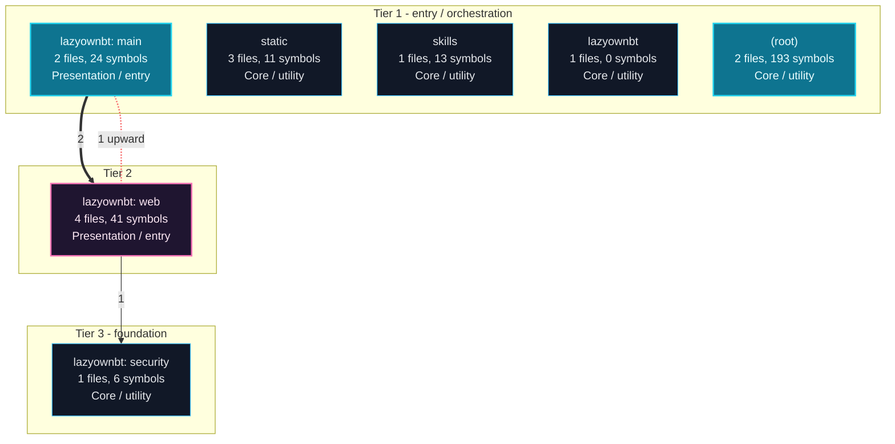
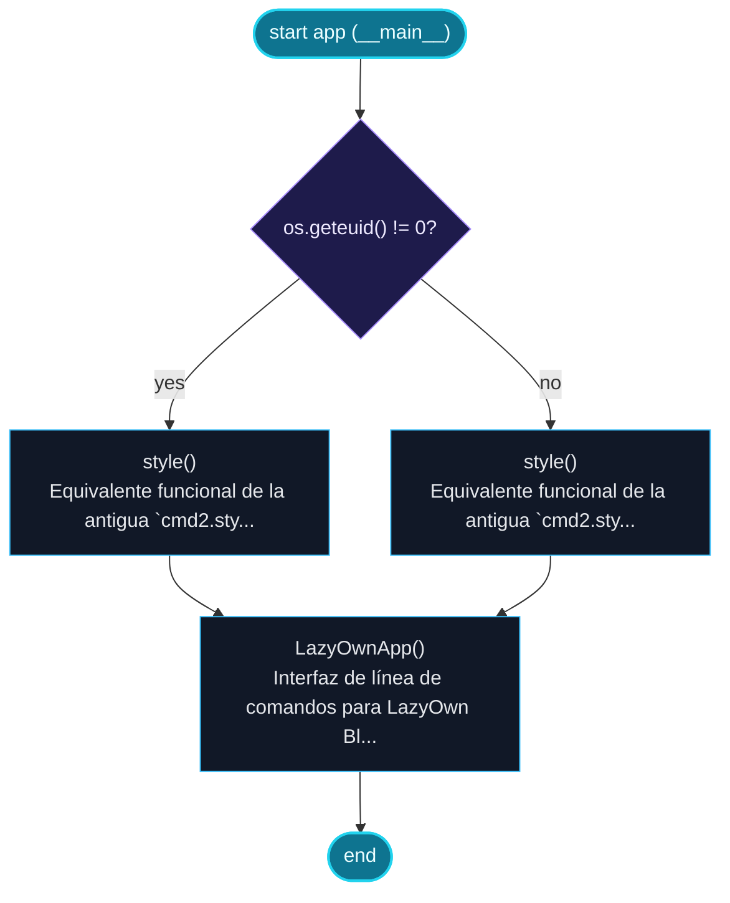
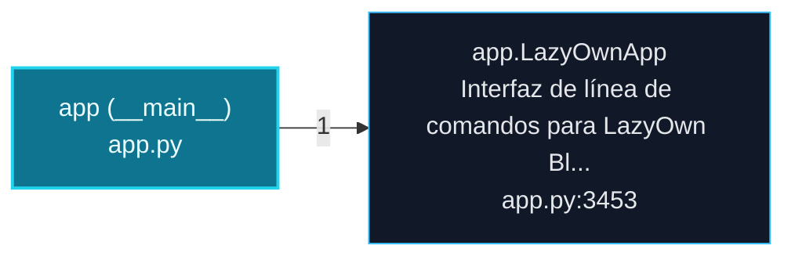
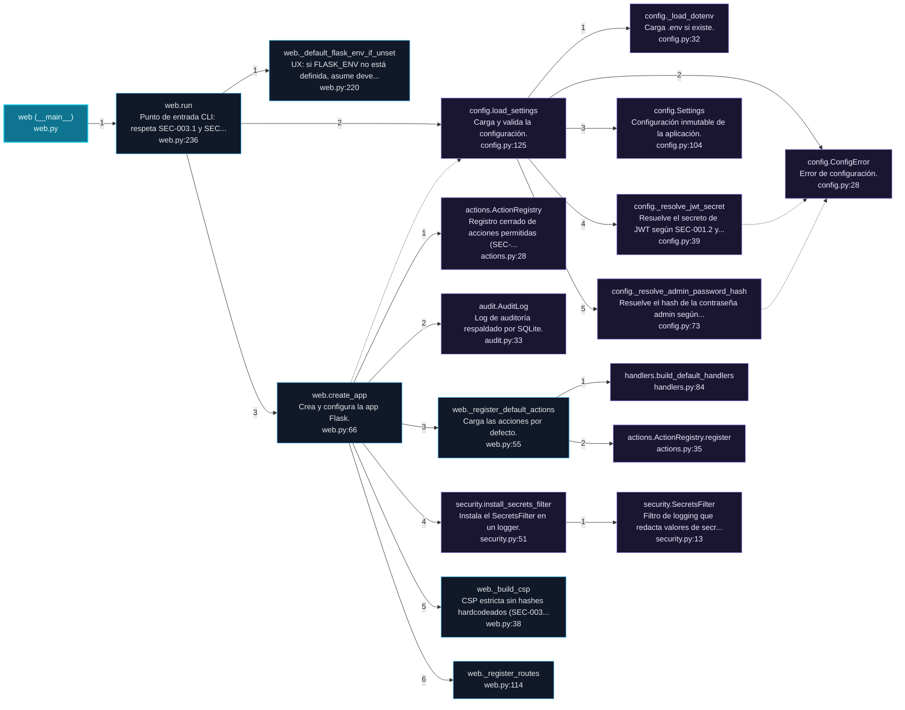
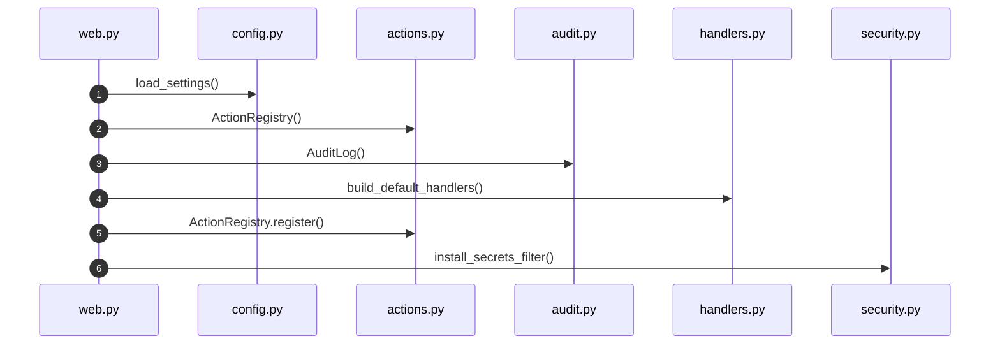
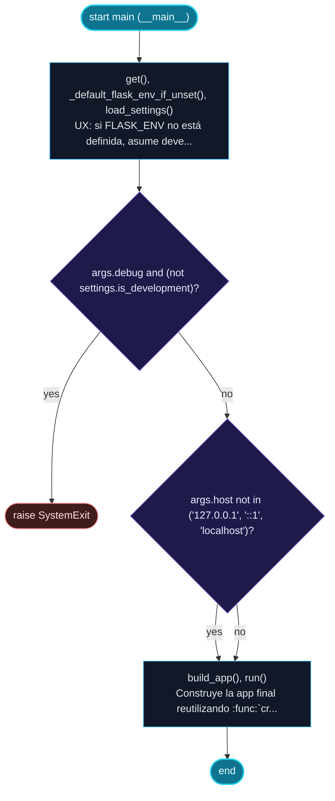
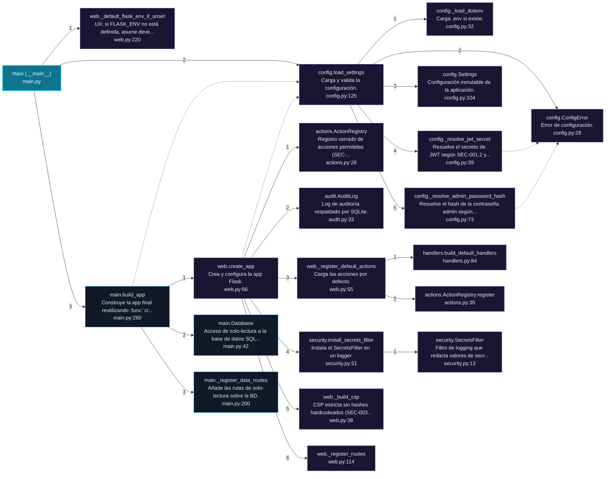
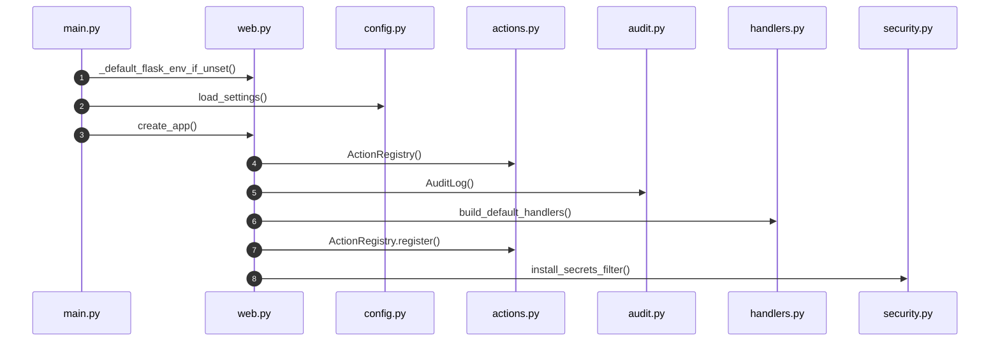

# LazyOwnBT Architecture and Execution Flows

[Back to index](index.md)

## Architecture Overview

7 components stacked in 3 dependency tiers (weighted Eades-Lin-Smyth ordering: arrows point from dependent to dependency, top to bottom). Labels are import counts, thick arrows the top quartile; 0 transitively implied edges are omitted. Dashed red arrows are upward dependencies: the smallest set of imports that closes every cycle and breaks the layering. Cyan components hold entry points. Interactive version: `readmenator-apidocs/index.html#/flows`.

Upward dependencies to fix first: `lazyownbt: web` -> `lazyownbt: main` (1 imports)

---

## Execution Flows

Entry points are scored from `__main__` guards, `main` functions, entry-style names and files, and call-graph sources. Each flow walks resolved calls in call-site order (depth <= 4, <= 40 steps); numbers give the call order, dashed arrows revisit an already expanded callee, red arrows are recursion. Interactive version with zoom and per-node docs: `readmenator-apidocs/index.html#/flows`.

### `app (__main__)`

`app.py:5313`, score 8: `if __name__ == "__main__"` guard.

Control flow:

Call tree:

### `web (__main__)`

`lazyownbt/web.py:258`, score 8: `if __name__ == "__main__"` guard.

Call tree:

Cross-file sequence:

### `main (__main__)`

`main.py:287`, score 8: `if __name__ == "__main__"` guard.

Control flow:

Call tree:

Cross-file sequence:

---
