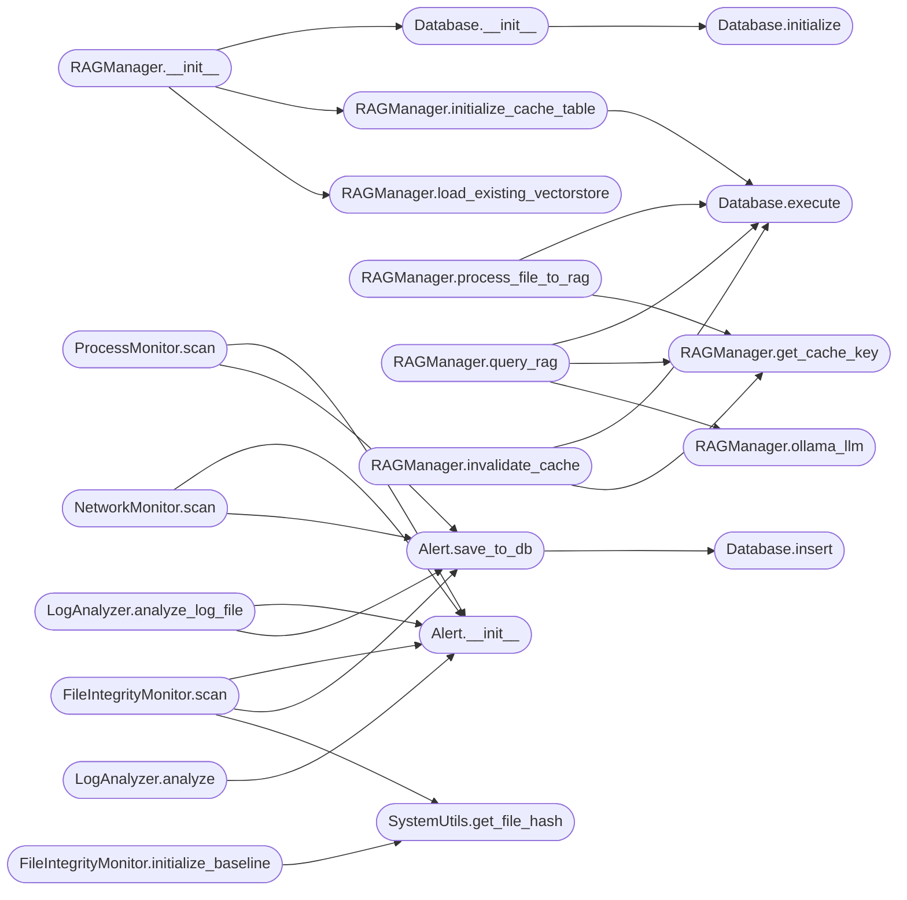

# `app`

> Source: [app.py:1](../../app.py#L1) | language `py` | coverage 81.1% | [API index](../index.md)

LazyOwn BlueTeam Framework Una herramienta monolítica de seguridad defensiva para detección de amenazas, respuesta a incidentes y endurecimiento de sistemas Linux.

## Contents

- **Classes:** [`Fg`](#fg), [`FgColor`](#fgcolor), [`Cyan`](#cyan), [`Red`](#red), [`RAGManager`](#ragmanager), [`Database`](#database), [`Alert`](#alert), [`SystemUtils`](#systemutils), [`ProcessMonitor`](#processmonitor), [`NetworkMonitor`](#networkmonitor), [`FileIntegrityMonitor`](#fileintegritymonitor), [`LogAnalyzer`](#loganalyzer), [`RealTimeLogMonitor`](#realtimelogmonitor), [`SystemHardener`](#systemhardener), [`IncidentResponder`](#incidentresponder), [`ReportGenerator`](#reportgenerator), [`MemoryScanner`](#memoryscanner), [`LazySentinelHandler`](#lazysentinelhandler), [`LazySentinel`](#lazysentinel), [`LazyOwnApp`](#lazyownapp)
- **Functions:** [`style`](#style), [`replace_command_placeholders`](#replace_command_placeholders), [`sanitize_content`](#sanitize_content)
- **Constants:** [`DEEPSEEK_API_URL`](#deepseek_api_url), [`DEEPSEEK_MODEL`](#deepseek_model), [`KNOWLEDGE_BASE_DIR`](#knowledge_base_dir), [`DEFAULT_CONFIG`](#default_config)

## Type Diagram

```mermaid
classDiagram
    direction LR
    class Fg
    Fg : DEFAULT
    Fg : BLACK
    Fg : RED
    Fg : GREEN
    Fg : YELLOW
    Fg : BLUE
    Fg : MAGENTA
    Fg : CYAN
    Fg : WHITE
    class FgColor
    class Cyan
    class Red
    class RAGManager
    RAGManager : __init__()
    RAGManager : initialize_cache_table()
    RAGManager : get_cache_key()
    RAGManager : load_existing_vectorstore()
    RAGManager : ollama_llm()
    RAGManager : process_file_to_rag()
    RAGManager : query_rag()
    RAGManager : invalidate_cache()
    RAGManager : get_knowledge_base_stats()
    class Database
    Database : __init__()
    Database : initialize()
    Database : execute()
    Database : insert()
    Database : close()
    Database : execute()
    Database : insert()
    Database : close()
    class Alert
    Alert : SEVERITY_LEVELS
    Alert : __init__()
    Alert : to_dict()
    Alert : save_to_db()
    class SystemUtils
    SystemUtils : run_command()
    SystemUtils : get_file_hash()
    SystemUtils : get_system_info()
    SystemUtils : backup_file()
    SystemUtils : get_process_details()
    class ProcessMonitor
    ProcessMonitor : __init__()
    ProcessMonitor : scan()
    class NetworkMonitor
    NetworkMonitor : __init__()
    NetworkMonitor : create_baseline()
    NetworkMonitor : scan()
    class FileIntegrityMonitor
    FileIntegrityMonitor : __init__()
    FileIntegrityMonitor : initialize_baseline()
    FileIntegrityMonitor : scan()
    class LogAnalyzer
    LogAnalyzer : __init__()
    LogAnalyzer : analyze_log_file()
    LogAnalyzer : analyze_all_logs()
    LogAnalyzer : get_performance_metrics()
    LogAnalyzer : reset_trackers()
    LogAnalyzer : add_custom_pattern()
    LogAnalyzer : export_findings_summary()
    LogAnalyzer : create_hunting_report()
    LogAnalyzer : analyze()
    class RealTimeLogMonitor
    RealTimeLogMonitor : __init__()
    RealTimeLogMonitor : start()
    RealTimeLogMonitor : stop()
    RealTimeLogMonitor : get_status()
    class SystemHardener
    SystemHardener : __init__()
    SystemHardener : check_system_security()
    SystemHardener : apply_hardening()
    SystemHardener : audit_ssh_config()
    SystemHardener : check_suid_sgid_files()
    class IncidentResponder
    IncidentResponder : __init__()
    IncidentResponder : quarantine_file()
    IncidentResponder : block_ip()
    IncidentResponder : kill_process()
    class ReportGenerator
    ReportGenerator : __init__()
    ReportGenerator : generate_summary_report()
    class MemoryScanner
    MemoryScanner : __init__()
    MemoryScanner : scan_process_memory()
    MemoryScanner : scan_system()
    class LazySentinelHandler
    LazySentinelHandler : __init__()
    LazySentinelHandler : is_text_file()
    LazySentinelHandler : on_created()
    LazySentinelHandler : on_modified()
    class LazySentinel
    LazySentinel : __init__()
    LazySentinel : chunk_text()
    LazySentinel : select_relevant_chunk()
    LazySentinel : parse_deepseek_response()
    LazySentinel : show_popup()
    LazySentinel : process_file()
    LazySentinel : stop()
    class LazyOwnApp
    LazyOwnApp : intro
    LazyOwnApp : prompt
    LazyOwnApp : __init__()
    LazyOwnApp : list_files_in_directory()
    LazyOwnApp : load_plugins()
    LazyOwnApp : load_yaml_plugins()
    LazyOwnApp : register_yaml_plugin()
    LazyOwnApp : postloop()
    LazyOwnApp : postcmd()
    LazyOwnApp : do_ai_status()
    LazyOwnApp : do_ai_load()
    LazyOwnApp : do_ai_test()
    LazyOwnApp : do_ai_feedback()
    LazyOwnApp : do_ai_retrain()
    LazyOwnApp : do_sysinfo()
    LazyOwnApp : do_proc_scan()
    LazyOwnApp : proc_details_parser
    LazyOwnApp : do_proc_details()
    LazyOwnApp : do_net_baseline()
    LazyOwnApp : do_net_scan()
    LazyOwnApp : net_conns_parser
    LazyOwnApp : do_net_conns()
    LazyOwnApp : fim_baseline_parser
    LazyOwnApp : do_fim_baseline()
    FgColor <|-- Cyan
    FgColor <|-- Red
```



## Call Graph

Solid arrows stay in this module, dashed arrows leave it.



## Classes

<a id="fg"></a>

### `Fg`

`class` | [app.py:48](../../app.py#L48)

```python
class Fg
```

Color foreground (compat).

Mapea al enum `cmd2.styles.Color`.

**Attributes**

| Name | Type | Default | Description |
|---|---|---|---|
| [`DEFAULT`](#fg-default) |  | `'default'` |  |
| [`BLACK`](#fg-black) |  | `'black'` |  |
| [`RED`](#fg-red) |  | `'red'` |  |
| [`GREEN`](#fg-green) |  | `'green'` |  |
| [`YELLOW`](#fg-yellow) |  | `'yellow'` |  |
| [`BLUE`](#fg-blue) |  | `'blue'` |  |
| [`MAGENTA`](#fg-magenta) |  | `'magenta'` |  |
| [`CYAN`](#fg-cyan) |  | `'cyan'` |  |
| [`WHITE`](#fg-white) |  | `'white'` |  |

---

<a id="fgcolor"></a>

### `FgColor`

`class` | [app.py:228](../../app.py#L228)

```python
class FgColor
```

Subclasses: [`Cyan`](#cyan), [`Red`](#red)

---

<a id="cyan"></a>

### `Cyan`

`class` | [app.py:231](../../app.py#L231)

```python
class Cyan(FgColor)
```

Bases: [`FgColor`](#fgcolor)

---

<a id="red"></a>

### `Red`

`class` | [app.py:234](../../app.py#L234)

```python
class Red(FgColor)
```

Bases: [`FgColor`](#fgcolor)

---

<a id="ragmanager"></a>

### `RAGManager`

`class` | [app.py:249](../../app.py#L249)

```python
class RAGManager
```

Manages RAG functionality with CAG caching for document processing and querying.

**Members**

| Member | Kind | Summary |
|---|---|---|
| [`__init__`](#ragmanager-__init__) | constructor |  |
| [`initialize_cache_table`](#ragmanager-initialize_cache_table) | method | Initialize SQLite table for persistent cache. |
| [`get_cache_key`](#ragmanager-get_cache_key) | method | Generate a cache key from content using SHA-256. |
| [`load_existing_vectorstore`](#ragmanager-load_existing_vectorstore) | method | Load existing vectorstore if available. |
| [`ollama_llm`](#ragmanager-ollama_llm) | method | Query LLM with context using Ollama. |
| [`process_file_to_rag`](#ragmanager-process_file_to_rag) | method | Process a file, add it to the RAG knowledge base, and cache embeddings. |
| [`query_rag`](#ragmanager-query_rag) | method | Query the RAG system with caching. |
| [`invalidate_cache`](#ragmanager-invalidate_cache) | method | Invalidate cache entries for a specific file. |
| [`get_knowledge_base_stats`](#ragmanager-get_knowledge_base_stats) | method | Get statistics about the knowledge base and cache. |

<a id="ragmanager-__init__"></a>

#### `RAGManager.__init__`

`constructor` | [app.py:252](../../app.py#L252)

```python
def __init__(self, model_name: str = DEEPSEEK_MODEL, cache_size: int = 1000)
```

**Parameters**

| Name | Type | Default | Description |
|---|---|---|---|
| `model_name` | `str` | `DEEPSEEK_MODEL` |  |
| `cache_size` | `int` | `1000` |  |

*Calls:* [`Database.__init__`](#database-__init__), [`RAGManager.initialize_cache_table`](#ragmanager-initialize_cache_table), [`RAGManager.load_existing_vectorstore`](#ragmanager-load_existing_vectorstore)

*Called by:* [`LazySentinel.__init__`](#lazysentinel-__init__)

<a id="ragmanager-initialize_cache_table"></a>

#### `RAGManager.initialize_cache_table`

`method` | [app.py:265](../../app.py#L265)

```python
def initialize_cache_table(self)
```

Initialize SQLite table for persistent cache.

*Calls:* [`Database.execute`](#database-execute)

*Called by:* [`RAGManager.__init__`](#ragmanager-__init__)

<a id="ragmanager-get_cache_key"></a>

#### `RAGManager.get_cache_key`

`method` | [app.py:278](../../app.py#L278)

```python
def get_cache_key(self, content: str) -> str
```

Generate a cache key from content using SHA-256.

**Parameters**

| Name | Type | Default | Description |
|---|---|---|---|
| `content` | `str` |  |  |

**Returns:** `str`

*Called by:* [`RAGManager.invalidate_cache`](#ragmanager-invalidate_cache), [`RAGManager.process_file_to_rag`](#ragmanager-process_file_to_rag), [`RAGManager.query_rag`](#ragmanager-query_rag)

<a id="ragmanager-load_existing_vectorstore"></a>

#### `RAGManager.load_existing_vectorstore`

`method` | [app.py:282](../../app.py#L282)

```python
def load_existing_vectorstore(self)
```

Load existing vectorstore if available.

*Called by:* [`RAGManager.__init__`](#ragmanager-__init__)

<a id="ragmanager-ollama_llm"></a>

#### `RAGManager.ollama_llm`

`method` | [app.py:296](../../app.py#L296)

```python
def ollama_llm(self, question: str, context: str) -> str
```

Query LLM with context using Ollama.

**Parameters**

| Name | Type | Default | Description |
|---|---|---|---|
| `question` | `str` |  |  |
| `context` | `str` |  |  |

**Returns:** `str`

*Called by:* [`RAGManager.query_rag`](#ragmanager-query_rag)

<a id="ragmanager-process_file_to_rag"></a>

#### `RAGManager.process_file_to_rag`

`method` | [app.py:311](../../app.py#L311)

```python
def process_file_to_rag(self, file_path: Path) -> bool
```

Process a file, add it to the RAG knowledge base, and cache embeddings.

**Parameters**

| Name | Type | Default | Description |
|---|---|---|---|
| `file_path` | `Path` |  |  |

**Returns:** `bool`

*Calls:* [`Database.execute`](#database-execute), [`RAGManager.get_cache_key`](#ragmanager-get_cache_key)

*Called by:* [`LazyOwnApp.do_rag_add`](#lazyownapp-do_rag_add), [`LazyOwnApp.do_rag_bulk_add`](#lazyownapp-do_rag_bulk_add), [`LazySentinel.process_file`](#lazysentinel-process_file)

<a id="ragmanager-query_rag"></a>

#### `RAGManager.query_rag`

`method` | [app.py:370](../../app.py#L370)

```python
def query_rag(self, question: str) -> str
```

Query the RAG system with caching.

**Parameters**

| Name | Type | Default | Description |
|---|---|---|---|
| `question` | `str` |  |  |

**Returns:** `str`

*Calls:* [`Database.execute`](#database-execute), [`RAGManager.get_cache_key`](#ragmanager-get_cache_key), [`RAGManager.ollama_llm`](#ragmanager-ollama_llm)

*Called by:* [`LazyOwnApp.do_rag_query`](#lazyownapp-do_rag_query)

<a id="ragmanager-invalidate_cache"></a>

#### `RAGManager.invalidate_cache`

`method` | [app.py:410](../../app.py#L410)

```python
def invalidate_cache(self, file_path: Path)
```

Invalidate cache entries for a specific file.

**Parameters**

| Name | Type | Default | Description |
|---|---|---|---|
| `file_path` | `Path` |  |  |

*Calls:* [`Database.execute`](#database-execute), [`RAGManager.get_cache_key`](#ragmanager-get_cache_key)

*Called by:* [`LazySentinel.process_file`](#lazysentinel-process_file)

<a id="ragmanager-get_knowledge_base_stats"></a>

#### `RAGManager.get_knowledge_base_stats`

`method` | [app.py:429](../../app.py#L429)

```python
def get_knowledge_base_stats(self) -> Dict
```

Get statistics about the knowledge base and cache.

**Returns:** `Dict`

*Called by:* [`LazyOwnApp.do_rag_status`](#lazyownapp-do_rag_status)

---

<a id="database"></a>

### `Database`

`class` | [app.py:455](../../app.py#L455)

```python
class Database
```

Clase para manejar la base de datos SQLite.

**Members**

| Member | Kind | Summary |
|---|---|---|
| [`__init__`](#database-__init__) | constructor |  |
| [`initialize`](#database-initialize) | method | Inicializa la conexión a la base de datos y crea las tablas si no existen. |
| [`execute`](#database-execute) | method | Ejecuta una consulta SQL y devuelve los resultados. |
| [`insert`](#database-insert) | method | Inserta datos en la base de datos y devuelve el ID del último registro. |
| [`close`](#database-close) | method | Cierra la conexión a la base de datos. |
| [`execute`](#database-execute) | method | Ejecuta una consulta SQL y devuelve los resultados. |
| [`insert`](#database-insert) | method | Inserta datos en la base de datos y devuelve el ID del último registro. |
| [`close`](#database-close) | method | Cierra la conexión a la base de datos. |

<a id="database-__init__"></a>

#### `Database.__init__`

`constructor` | [app.py:458](../../app.py#L458)

```python
def __init__(self, db_path: str)
```

**Parameters**

| Name | Type | Default | Description |
|---|---|---|---|
| `db_path` | `str` |  |  |

*Calls:* [`Database.initialize`](#database-initialize)

*Called by:* [`LazyOwnApp.__init__`](#lazyownapp-__init__), [`LazySentinel.__init__`](#lazysentinel-__init__), [`RAGManager.__init__`](#ragmanager-__init__)

<a id="database-initialize"></a>

#### `Database.initialize`

`method` | [app.py:464](../../app.py#L464)

```python
def initialize(self) -> None
```

Inicializa la conexión a la base de datos y crea las tablas si no existen.

*Called by:* [`Database.__init__`](#database-__init__)

<a id="database-execute"></a>

#### `Database.execute`

`method` | [app.py:578](../../app.py#L578)

```python
def execute(self, query: str, params: tuple = ()) -> List[sqlite3.Row]
```

Ejecuta una consulta SQL y devuelve los resultados.

**Parameters**

| Name | Type | Default | Description |
|---|---|---|---|
| `query` | `str` |  |  |
| `params` | `tuple` | `()` |  |

**Returns:** `List[sqlite3.Row]`

*Called by:* [`LazyOwnApp.do_debug`](#lazyownapp-do_debug), [`RAGManager.initialize_cache_table`](#ragmanager-initialize_cache_table), [`RAGManager.invalidate_cache`](#ragmanager-invalidate_cache), [`RAGManager.process_file_to_rag`](#ragmanager-process_file_to_rag), [`RAGManager.query_rag`](#ragmanager-query_rag)

<a id="database-insert"></a>

#### `Database.insert`

`method` | [app.py:588](../../app.py#L588)

```python
def insert(self, query: str, params: tuple = ()) -> Optional[int]
```

Inserta datos en la base de datos y devuelve el ID del último registro.

**Parameters**

| Name | Type | Default | Description |
|---|---|---|---|
| `query` | `str` |  |  |
| `params` | `tuple` | `()` |  |

**Returns:** `Optional[int]`

*Called by:* [`Alert.save_to_db`](#alert-save_to_db)

<a id="database-close"></a>

#### `Database.close`

`method` | [app.py:599](../../app.py#L599)

```python
def close(self) -> None
```

Cierra la conexión a la base de datos.

*Called by:* [`LazyOwnApp.postloop`](#lazyownapp-postloop)

<a id="database-execute"></a>

#### `Database.execute`

`method` | [app.py:578](../../app.py#L578)

```python
def execute(self, query: str, params: tuple = ()) -> List[sqlite3.Row]
```

Ejecuta una consulta SQL y devuelve los resultados.

**Parameters**

| Name | Type | Default | Description |
|---|---|---|---|
| `query` | `str` |  |  |
| `params` | `tuple` | `()` |  |

**Returns:** `List[sqlite3.Row]`

*Called by:* [`LazyOwnApp.do_debug`](#lazyownapp-do_debug), [`RAGManager.initialize_cache_table`](#ragmanager-initialize_cache_table), [`RAGManager.invalidate_cache`](#ragmanager-invalidate_cache), [`RAGManager.process_file_to_rag`](#ragmanager-process_file_to_rag), [`RAGManager.query_rag`](#ragmanager-query_rag)

<a id="database-insert"></a>

#### `Database.insert`

`method` | [app.py:588](../../app.py#L588)

```python
def insert(self, query: str, params: tuple = ()) -> Optional[int]
```

Inserta datos en la base de datos y devuelve el ID del último registro.

**Parameters**

| Name | Type | Default | Description |
|---|---|---|---|
| `query` | `str` |  |  |
| `params` | `tuple` | `()` |  |

**Returns:** `Optional[int]`

*Called by:* [`Alert.save_to_db`](#alert-save_to_db)

<a id="database-close"></a>

#### `Database.close`

`method` | [app.py:599](../../app.py#L599)

```python
def close(self) -> None
```

Cierra la conexión a la base de datos.

*Called by:* [`LazyOwnApp.postloop`](#lazyownapp-postloop)

---

<a id="alert"></a>

### `Alert`

`class` | [app.py:605](../../app.py#L605)

```python
class Alert
```

Clase para representar y manejar alertas.

**Attributes**

| Name | Type | Default | Description |
|---|---|---|---|
| [`SEVERITY_LEVELS`](#alert-severity_levels) |  | `['info', 'low', 'medium', 'high', 'critical']` |  |

**Members**

| Member | Kind | Summary |
|---|---|---|
| [`__init__`](#alert-__init__) | constructor |  |
| [`to_dict`](#alert-to_dict) | method | Convierte la alerta a diccionario. |
| [`save_to_db`](#alert-save_to_db) | method | Guarda la alerta en la base de datos. |

<a id="alert-__init__"></a>

#### `Alert.__init__`

`constructor` | [app.py:610](../../app.py#L610)

```python
def __init__(self, alert_type: str, details: Dict, severity: str = 'medium')
```

**Parameters**

| Name | Type | Default | Description |
|---|---|---|---|
| `alert_type` | `str` |  |  |
| `details` | `Dict` |  |  |
| `severity` | `str` | `'medium'` |  |

*Called by:* [`FileIntegrityMonitor.scan`](#fileintegritymonitor-scan), [`IncidentResponder.block_ip`](#incidentresponder-block_ip), [`IncidentResponder.kill_process`](#incidentresponder-kill_process), [`IncidentResponder.quarantine_file`](#incidentresponder-quarantine_file), [`LazyOwnApp.do_audit_users`](#lazyownapp-do_audit_users), [`LazyOwnApp.do_block_ip`](#lazyownapp-do_block_ip), [`LazyOwnApp.do_kill_process`](#lazyownapp-do_kill_process), [`LazyOwnApp.do_quarantine_file`](#lazyownapp-do_quarantine_file), [`LazyOwnApp.do_resp_block_ip`](#lazyownapp-do_resp_block_ip), [`LazySentinel.process_file`](#lazysentinel-process_file), [`LogAnalyzer.analyze`](#loganalyzer-analyze), [`LogAnalyzer.analyze_log_file`](#loganalyzer-analyze_log_file) and 5 more

<a id="alert-to_dict"></a>

#### `Alert.to_dict`

`method` | [app.py:616](../../app.py#L616)

```python
def to_dict(self) -> Dict
```

Convierte la alerta a diccionario.

**Returns:** `Dict`

<a id="alert-save_to_db"></a>

#### `Alert.save_to_db`

`method` | [app.py:625](../../app.py#L625)

```python
def save_to_db(self, db: 'Database') -> Optional[int]
```

Guarda la alerta en la base de datos.

**Parameters**

| Name | Type | Default | Description |
|---|---|---|---|
| `db` | `'Database'` |  |  |

**Returns:** `Optional[int]`

*Calls:* [`Database.insert`](#database-insert)

*Called by:* [`FileIntegrityMonitor.scan`](#fileintegritymonitor-scan), [`IncidentResponder.block_ip`](#incidentresponder-block_ip), [`IncidentResponder.kill_process`](#incidentresponder-kill_process), [`IncidentResponder.quarantine_file`](#incidentresponder-quarantine_file), [`LazyOwnApp.do_audit_users`](#lazyownapp-do_audit_users), [`LazyOwnApp.do_block_ip`](#lazyownapp-do_block_ip), [`LazyOwnApp.do_kill_process`](#lazyownapp-do_kill_process), [`LazyOwnApp.do_quarantine_file`](#lazyownapp-do_quarantine_file), [`LazyOwnApp.do_resp_block_ip`](#lazyownapp-do_resp_block_ip), [`LazySentinel.process_file`](#lazysentinel-process_file), [`LogAnalyzer.analyze`](#loganalyzer-analyze), [`LogAnalyzer.analyze_log_file`](#loganalyzer-analyze_log_file) and 5 more

---

<a id="systemutils"></a>

### `SystemUtils`

`class` | [app.py:639](../../app.py#L639)

```python
class SystemUtils
```

Utilidades para trabajar con el sistema.

**Members**

| Member | Kind | Summary |
|---|---|---|
| [`run_command`](#systemutils-run_command) | staticmethod | Ejecuta un comando del sistema y devuelve el código de salida, stdout y stderr. |
| [`get_file_hash`](#systemutils-get_file_hash) | staticmethod | Calcula el hash SHA-256 de un archivo. |
| [`get_system_info`](#systemutils-get_system_info) | staticmethod | Obtiene información del sistema. |
| [`backup_file`](#systemutils-backup_file) | staticmethod | Crea una copia de seguridad de un archivo. |
| [`get_process_details`](#systemutils-get_process_details) | staticmethod |  |

<a id="systemutils-run_command"></a>

#### `SystemUtils.run_command`

`staticmethod` | [app.py:643](../../app.py#L643)

Decorators: `@staticmethod`

```python
def run_command(command: Union[str, List[str]], shell: bool = False) -> Tuple[int, str, str]
```

Ejecuta un comando del sistema y devuelve el código de salida, stdout y stderr.

**Parameters**

| Name | Type | Default | Description |
|---|---|---|---|
| `command` | `Union[str, List[str]]` |  |  |
| `shell` | `bool` | `False` |  |

**Returns:** `Tuple[int, str, str]`

*Called by:* [`IncidentResponder.block_ip`](#incidentresponder-block_ip), [`LazyOwnApp.do_block_ip`](#lazyownapp-do_block_ip), [`SystemHardener.apply_hardening`](#systemhardener-apply_hardening), [`SystemHardener.check_system_security`](#systemhardener-check_system_security)

<a id="systemutils-get_file_hash"></a>

#### `SystemUtils.get_file_hash`

`staticmethod` | [app.py:673](../../app.py#L673)

Decorators: `@staticmethod`

```python
def get_file_hash(filepath: str) -> str
```

Calcula el hash SHA-256 de un archivo.

**Parameters**

| Name | Type | Default | Description |
|---|---|---|---|
| `filepath` | `str` |  |  |

**Returns:** `str`

*Called by:* [`FileIntegrityMonitor.initialize_baseline`](#fileintegritymonitor-initialize_baseline), [`FileIntegrityMonitor.scan`](#fileintegritymonitor-scan)

<a id="systemutils-get_system_info"></a>

#### `SystemUtils.get_system_info`

`staticmethod` | [app.py:690](../../app.py#L690)

Decorators: `@staticmethod`

```python
def get_system_info() -> Dict
```

Obtiene información del sistema.

**Returns:** `Dict`

*Called by:* [`LazyOwnApp.do_sysinfo`](#lazyownapp-do_sysinfo), [`LazyOwnApp.do_system_info`](#lazyownapp-do_system_info)

<a id="systemutils-backup_file"></a>

#### `SystemUtils.backup_file`

`staticmethod` | [app.py:721](../../app.py#L721)

Decorators: `@staticmethod`

```python
def backup_file(filepath: str, backup_dir: str) -> str
```

Crea una copia de seguridad de un archivo.

**Parameters**

| Name | Type | Default | Description |
|---|---|---|---|
| `filepath` | `str` |  |  |
| `backup_dir` | `str` |  |  |

**Returns:** `str`

*Called by:* [`IncidentResponder.quarantine_file`](#incidentresponder-quarantine_file)

<a id="systemutils-get_process_details"></a>

#### `SystemUtils.get_process_details`

`staticmethod` | [app.py:742](../../app.py#L742)

Decorators: `@staticmethod`

```python
def get_process_details(pid: int) -> Optional[Dict]
```

**Parameters**

| Name | Type | Default | Description |
|---|---|---|---|
| `pid` | `int` |  |  |

**Returns:** `Optional[Dict]`

*Called by:* [`LazyOwnApp.do_proc_details`](#lazyownapp-do_proc_details)

---

<a id="processmonitor"></a>

### `ProcessMonitor`

`class` | [app.py:751](../../app.py#L751)

```python
class ProcessMonitor
```

Monitor de procesos para detección de actividad sospechosa.

**Members**

| Member | Kind | Summary |
|---|---|---|
| [`__init__`](#processmonitor-__init__) | constructor |  |
| [`scan`](#processmonitor-scan) | method | Escanea procesos en busca de actividad sospechosa. |

<a id="processmonitor-__init__"></a>

#### `ProcessMonitor.__init__`

`constructor` | [app.py:754](../../app.py#L754)

```python
def __init__(self, config: Dict, db: Database)
```

**Parameters**

| Name | Type | Default | Description |
|---|---|---|---|
| `config` | `Dict` |  |  |
| `db` | `Database` |  |  |

*Called by:* [`LazyOwnApp.__init__`](#lazyownapp-__init__), [`MemoryScanner.scan_system`](#memoryscanner-scan_system)

<a id="processmonitor-scan"></a>

#### `ProcessMonitor.scan`

`method` | [app.py:761](../../app.py#L761)

```python
def scan(self, generate_alerts: bool = True) -> List[Dict]
```

Escanea procesos en busca de actividad sospechosa.

**Parameters**

| Name | Type | Default | Description |
|---|---|---|---|
| `generate_alerts` | `bool` | `True` |  |

**Returns:** `List[Dict]`

*Calls:* [`Alert.__init__`](#alert-__init__), [`Alert.save_to_db`](#alert-save_to_db)

*Called by:* [`LazyOwnApp.do_proc_scan`](#lazyownapp-do_proc_scan), [`LazyOwnApp.do_processes`](#lazyownapp-do_processes), [`LazyOwnApp.do_scan_processes`](#lazyownapp-do_scan_processes), [`MemoryScanner.scan_system`](#memoryscanner-scan_system)

---

<a id="networkmonitor"></a>

### `NetworkMonitor`

`class` | [app.py:849](../../app.py#L849)

```python
class NetworkMonitor
```

Monitor de red para detección de conexiones sospechosas.

**Members**

| Member | Kind | Summary |
|---|---|---|
| [`__init__`](#networkmonitor-__init__) | constructor |  |
| [`create_baseline`](#networkmonitor-create_baseline) | method | Crea una línea base de las conexiones de red actuales (LISTEN y ESTABLISHED). |
| [`scan`](#networkmonitor-scan) | method | Escanea las conexiones de red en busca de anomalías. |

<a id="networkmonitor-__init__"></a>

#### `NetworkMonitor.__init__`

`constructor` | [app.py:852](../../app.py#L852)

```python
def __init__(self, config: Dict, db: Database)
```

**Parameters**

| Name | Type | Default | Description |
|---|---|---|---|
| `config` | `Dict` |  |  |
| `db` | `Database` |  |  |

*Called by:* [`LazyOwnApp.__init__`](#lazyownapp-__init__)

<a id="networkmonitor-create_baseline"></a>

#### `NetworkMonitor.create_baseline`

`method` | [app.py:874](../../app.py#L874)

```python
def create_baseline(self) -> None
```

Crea una línea base de las conexiones de red actuales (LISTEN y ESTABLISHED).

*Called by:* [`LazyOwnApp.do_create_network_baseline`](#lazyownapp-do_create_network_baseline), [`LazyOwnApp.do_net_baseline`](#lazyownapp-do_net_baseline)

<a id="networkmonitor-scan"></a>

#### `NetworkMonitor.scan`

`method` | [app.py:920](../../app.py#L920)

```python
def scan(self, generate_alerts: bool = True) -> List[Dict]
```

Escanea las conexiones de red en busca de anomalías.

**Parameters**

| Name | Type | Default | Description |
|---|---|---|---|
| `generate_alerts` | `bool` | `True` |  |

**Returns:** `List[Dict]`

*Calls:* [`Alert.__init__`](#alert-__init__), [`Alert.save_to_db`](#alert-save_to_db)

*Called by:* [`LazyOwnApp.do_net_scan`](#lazyownapp-do_net_scan), [`LazyOwnApp.do_network`](#lazyownapp-do_network), [`LazyOwnApp.do_scan_network`](#lazyownapp-do_scan_network)

---

<a id="fileintegritymonitor"></a>

### `FileIntegrityMonitor`

`class` | [app.py:993](../../app.py#L993)

```python
class FileIntegrityMonitor
```

Monitor de integridad de archivos.

**Members**

| Member | Kind | Summary |
|---|---|---|
| [`__init__`](#fileintegritymonitor-__init__) | constructor |  |
| [`initialize_baseline`](#fileintegritymonitor-initialize_baseline) | method | Inicializa o actualiza la línea base de hashes de archivos. |
| [`scan`](#fileintegritymonitor-scan) | method | Verifica la integridad de los archivos contra la línea base. |

<a id="fileintegritymonitor-__init__"></a>

#### `FileIntegrityMonitor.__init__`

`constructor` | [app.py:996](../../app.py#L996)

```python
def __init__(self, config: Dict, db: Database)
```

**Parameters**

| Name | Type | Default | Description |
|---|---|---|---|
| `config` | `Dict` |  |  |
| `db` | `Database` |  |  |

*Called by:* [`LazyOwnApp.__init__`](#lazyownapp-__init__), [`ReportGenerator.generate_summary_report`](#reportgenerator-generate_summary_report)

<a id="fileintegritymonitor-initialize_baseline"></a>

#### `FileIntegrityMonitor.initialize_baseline`

`method` | [app.py:1001](../../app.py#L1001)

```python
def initialize_baseline(self, files_to_baseline: Optional[List[str]] = None) -> None
```

Inicializa o actualiza la línea base de hashes de archivos.

**Parameters**

| Name | Type | Default | Description |
|---|---|---|---|
| `files_to_baseline` | `Optional[List[str]]` | `None` |  |

*Calls:* [`SystemUtils.get_file_hash`](#systemutils-get_file_hash)

*Called by:* [`LazyOwnApp.do_fim_baseline`](#lazyownapp-do_fim_baseline), [`LazyOwnApp.do_init_file_baseline`](#lazyownapp-do_init_file_baseline)

<a id="fileintegritymonitor-scan"></a>

#### `FileIntegrityMonitor.scan`

`method` | [app.py:1044](../../app.py#L1044)

```python
def scan(self, generate_alerts: bool = True) -> List[Dict]
```

Verifica la integridad de los archivos contra la línea base.

**Parameters**

| Name | Type | Default | Description |
|---|---|---|---|
| `generate_alerts` | `bool` | `True` |  |

**Returns:** `List[Dict]`

*Calls:* [`Alert.__init__`](#alert-__init__), [`Alert.save_to_db`](#alert-save_to_db), [`SystemUtils.get_file_hash`](#systemutils-get_file_hash)

*Called by:* [`LazyOwnApp.do_check_file_integrity`](#lazyownapp-do_check_file_integrity), [`LazyOwnApp.do_files`](#lazyownapp-do_files), [`LazyOwnApp.do_fim_scan`](#lazyownapp-do_fim_scan), [`ReportGenerator.generate_summary_report`](#reportgenerator-generate_summary_report)

---

<a id="loganalyzer"></a>

### `LogAnalyzer`

`class` | [app.py:1111](../../app.py#L1111)

```python
class LogAnalyzer
```

Analizador avanzado de logs del sistema para equipos de seguridad azules.

**Members**

| Member | Kind | Summary |
|---|---|---|
| [`__init__`](#loganalyzer-__init__) | constructor | Inicializa el analizador con configuración mejorada y validada |
| [`analyze_log_file`](#loganalyzer-analyze_log_file) | method | Analiza un único archivo de log con detección avanzada de amenazas. |
| [`analyze_all_logs`](#loganalyzer-analyze_all_logs) | method | Analiza todos los archivos de log configurados usando procesamiento paralelo. |
| [`get_performance_metrics`](#loganalyzer-get_performance_metrics) | method | Devuelve métricas de rendimiento del analizador |
| [`reset_trackers`](#loganalyzer-reset_trackers) | method | Reinicia los contadores y rastreadores de eventos |
| [`add_custom_pattern`](#loganalyzer-add_custom_pattern) | method | Añade un patrón personalizado para detección |
| [`export_findings_summary`](#loganalyzer-export_findings_summary) | method | Exporta un resumen de hallazgos para informes |
| [`create_hunting_report`](#loganalyzer-create_hunting_report) | method | Genera un informe de hunting basado en los hallazgos |
| [`analyze`](#loganalyzer-analyze) | method |  |

<a id="loganalyzer-__init__"></a>

#### `LogAnalyzer.__init__`

`constructor` | [app.py:1114](../../app.py#L1114)

```python
def __init__(self, config: Dict, db: Database)
```

Inicializa el analizador con configuración mejorada y validada

**Parameters**

| Name | Type | Default | Description |
|---|---|---|---|
| `config` | `Dict` |  |  |
| `db` | `Database` |  |  |

**Raises**

- `TypeError`: (raised in the body, not documented)

*Called by:* [`LazyOwnApp.__init__`](#lazyownapp-__init__), [`RealTimeLogMonitor.__init__`](#realtimelogmonitor-__init__)

<a id="loganalyzer-analyze_log_file"></a>

#### `LogAnalyzer.analyze_log_file`

`method` | [app.py:1533](../../app.py#L1533)

```python
def analyze_log_file(self, log_path: str, generate_alerts: bool = True) -> List[Dict]
```

Analiza un único archivo de log con detección avanzada de amenazas.

**Parameters**

| Name | Type | Default | Description |
|---|---|---|---|
| `log_path` | `str` |  |  |
| `generate_alerts` | `bool` | `True` |  |

**Returns:** `List[Dict]`

*Calls:* [`Alert.__init__`](#alert-__init__), [`Alert.save_to_db`](#alert-save_to_db)

*Called by:* [`LazyOwnApp.do_analyze`](#lazyownapp-do_analyze), [`LazyOwnApp.do_log_analyze`](#lazyownapp-do_log_analyze)

<a id="loganalyzer-analyze_all_logs"></a>

#### `LogAnalyzer.analyze_all_logs`

`method` | [app.py:2021](../../app.py#L2021)

```python
def analyze_all_logs(self, generate_alerts: bool = True) -> Dict[str, List[Dict]]
```

Analiza todos los archivos de log configurados usando procesamiento paralelo.

**Parameters**

| Name | Type | Default | Description |
|---|---|---|---|
| `generate_alerts` | `bool` | `True` |  |

**Returns:** `Dict[str, List[Dict]]`

*Called by:* [`LazyOwnApp.do_analyze_logs`](#lazyownapp-do_analyze_logs), [`LazyOwnApp.do_log_analyze`](#lazyownapp-do_log_analyze), [`LazyOwnApp.do_redteam_hunt`](#lazyownapp-do_redteam_hunt), [`RealTimeLogMonitor.start`](#realtimelogmonitor-start)

<a id="loganalyzer-get_performance_metrics"></a>

#### `LogAnalyzer.get_performance_metrics`

`method` | [app.py:2141](../../app.py#L2141)

```python
def get_performance_metrics(self) -> Dict[str, Any]
```

Devuelve métricas de rendimiento del analizador

**Returns:** `Dict[str, Any]`

*Called by:* [`LazyOwnApp.do_monitor`](#lazyownapp-do_monitor), [`RealTimeLogMonitor.get_status`](#realtimelogmonitor-get_status)

<a id="loganalyzer-reset_trackers"></a>

#### `LogAnalyzer.reset_trackers`

`method` | [app.py:2155](../../app.py#L2155)

```python
def reset_trackers(self) -> None
```

Reinicia los contadores y rastreadores de eventos

<a id="loganalyzer-add_custom_pattern"></a>

#### `LogAnalyzer.add_custom_pattern`

`method` | [app.py:2163](../../app.py#L2163)

```python
def add_custom_pattern(self, name: str, pattern: str, severity: str = 'medium', mitre_tactics: List[str] = None, mitre_techniques: List[str] = None) -> bool
```

Añade un patrón personalizado para detección

**Parameters**

| Name | Type | Default | Description |
|---|---|---|---|
| `name` | `str` |  |  |
| `pattern` | `str` |  |  |
| `severity` | `str` | `'medium'` |  |
| `mitre_tactics` | `List[str]` | `None` |  |
| `mitre_techniques` | `List[str]` | `None` |  |

**Returns:** `bool`

*Called by:* [`LazyOwnApp.do_add_pattern`](#lazyownapp-do_add_pattern), [`LazyOwnApp.do_patterns`](#lazyownapp-do_patterns)

<a id="loganalyzer-export_findings_summary"></a>

#### `LogAnalyzer.export_findings_summary`

`method` | [app.py:2192](../../app.py#L2192)

```python
def export_findings_summary(self) -> Dict[str, Any]
```

Exporta un resumen de hallazgos para informes

**Returns:** `Dict[str, Any]`

<a id="loganalyzer-create_hunting_report"></a>

#### `LogAnalyzer.create_hunting_report`

`method` | [app.py:2210](../../app.py#L2210)

```python
def create_hunting_report(self) -> Dict[str, Any]
```

Genera un informe de hunting basado en los hallazgos

**Returns:** `Dict[str, Any]`

*Called by:* [`LazyOwnApp.do_redteam_hunt`](#lazyownapp-do_redteam_hunt)

<a id="loganalyzer-analyze"></a>

#### `LogAnalyzer.analyze`

`method` | [app.py:2225](../../app.py#L2225)

```python
def analyze(self) -> Dict[str, List]
```

**Returns:** `Dict[str, List]`

*Calls:* [`Alert.__init__`](#alert-__init__), [`Alert.save_to_db`](#alert-save_to_db)

*Called by:* [`LazyOwnApp.do_logs`](#lazyownapp-do_logs)

---

<a id="realtimelogmonitor"></a>

### `RealTimeLogMonitor`

`class` | [app.py:2381](../../app.py#L2381)

```python
class RealTimeLogMonitor
```

Monitor de logs en tiempo real que utiliza LogAnalyzer

**Members**

| Member | Kind | Summary |
|---|---|---|
| [`__init__`](#realtimelogmonitor-__init__) | constructor | Inicializa el monitor con configuración |
| [`start`](#realtimelogmonitor-start) | method | Inicia el monitoreo en tiempo real |
| [`stop`](#realtimelogmonitor-stop) | method | Detiene el monitoreo en tiempo real |
| [`get_status`](#realtimelogmonitor-get_status) | method | Devuelve el estado actual del monitor |

<a id="realtimelogmonitor-__init__"></a>

#### `RealTimeLogMonitor.__init__`

`constructor` | [app.py:2384](../../app.py#L2384)

```python
def __init__(self, config: Dict, db: Database)
```

Inicializa el monitor con configuración

**Parameters**

| Name | Type | Default | Description |
|---|---|---|---|
| `config` | `Dict` |  |  |
| `db` | `Database` |  |  |

*Calls:* [`LogAnalyzer.__init__`](#loganalyzer-__init__)

*Called by:* [`LazyOwnApp.__init__`](#lazyownapp-__init__)

<a id="realtimelogmonitor-start"></a>

#### `RealTimeLogMonitor.start`

`method` | [app.py:2391](../../app.py#L2391)

```python
def start(self)
```

Inicia el monitoreo en tiempo real

*Calls:* [`LogAnalyzer.analyze_all_logs`](#loganalyzer-analyze_all_logs)

<a id="realtimelogmonitor-stop"></a>

#### `RealTimeLogMonitor.stop`

`method` | [app.py:2416](../../app.py#L2416)

```python
def stop(self)
```

Detiene el monitoreo en tiempo real

*Called by:* [`LazyOwnApp.do_stop_monitor`](#lazyownapp-do_stop_monitor)

<a id="realtimelogmonitor-get_status"></a>

#### `RealTimeLogMonitor.get_status`

`method` | [app.py:2421](../../app.py#L2421)

```python
def get_status(self) -> Dict[str, Any]
```

Devuelve el estado actual del monitor

**Returns:** `Dict[str, Any]`

*Calls:* [`LogAnalyzer.get_performance_metrics`](#loganalyzer-get_performance_metrics)

*Called by:* [`LazyOwnApp.do_monitor_status`](#lazyownapp-do_monitor_status)

---

<a id="systemhardener"></a>

### `SystemHardener`

`class` | [app.py:2431](../../app.py#L2431)

```python
class SystemHardener
```

Módulo para aplicar y auditar configuraciones de endurecimiento.

**Members**

| Member | Kind | Summary |
|---|---|---|
| [`__init__`](#systemhardener-__init__) | constructor |  |
| [`check_system_security`](#systemhardener-check_system_security) | method |  |
| [`apply_hardening`](#systemhardener-apply_hardening) | method |  |
| [`audit_ssh_config`](#systemhardener-audit_ssh_config) | method | Audita la configuración de SSHD. |
| [`check_suid_sgid_files`](#systemhardener-check_suid_sgid_files) | method | Encuentra archivos con bits SUID/SGID. |

<a id="systemhardener-__init__"></a>

#### `SystemHardener.__init__`

`constructor` | [app.py:2433](../../app.py#L2433)

```python
def __init__(self, config: Dict, db: Database)
```

**Parameters**

| Name | Type | Default | Description |
|---|---|---|---|
| `config` | `Dict` |  |  |
| `db` | `Database` |  |  |

*Called by:* [`LazyOwnApp.__init__`](#lazyownapp-__init__)

<a id="systemhardener-check_system_security"></a>

#### `SystemHardener.check_system_security`

`method` | [app.py:2438](../../app.py#L2438)

```python
def check_system_security(self) -> Dict[str, List]
```

**Returns:** `Dict[str, List]`

*Calls:* [`Alert.__init__`](#alert-__init__), [`Alert.save_to_db`](#alert-save_to_db), [`SystemUtils.run_command`](#systemutils-run_command)

*Called by:* [`LazyOwnApp.do_check_security`](#lazyownapp-do_check_security)

<a id="systemhardener-apply_hardening"></a>

#### `SystemHardener.apply_hardening`

`method` | [app.py:2637](../../app.py#L2637)

```python
def apply_hardening(self, backup: bool = True) -> Dict[str, Any]
```

**Parameters**

| Name | Type | Default | Description |
|---|---|---|---|
| `backup` | `bool` | `True` |  |

**Returns:** `Dict[str, Any]`

*Calls:* [`SystemUtils.run_command`](#systemutils-run_command)

*Called by:* [`LazyOwnApp.do_harden_system`](#lazyownapp-do_harden_system), [`LazyOwnApp.do_hardening`](#lazyownapp-do_hardening)

<a id="systemhardener-audit_ssh_config"></a>

#### `SystemHardener.audit_ssh_config`

`method` | [app.py:2791](../../app.py#L2791)

```python
def audit_ssh_config(self, generate_alerts: bool = True) -> List[Dict]
```

Audita la configuración de SSHD.

**Parameters**

| Name | Type | Default | Description |
|---|---|---|---|
| `generate_alerts` | `bool` | `True` |  |

**Returns:** `List[Dict]`

*Calls:* [`Alert.__init__`](#alert-__init__), [`Alert.save_to_db`](#alert-save_to_db)

*Called by:* [`LazyOwnApp.do_harden_audit_ssh`](#lazyownapp-do_harden_audit_ssh)

<a id="systemhardener-check_suid_sgid_files"></a>

#### `SystemHardener.check_suid_sgid_files`

`method` | [app.py:2874](../../app.py#L2874)

```python
def check_suid_sgid_files(self) -> List[Dict]
```

Encuentra archivos con bits SUID/SGID.

**Returns:** `List[Dict]`

---

<a id="incidentresponder"></a>

### `IncidentResponder`

`class` | [app.py:2910](../../app.py#L2910)

```python
class IncidentResponder
```

Módulo para acciones de respuesta a incidentes.

**Members**

| Member | Kind | Summary |
|---|---|---|
| [`__init__`](#incidentresponder-__init__) | constructor |  |
| [`quarantine_file`](#incidentresponder-quarantine_file) | method | Mueve un archivo a la carpeta de cuarentena y le quita permisos. |
| [`block_ip`](#incidentresponder-block_ip) | method | Bloquea una IP usando iptables (requiere sudo). |
| [`kill_process`](#incidentresponder-kill_process) | method | Termina un proceso por su PID. |

<a id="incidentresponder-__init__"></a>

#### `IncidentResponder.__init__`

`constructor` | [app.py:2912](../../app.py#L2912)

```python
def __init__(self, config: Dict, db: Database)
```

**Parameters**

| Name | Type | Default | Description |
|---|---|---|---|
| `config` | `Dict` |  |  |
| `db` | `Database` |  |  |

*Called by:* [`LazyOwnApp.__init__`](#lazyownapp-__init__)

<a id="incidentresponder-quarantine_file"></a>

#### `IncidentResponder.quarantine_file`

`method` | [app.py:2918](../../app.py#L2918)

```python
def quarantine_file(self, filepath: str) -> bool
```

Mueve un archivo a la carpeta de cuarentena y le quita permisos.

**Parameters**

| Name | Type | Default | Description |
|---|---|---|---|
| `filepath` | `str` |  |  |

**Returns:** `bool`

*Calls:* [`Alert.__init__`](#alert-__init__), [`Alert.save_to_db`](#alert-save_to_db), [`SystemUtils.backup_file`](#systemutils-backup_file)

*Called by:* [`LazyOwnApp.do_resp_quarantine_file`](#lazyownapp-do_resp_quarantine_file)

<a id="incidentresponder-block_ip"></a>

#### `IncidentResponder.block_ip`

`method` | [app.py:2945](../../app.py#L2945)

```python
def block_ip(self, ip_address: str, interface: str = 'INPUT') -> bool
```

Bloquea una IP usando iptables (requiere sudo).

Esta es una acción peligrosa.

**Parameters**

| Name | Type | Default | Description |
|---|---|---|---|
| `ip_address` | `str` |  |  |
| `interface` | `str` | `'INPUT'` |  |

**Returns:** `bool`

*Calls:* [`Alert.__init__`](#alert-__init__), [`Alert.save_to_db`](#alert-save_to_db), [`SystemUtils.run_command`](#systemutils-run_command)

*Called by:* [`LazyOwnApp.do_resp_block_ip`](#lazyownapp-do_resp_block_ip)

<a id="incidentresponder-kill_process"></a>

#### `IncidentResponder.kill_process`

`method` | [app.py:2985](../../app.py#L2985)

```python
def kill_process(self, pid: int, signal_to_send=signal.SIGTERM) -> bool
```

Termina un proceso por su PID.

**Parameters**

| Name | Type | Default | Description |
|---|---|---|---|
| `pid` | `int` |  |  |
| `signal_to_send` |  | `signal.SIGTERM` |  |

**Returns:** `bool`

*Calls:* [`Alert.__init__`](#alert-__init__), [`Alert.save_to_db`](#alert-save_to_db)

*Called by:* [`LazyOwnApp.do_resp_kill_proc`](#lazyownapp-do_resp_kill_proc)

---

<a id="reportgenerator"></a>

### `ReportGenerator`

`class` | [app.py:3006](../../app.py#L3006)

```python
class ReportGenerator
```

Genera informes basados en los hallazgos.

**Members**

| Member | Kind | Summary |
|---|---|---|
| [`__init__`](#reportgenerator-__init__) | constructor |  |
| [`generate_summary_report`](#reportgenerator-generate_summary_report) | method | Genera un informe de resumen en texto plano. |

<a id="reportgenerator-__init__"></a>

#### `ReportGenerator.__init__`

`constructor` | [app.py:3008](../../app.py#L3008)

```python
def __init__(self, config: Dict, db: Database)
```

**Parameters**

| Name | Type | Default | Description |
|---|---|---|---|
| `config` | `Dict` |  |  |
| `db` | `Database` |  |  |

*Called by:* [`LazyOwnApp.__init__`](#lazyownapp-__init__)

<a id="reportgenerator-generate_summary_report"></a>

#### `ReportGenerator.generate_summary_report`

`method` | [app.py:3014](../../app.py#L3014)

```python
def generate_summary_report(self, filename: Optional[str] = None) -> str
```

Genera un informe de resumen en texto plano.

**Parameters**

| Name | Type | Default | Description |
|---|---|---|---|
| `filename` | `Optional[str]` | `None` |  |

**Returns:** `str`

*Calls:* [`FileIntegrityMonitor.__init__`](#fileintegritymonitor-__init__), [`FileIntegrityMonitor.scan`](#fileintegritymonitor-scan)

*Called by:* [`LazyOwnApp.do_report_summary`](#lazyownapp-do_report_summary)

---

<a id="memoryscanner"></a>

### `MemoryScanner`

`class` | [app.py:3076](../../app.py#L3076)

```python
class MemoryScanner
```

**Members**

| Member | Kind | Summary |
|---|---|---|
| [`__init__`](#memoryscanner-__init__) | constructor |  |
| [`scan_process_memory`](#memoryscanner-scan_process_memory) | method |  |
| [`scan_system`](#memoryscanner-scan_system) | method |  |

<a id="memoryscanner-__init__"></a>

#### `MemoryScanner.__init__`

`constructor` | [app.py:3077](../../app.py#L3077)

```python
def __init__(self, config: Dict, db: Database)
```

**Parameters**

| Name | Type | Default | Description |
|---|---|---|---|
| `config` | `Dict` |  |  |
| `db` | `Database` |  |  |

*Called by:* [`LazyOwnApp.__init__`](#lazyownapp-__init__)

<a id="memoryscanner-scan_process_memory"></a>

#### `MemoryScanner.scan_process_memory`

`method` | [app.py:3088](../../app.py#L3088)

```python
def scan_process_memory(self, pid: int) -> Dict
```

**Parameters**

| Name | Type | Default | Description |
|---|---|---|---|
| `pid` | `int` |  |  |

**Returns:** `Dict`

*Calls:* [`Alert.__init__`](#alert-__init__), [`Alert.save_to_db`](#alert-save_to_db)

*Called by:* [`MemoryScanner.scan_system`](#memoryscanner-scan_system)

<a id="memoryscanner-scan_system"></a>

#### `MemoryScanner.scan_system`

`method` | [app.py:3154](../../app.py#L3154)

```python
def scan_system(self, max_processes: int = 50) -> List[Dict]
```

**Parameters**

| Name | Type | Default | Description |
|---|---|---|---|
| `max_processes` | `int` | `50` |  |

**Returns:** `List[Dict]`

*Calls:* [`MemoryScanner.scan_process_memory`](#memoryscanner-scan_process_memory), [`ProcessMonitor.__init__`](#processmonitor-__init__), [`ProcessMonitor.scan`](#processmonitor-scan)

*Called by:* [`LazyOwnApp.do_memory`](#lazyownapp-do_memory), [`LazyOwnApp.do_scan_memory`](#lazyownapp-do_scan_memory)

---

<a id="lazysentinelhandler"></a>

### `LazySentinelHandler`

`class` | [app.py:3168](../../app.py#L3168)

```python
class LazySentinelHandler(FileSystemEventHandler)
```

Bases: `FileSystemEventHandler`

**Members**

| Member | Kind | Summary |
|---|---|---|
| [`__init__`](#lazysentinelhandler-__init__) | constructor |  |
| [`is_text_file`](#lazysentinelhandler-is_text_file) | method | Check if a file is a text file by extension or content. |
| [`on_created`](#lazysentinelhandler-on_created) | method |  |
| [`on_modified`](#lazysentinelhandler-on_modified) | method |  |

<a id="lazysentinelhandler-__init__"></a>

#### `LazySentinelHandler.__init__`

`constructor` | [app.py:3169](../../app.py#L3169)

```python
def __init__(self, lazysentinel)
```

**Parameters**

| Name | Type | Default | Description |
|---|---|---|---|
| `lazysentinel` |  |  |  |

*Called by:* [`LazySentinel.__init__`](#lazysentinel-__init__)

<a id="lazysentinelhandler-is_text_file"></a>

#### `LazySentinelHandler.is_text_file`

`method` | [app.py:3172](../../app.py#L3172)

```python
def is_text_file(self, file_path: Path) -> bool
```

Check if a file is a text file by extension or content.

**Parameters**

| Name | Type | Default | Description |
|---|---|---|---|
| `file_path` | `Path` |  |  |

**Returns:** `bool`

*Called by:* [`LazySentinelHandler.on_created`](#lazysentinelhandler-on_created), [`LazySentinelHandler.on_modified`](#lazysentinelhandler-on_modified)

<a id="lazysentinelhandler-on_created"></a>

#### `LazySentinelHandler.on_created`

`method` | [app.py:3183](../../app.py#L3183)

```python
def on_created(self, event)
```

**Parameters**

| Name | Type | Default | Description |
|---|---|---|---|
| `event` |  |  |  |

*Calls:* [`LazySentinelHandler.is_text_file`](#lazysentinelhandler-is_text_file)

<a id="lazysentinelhandler-on_modified"></a>

#### `LazySentinelHandler.on_modified`

`method` | [app.py:3195](../../app.py#L3195)

```python
def on_modified(self, event)
```

**Parameters**

| Name | Type | Default | Description |
|---|---|---|---|
| `event` |  |  |  |

*Calls:* [`LazySentinelHandler.is_text_file`](#lazysentinelhandler-is_text_file)

---

<a id="lazysentinel"></a>

### `LazySentinel`

`class` | [app.py:3206](../../app.py#L3206)

```python
class LazySentinel
```

**Members**

| Member | Kind | Summary |
|---|---|---|
| [`__init__`](#lazysentinel-__init__) | constructor |  |
| [`chunk_text`](#lazysentinel-chunk_text) | method |  |
| [`select_relevant_chunk`](#lazysentinel-select_relevant_chunk) | method |  |
| [`parse_deepseek_response`](#lazysentinel-parse_deepseek_response) | method | Parse DeepSeek's plain text response into a JSON-like dictionary. |
| [`show_popup`](#lazysentinel-show_popup) | method | Queue a Rich-based popup to be displayed in the main thread. |
| [`process_file`](#lazysentinel-process_file) | method |  |
| [`stop`](#lazysentinel-stop) | method |  |

<a id="lazysentinel-__init__"></a>

#### `LazySentinel.__init__`

`constructor` | [app.py:3207](../../app.py#L3207)

```python
def __init__(self, app, popup_queue, watch_dir='sessions', excluded_files=None, min_file_size=10)
```

**Parameters**

| Name | Type | Default | Description |
|---|---|---|---|
| `app` |  |  |  |
| `popup_queue` |  |  |  |
| `watch_dir` |  | `'sessions'` |  |
| `excluded_files` |  | `None` |  |
| `min_file_size` |  | `10` |  |

*Calls:* [`Database.__init__`](#database-__init__), [`LazySentinelHandler.__init__`](#lazysentinelhandler-__init__), [`RAGManager.__init__`](#ragmanager-__init__)

*Called by:* [`LazyOwnApp.__init__`](#lazyownapp-__init__)

<a id="lazysentinel-chunk_text"></a>

#### `LazySentinel.chunk_text`

`method` | [app.py:3228](../../app.py#L3228)

```python
def chunk_text(self, text, chunk_size)
```

**Parameters**

| Name | Type | Default | Description |
|---|---|---|---|
| `text` |  |  |  |
| `chunk_size` |  |  |  |

*Called by:* [`LazySentinel.process_file`](#lazysentinel-process_file)

<a id="lazysentinel-select_relevant_chunk"></a>

#### `LazySentinel.select_relevant_chunk`

`method` | [app.py:3231](../../app.py#L3231)

```python
def select_relevant_chunk(self, file_content, chunks)
```

**Parameters**

| Name | Type | Default | Description |
|---|---|---|---|
| `file_content` |  |  |  |
| `chunks` |  |  |  |

*Called by:* [`LazySentinel.process_file`](#lazysentinel-process_file)

<a id="lazysentinel-parse_deepseek_response"></a>

#### `LazySentinel.parse_deepseek_response`

`method` | [app.py:3245](../../app.py#L3245)

```python
def parse_deepseek_response(self, response_text: str) -> Dict
```

Parse DeepSeek's plain text response into a JSON-like dictionary.

**Parameters**

| Name | Type | Default | Description |
|---|---|---|---|
| `response_text` | `str` |  |  |

**Returns:** `Dict`

*Called by:* [`LazySentinel.process_file`](#lazysentinel-process_file)

<a id="lazysentinel-show_popup"></a>

#### `LazySentinel.show_popup`

`method` | [app.py:3275](../../app.py#L3275)

```python
def show_popup(self, file_name: str, relevant_info: str, commands: List[str], details: str)
```

Queue a Rich-based popup to be displayed in the main thread.

**Parameters**

| Name | Type | Default | Description |
|---|---|---|---|
| `file_name` | `str` |  |  |
| `relevant_info` | `str` |  |  |
| `commands` | `List[str]` |  |  |
| `details` | `str` |  |  |

*Calls:* [`sanitize_content`](#sanitize_content)

*Called by:* [`LazySentinel.process_file`](#lazysentinel-process_file)

<a id="lazysentinel-process_file"></a>

#### `LazySentinel.process_file`

`method` | [app.py:3298](../../app.py#L3298)

```python
def process_file(self, file_path)
```

**Parameters**

| Name | Type | Default | Description |
|---|---|---|---|
| `file_path` |  |  |  |

*Calls:* [`Alert.__init__`](#alert-__init__), [`Alert.save_to_db`](#alert-save_to_db), [`LazySentinel.chunk_text`](#lazysentinel-chunk_text), [`LazySentinel.parse_deepseek_response`](#lazysentinel-parse_deepseek_response), [`LazySentinel.select_relevant_chunk`](#lazysentinel-select_relevant_chunk), [`LazySentinel.show_popup`](#lazysentinel-show_popup), [`RAGManager.invalidate_cache`](#ragmanager-invalidate_cache), [`RAGManager.process_file_to_rag`](#ragmanager-process_file_to_rag)

<a id="lazysentinel-stop"></a>

#### `LazySentinel.stop`

`method` | [app.py:3447](../../app.py#L3447)

```python
def stop(self)
```

*Called by:* [`LazyOwnApp.do_quit`](#lazyownapp-do_quit)

---

<a id="lazyownapp"></a>

### `LazyOwnApp`

`class` | [app.py:3453](../../app.py#L3453)

```python
class LazyOwnApp(cmd2.Cmd)
```

Bases: `cmd2.Cmd`

Interfaz de línea de comandos para LazyOwn BlueTeam Framework.

**Attributes**

| Name | Type | Default | Description |
|---|---|---|---|
| [`intro`](#lazyownapp-intro) |  | `"\n ╔══════════════════════════════════════════════════════════╗\n ║ LazyOwn BLUE TEAM FRAMEWORK CLI ║\n ║ Análisis Forense y Monitoreo ║\n ╚══════════════════════════════════════════════════════════╝\n \n Escriba 'help' o '?' para ver la lista de comandos disponibles.\n Escriba 'exit' para salir del programa.\n "` |  |
| [`prompt`](#lazyownapp-prompt) |  | `'\x1b[1;34mBlueTeam>\x1b[0m '` |  |
| [`proc_details_parser`](#lazyownapp-proc_details_parser) |  | `cmd2.Cmd2ArgumentParser(description='Muestra detalles de un proceso específico.')` |  |
| [`net_conns_parser`](#lazyownapp-net_conns_parser) |  | `cmd2.Cmd2ArgumentParser(description='Muestra conexiones de red activas, similar a netstat/ss.')` |  |
| [`fim_baseline_parser`](#lazyownapp-fim_baseline_parser) |  | `cmd2.Cmd2ArgumentParser(description='Inicializa o actualiza la línea base de integridad para archivos críticos o especificados.')` |  |
| [`log_analyze_parser`](#lazyownapp-log_analyze_parser) |  | `cmd2.Cmd2ArgumentParser(description='Analiza archivos de log específicos o todos los configurados.')` |  |
| [`quarantine_parser`](#lazyownapp-quarantine_parser) |  | `cmd2.Cmd2ArgumentParser(description='Mueve un archivo a la carpeta de cuarentena y le quita permisos.')` |  |
| [`blockip_parser`](#lazyownapp-blockip_parser) |  | `cmd2.Cmd2ArgumentParser(description='Bloquea una dirección IP usando iptables (requiere sudo).')` |  |
| [`killproc_parser`](#lazyownapp-killproc_parser) |  | `cmd2.Cmd2ArgumentParser(description='Termina un proceso por su PID (envía SIGTERM por defecto).')` |  |
| [`report_parser`](#lazyownapp-report_parser) |  | `cmd2.Cmd2ArgumentParser(description='Genera un informe de seguridad resumen.')` |  |

**Members**

| Member | Kind | Summary |
|---|---|---|
| [`__init__`](#lazyownapp-__init__) | constructor | Inicializa el CLI con configuración y componentes necesarios |
| [`list_files_in_directory`](#lazyownapp-list_files_in_directory) | method | Lista todos los archivos en un directorio dado. |
| [`load_plugins`](#lazyownapp-load_plugins) | method | Carga todos los plugins Lua desde el directorio 'plugins/'. |
| [`load_yaml_plugins`](#lazyownapp-load_yaml_plugins) | method | Loads all YAML plugins from the 'lazyaddons/' directory. |
| [`register_yaml_plugin`](#lazyownapp-register_yaml_plugin) | method | Registers a YAML plugin as a new command. |
| [`postloop`](#lazyownapp-postloop) | method | Acciones al salir de la aplicación. |
| [`postcmd`](#lazyownapp-postcmd) | method | Check the popup queue after each command and display with Rich Markdown. |
| [`do_ai_status`](#lazyownapp-do_ai_status) | method | Muestra el estado del modelo de IA |
| [`do_ai_load`](#lazyownapp-do_ai_load) | method | Intenta cargar manualmente el modelo de IA |
| [`do_ai_test`](#lazyownapp-do_ai_test) | method | Prueba un comando con el modelo de IA |
| [`do_ai_feedback`](#lazyownapp-do_ai_feedback) | method | Proporciona feedback sobre una detección de IA para mejorar el modelo |
| [`do_ai_retrain`](#lazyownapp-do_ai_retrain) | method | Reentrena el modelo de IA con nuevos datos de feedback |
| [`do_sysinfo`](#lazyownapp-do_sysinfo) | method | Muestra información detallada del sistema. |
| [`do_proc_scan`](#lazyownapp-do_proc_scan) | method | Escanea procesos actuales en busca de actividad sospechosa. |
| [`do_proc_details`](#lazyownapp-do_proc_details) | method | Muestra información detallada de un proceso específico por PID. |
| [`do_net_baseline`](#lazyownapp-do_net_baseline) | method | Crea/actualiza la línea base de conexiones de red activas. |
| [`do_net_scan`](#lazyownapp-do_net_scan) | method | Escanea conexiones de red actuales en busca de anomalías respecto a la línea base y puertos sospechosos. |
| [`do_net_conns`](#lazyownapp-do_net_conns) | method | Muestra conexiones de red activas (TCP, UDP, LISTEN, ESTABLISHED, etc.). |
| [`do_fim_baseline`](#lazyownapp-do_fim_baseline) | method | Inicializa/actualiza la línea base de hashes para los archivos críticos o especificados. |
| [`do_fim_scan`](#lazyownapp-do_fim_scan) | method | Verifica la integridad de los archivos críticos contra la línea base. |
| [`do_log_analyze`](#lazyownapp-do_log_analyze) | method | Analiza los logs configurados o especificados en busca de patrones sospechosos. |
| [`do_harden_audit_ssh`](#lazyownapp-do_harden_audit_ssh) | method | Audita la configuración del demonio SSH (sshd_config). |
| [`do_resp_quarantine_file`](#lazyownapp-do_resp_quarantine_file) | method | Mueve un archivo a cuarentena y le quita permisos (acción irreversible sobre el original). |
| [`do_resp_block_ip`](#lazyownapp-do_resp_block_ip) | method | Bloquea una IP usando iptables (¡ACCIÓN PELIGROSA, REQUIERE SUDO!). |
| [`do_resp_kill_proc`](#lazyownapp-do_resp_kill_proc) | method | Termina un proceso enviándole una señal (SIGTERM por defecto). |
| [`do_report_summary`](#lazyownapp-do_report_summary) | method | Genera un informe de resumen de seguridad. |
| [`do_show_config`](#lazyownapp-do_show_config) | method | Muestra la configuración actual de LazyOwn. |
| [`print_रात`](#lazyownapp-print_) | method | Método wrapper para poutput, maneja diferentes tipos de datos. |
| [`do_system_info`](#lazyownapp-do_system_info) | method | Display system information. |
| [`do_scan_processes`](#lazyownapp-do_scan_processes) | method | Scan for suspicious processes. |
| [`do_scan_network`](#lazyownapp-do_scan_network) | method | Scan for suspicious network connections. |
| [`do_create_network_baseline`](#lazyownapp-do_create_network_baseline) | method | Create network connections baseline. |
| [`do_check_file_integrity`](#lazyownapp-do_check_file_integrity) | method | Check integrity of critical files. |
| [`do_init_file_baseline`](#lazyownapp-do_init_file_baseline) | method | Initialize file integrity baseline. |
| [`do_analyze_logs`](#lazyownapp-do_analyze_logs) | method | Analiza los archivos de log configurados |
| [`do_check_security`](#lazyownapp-do_check_security) | method | Check system security configuration. |
| [`do_harden_system`](#lazyownapp-do_harden_system) | method | Apply system hardening measures. |
| [`do_scan_memory`](#lazyownapp-do_scan_memory) | method | Scan system memory for suspicious content. |
| [`do_block_ip`](#lazyownapp-do_block_ip) | method | Block an IP address using UFW: block_ip <ip_address> |
| [`do_kill_process`](#lazyownapp-do_kill_process) | method | Kill a process by PID: kill_process <pid> |
| [`do_quit`](#lazyownapp-do_quit) | method | Quit the application. |
| [`do_debug`](#lazyownapp-do_debug) | method | Display debug information about LazySentinel state. |
| [`do_rag_query`](#lazyownapp-do_rag_query) | method | Query the RAG knowledge base with a question. |
| [`do_rag_add`](#lazyownapp-do_rag_add) | method | Add a specific file to the RAG knowledge base. |
| [`do_rag_status`](#lazyownapp-do_rag_status) | method | Display RAG knowledge base status and statistics. |
| [`do_rag_toggle`](#lazyownapp-do_rag_toggle) | method | Toggle automatic addition of monitored files to RAG knowledge base. |
| [`do_rag_bulk_add`](#lazyownapp-do_rag_bulk_add) | method | Add all files in the monitored directory to RAG knowledge base. |
| [`do_rag_search`](#lazyownapp-do_rag_search) | method | Search for similar content in the RAG knowledge base. |
| [`complete_rag_add`](#lazyownapp-complete_rag_add) | method | Tab completion for rag_add command. |
| [`complete_rag_bulk_add`](#lazyownapp-complete_rag_bulk_add) | method | Tab completion for rag_bulk_add command. |
| [`do_quarantine_file`](#lazyownapp-do_quarantine_file) | method | Quarantine a suspicious file: quarantine_file <filepath> |
| [`do_audit_users`](#lazyownapp-do_audit_users) | method | Audit system users and their privileges |
| [`do_processes`](#lazyownapp-do_processes) | method | Escanear procesos sospechosos |
| [`do_network`](#lazyownapp-do_network) | method | Escanear conexiones de red sospechosas |
| [`do_files`](#lazyownapp-do_files) | method | Verificar integridad de archivos críticos |
| [`do_logs`](#lazyownapp-do_logs) | method | Analizar logs del sistema |
| [`do_memory`](#lazyownapp-do_memory) | method | Escanear memoria de procesos sospechosos |
| [`do_hardening`](#lazyownapp-do_hardening) | method | Aplicar medidas de endurecimiento |
| [`confirm_action`](#lazyownapp-confirm_action) | method | Pide confirmación al usuario para una acción. |
| [`do_analyze`](#lazyownapp-do_analyze) | method | Analiza archivos de log específicos o todos los configurados. |
| [`do_monitor`](#lazyownapp-do_monitor) | method | Inicia o detiene el monitoreo en tiempo real de los logs. |
| [`do_patterns`](#lazyownapp-do_patterns) | method | Gestiona los patrones de detección para el análisis de logs. |
| [`do_analyze_logs`](#lazyownapp-do_analyze_logs) | method | Analiza los archivos de log configurados |
| [`do_start_monitor`](#lazyownapp-do_start_monitor) | method | Inicia el monitoreo en tiempo real de logs |
| [`do_stop_monitor`](#lazyownapp-do_stop_monitor) | method | Detiene el monitoreo en tiempo real |
| [`do_monitor_status`](#lazyownapp-do_monitor_status) | method | Muestra el estado actual del monitor |
| [`do_add_pattern`](#lazyownapp-do_add_pattern) | method | Añade un patrón personalizado de detección |
| [`do_redteam_hunt`](#lazyownapp-do_redteam_hunt) | method | Realiza una búsqueda específica de actividad del equipo rojo |

<a id="lazyownapp-__init__"></a>

#### `LazyOwnApp.__init__`

`constructor` | [app.py:3467](../../app.py#L3467)

```python
def __init__(self, config_file: str = 'config.json')
```

Inicializa el CLI con configuración y componentes necesarios

**Parameters**

| Name | Type | Default | Description |
|---|---|---|---|
| `config_file` | `str` | `'config.json'` |  |

*Calls:* [`Database.__init__`](#database-__init__), [`FileIntegrityMonitor.__init__`](#fileintegritymonitor-__init__), [`IncidentResponder.__init__`](#incidentresponder-__init__), [`LazyOwnApp.load_plugins`](#lazyownapp-load_plugins), [`LazySentinel.__init__`](#lazysentinel-__init__), [`LogAnalyzer.__init__`](#loganalyzer-__init__), [`MemoryScanner.__init__`](#memoryscanner-__init__), [`NetworkMonitor.__init__`](#networkmonitor-__init__), [`ProcessMonitor.__init__`](#processmonitor-__init__), [`RealTimeLogMonitor.__init__`](#realtimelogmonitor-__init__), [`ReportGenerator.__init__`](#reportgenerator-__init__), [`SystemHardener.__init__`](#systemhardener-__init__)

<a id="lazyownapp-list_files_in_directory"></a>

#### `LazyOwnApp.list_files_in_directory`

`method` | [app.py:3591](../../app.py#L3591)

```python
def list_files_in_directory(self, directory)
```

Lista todos los archivos en un directorio dado.

**Parameters**

| Name | Type | Default | Description |
|---|---|---|---|
| `directory` |  |  |  |

<a id="lazyownapp-load_plugins"></a>

#### `LazyOwnApp.load_plugins`

`method` | [app.py:3624](../../app.py#L3624)

```python
def load_plugins(self)
```

Carga todos los plugins Lua desde el directorio 'plugins/'.

*Called by:* [`LazyOwnApp.__init__`](#lazyownapp-__init__)

<a id="lazyownapp-load_yaml_plugins"></a>

#### `LazyOwnApp.load_yaml_plugins`

`method` | [app.py:3654](../../app.py#L3654)

```python
def load_yaml_plugins(self)
```

Loads all YAML plugins from the 'lazyaddons/' directory.

This method scans the 'lazyaddons/' directory, reads each YAML file,
and registers enabled plugins as new commands.

*Calls:* [`LazyOwnApp.register_yaml_plugin`](#lazyownapp-register_yaml_plugin)

<a id="lazyownapp-register_yaml_plugin"></a>

#### `LazyOwnApp.register_yaml_plugin`

`method` | [app.py:3677](../../app.py#L3677)

```python
def register_yaml_plugin(self, plugin_data)
```

Registers a YAML plugin as a new command.

This method creates a dynamic command based on the plugin's configuration
and assigns it to the application.

**Parameters**

| Name | Type | Default | Description |
|---|---|---|---|
| `plugin_data` |  |  |  |

*Calls:* [`replace_command_placeholders`](#replace_command_placeholders)

*Called by:* [`LazyOwnApp.load_yaml_plugins`](#lazyownapp-load_yaml_plugins)

<a id="lazyownapp-postloop"></a>

#### `LazyOwnApp.postloop`

`method` | [app.py:3740](../../app.py#L3740)

```python
def postloop(self) -> None
```

Acciones al salir de la aplicación.

*Calls:* [`Database.close`](#database-close)

<a id="lazyownapp-postcmd"></a>

#### `LazyOwnApp.postcmd`

`method` | [app.py:3748](../../app.py#L3748)

```python
def postcmd(self, stop, line)
```

Check the popup queue after each command and display with Rich Markdown.

**Parameters**

| Name | Type | Default | Description |
|---|---|---|---|
| `stop` |  |  |  |
| `line` |  |  |  |

<a id="lazyownapp-do_ai_status"></a>

#### `LazyOwnApp.do_ai_status`

`method` | [app.py:3807](../../app.py#L3807)

Decorators: `@cmd2.with_category(detection_category)`

```python
def do_ai_status(self, args)
```

Muestra el estado del modelo de IA

**Parameters**

| Name | Type | Default | Description |
|---|---|---|---|
| `args` |  |  |  |

<a id="lazyownapp-do_ai_load"></a>

#### `LazyOwnApp.do_ai_load`

`method` | [app.py:3818](../../app.py#L3818)

Decorators: `@cmd2.with_category(detection_category)`

```python
def do_ai_load(self, args)
```

Intenta cargar manualmente el modelo de IA

**Parameters**

| Name | Type | Default | Description |
|---|---|---|---|
| `args` |  |  |  |

<a id="lazyownapp-do_ai_test"></a>

#### `LazyOwnApp.do_ai_test`

`method` | [app.py:3830](../../app.py#L3830)

Decorators: `@cmd2.with_category(detection_category)`

```python
def do_ai_test(self, args)
```

Prueba un comando con el modelo de IA

**Parameters**

| Name | Type | Default | Description |
|---|---|---|---|
| `args` |  |  |  |

<a id="lazyownapp-do_ai_feedback"></a>

#### `LazyOwnApp.do_ai_feedback`

`method` | [app.py:3857](../../app.py#L3857)

Decorators: `@cmd2.with_category(response_category)`

```python
def do_ai_feedback(self, args)
```

Proporciona feedback sobre una detección de IA para mejorar el modelo

**Parameters**

| Name | Type | Default | Description |
|---|---|---|---|
| `args` |  |  |  |

<a id="lazyownapp-do_ai_retrain"></a>

#### `LazyOwnApp.do_ai_retrain`

`method` | [app.py:3917](../../app.py#L3917)

Decorators: `@cmd2.with_category(detection_category)`

```python
def do_ai_retrain(self, args)
```

Reentrena el modelo de IA con nuevos datos de feedback

**Parameters**

| Name | Type | Default | Description |
|---|---|---|---|
| `args` |  |  |  |

<a id="lazyownapp-do_sysinfo"></a>

#### `LazyOwnApp.do_sysinfo`

`method` | [app.py:3964](../../app.py#L3964)

Decorators: `@cmd2.with_category(sysinfo_category)`

```python
def do_sysinfo(self, _: cmd2.Statement)
```

Muestra información detallada del sistema.

**Parameters**

| Name | Type | Default | Description |
|---|---|---|---|
| `_` | `cmd2.Statement` |  |  |

*Calls:* [`LazyOwnApp.print_रात`](#lazyownapp-print_), [`SystemUtils.get_system_info`](#systemutils-get_system_info)

<a id="lazyownapp-do_proc_scan"></a>

#### `LazyOwnApp.do_proc_scan`

`method` | [app.py:3991](../../app.py#L3991)

Decorators: `@cmd2.with_category(detection_category)`

```python
def do_proc_scan(self, _: cmd2.Statement)
```

Escanea procesos actuales en busca de actividad sospechosa.

**Parameters**

| Name | Type | Default | Description |
|---|---|---|---|
| `_` | `cmd2.Statement` |  |  |

*Calls:* [`LazyOwnApp.print_रात`](#lazyownapp-print_), [`ProcessMonitor.scan`](#processmonitor-scan)

<a id="lazyownapp-do_proc_details"></a>

#### `LazyOwnApp.do_proc_details`

`method` | [app.py:4014](../../app.py#L4014)

Decorators: `@cmd2.with_category(detection_category)`, `@cmd2.with_argparser(proc_details_parser)`

```python
def do_proc_details(self, args: cmd2.Statement)
```

Muestra información detallada de un proceso específico por PID.

**Parameters**

| Name | Type | Default | Description |
|---|---|---|---|
| `args` | `cmd2.Statement` |  |  |

*Calls:* [`LazyOwnApp.print_रात`](#lazyownapp-print_), [`SystemUtils.get_process_details`](#systemutils-get_process_details)

<a id="lazyownapp-do_net_baseline"></a>

#### `LazyOwnApp.do_net_baseline`

`method` | [app.py:4043](../../app.py#L4043)

Decorators: `@cmd2.with_category(detection_category)`

```python
def do_net_baseline(self, _: cmd2.Statement)
```

Crea/actualiza la línea base de conexiones de red activas.

**Parameters**

| Name | Type | Default | Description |
|---|---|---|---|
| `_` | `cmd2.Statement` |  |  |

*Calls:* [`LazyOwnApp.confirm_action`](#lazyownapp-confirm_action), [`NetworkMonitor.create_baseline`](#networkmonitor-create_baseline)

<a id="lazyownapp-do_net_scan"></a>

#### `LazyOwnApp.do_net_scan`

`method` | [app.py:4052](../../app.py#L4052)

Decorators: `@cmd2.with_category(detection_category)`

```python
def do_net_scan(self, _: cmd2.Statement)
```

Escanea conexiones de red actuales en busca de anomalías respecto a la línea base y puertos sospechosos.

**Parameters**

| Name | Type | Default | Description |
|---|---|---|---|
| `_` | `cmd2.Statement` |  |  |

*Calls:* [`LazyOwnApp.print_रात`](#lazyownapp-print_), [`NetworkMonitor.scan`](#networkmonitor-scan)

<a id="lazyownapp-do_net_conns"></a>

#### `LazyOwnApp.do_net_conns`

`method` | [app.py:4081](../../app.py#L4081)

Decorators: `@cmd2.with_category(detection_category)`, `@cmd2.with_argparser(net_conns_parser)`

```python
def do_net_conns(self, args: cmd2.Statement)
```

Muestra conexiones de red activas (TCP, UDP, LISTEN, ESTABLISHED, etc.).

**Parameters**

| Name | Type | Default | Description |
|---|---|---|---|
| `args` | `cmd2.Statement` |  |  |

*Calls:* [`LazyOwnApp.print_रात`](#lazyownapp-print_)

<a id="lazyownapp-do_fim_baseline"></a>

#### `LazyOwnApp.do_fim_baseline`

`method` | [app.py:4147](../../app.py#L4147)

Decorators: `@cmd2.with_category(integrity_category)`, `@cmd2.with_argparser(fim_baseline_parser)`

```python
def do_fim_baseline(self, args: cmd2.Statement)
```

Inicializa/actualiza la línea base de hashes para los archivos críticos o especificados.

**Parameters**

| Name | Type | Default | Description |
|---|---|---|---|
| `args` | `cmd2.Statement` |  |  |

*Calls:* [`FileIntegrityMonitor.initialize_baseline`](#fileintegritymonitor-initialize_baseline), [`LazyOwnApp.confirm_action`](#lazyownapp-confirm_action)

<a id="lazyownapp-do_fim_scan"></a>

#### `LazyOwnApp.do_fim_scan`

`method` | [app.py:4160](../../app.py#L4160)

Decorators: `@cmd2.with_category(integrity_category)`

```python
def do_fim_scan(self, _: cmd2.Statement)
```

Verifica la integridad de los archivos críticos contra la línea base.

**Parameters**

| Name | Type | Default | Description |
|---|---|---|---|
| `_` | `cmd2.Statement` |  |  |

*Calls:* [`FileIntegrityMonitor.scan`](#fileintegritymonitor-scan), [`LazyOwnApp.print_रात`](#lazyownapp-print_)

<a id="lazyownapp-do_log_analyze"></a>

#### `LazyOwnApp.do_log_analyze`

`method` | [app.py:4184](../../app.py#L4184)

Decorators: `@cmd2.with_category(logging_category)`, `@cmd2.with_argparser(log_analyze_parser)`

```python
def do_log_analyze(self, args: cmd2.Statement)
```

Analiza los logs configurados o especificados en busca de patrones sospechosos.

**Parameters**

| Name | Type | Default | Description |
|---|---|---|---|
| `args` | `cmd2.Statement` |  |  |

*Calls:* [`LogAnalyzer.analyze_all_logs`](#loganalyzer-analyze_all_logs), [`LogAnalyzer.analyze_log_file`](#loganalyzer-analyze_log_file)

<a id="lazyownapp-do_harden_audit_ssh"></a>

#### `LazyOwnApp.do_harden_audit_ssh`

`method` | [app.py:4221](../../app.py#L4221)

Decorators: `@cmd2.with_category(hardening_category)`

```python
def do_harden_audit_ssh(self, _: cmd2.Statement)
```

Audita la configuración del demonio SSH (sshd_config).

**Parameters**

| Name | Type | Default | Description |
|---|---|---|---|
| `_` | `cmd2.Statement` |  |  |

*Calls:* [`LazyOwnApp.print_रात`](#lazyownapp-print_), [`SystemHardener.audit_ssh_config`](#systemhardener-audit_ssh_config)

<a id="lazyownapp-do_resp_quarantine_file"></a>

#### `LazyOwnApp.do_resp_quarantine_file`

`method` | [app.py:4241](../../app.py#L4241)

Decorators: `@cmd2.with_category(response_category)`, `@cmd2.with_argparser(quarantine_parser)`

```python
def do_resp_quarantine_file(self, args: cmd2.Statement)
```

Mueve un archivo a cuarentena y le quita permisos (acción irreversible sobre el original).

**Parameters**

| Name | Type | Default | Description |
|---|---|---|---|
| `args` | `cmd2.Statement` |  |  |

*Calls:* [`IncidentResponder.quarantine_file`](#incidentresponder-quarantine_file), [`LazyOwnApp.confirm_action`](#lazyownapp-confirm_action)

<a id="lazyownapp-do_resp_block_ip"></a>

#### `LazyOwnApp.do_resp_block_ip`

`method` | [app.py:4257](../../app.py#L4257)

Decorators: `@cmd2.with_category(response_category)`, `@cmd2.with_argparser(blockip_parser)`

```python
def do_resp_block_ip(self, args: cmd2.Statement)
```

Bloquea una IP usando iptables (¡ACCIÓN PELIGROSA, REQUIERE SUDO!).

**Parameters**

| Name | Type | Default | Description |
|---|---|---|---|
| `args` | `cmd2.Statement` |  |  |

*Calls:* [`Alert.__init__`](#alert-__init__), [`Alert.save_to_db`](#alert-save_to_db), [`IncidentResponder.block_ip`](#incidentresponder-block_ip), [`LazyOwnApp.confirm_action`](#lazyownapp-confirm_action)

<a id="lazyownapp-do_resp_kill_proc"></a>

#### `LazyOwnApp.do_resp_kill_proc`

`method` | [app.py:4290](../../app.py#L4290)

Decorators: `@cmd2.with_category(response_category)`, `@cmd2.with_argparser(killproc_parser)`

```python
def do_resp_kill_proc(self, args: cmd2.Statement)
```

Termina un proceso enviándole una señal (SIGTERM por defecto).

**Parameters**

| Name | Type | Default | Description |
|---|---|---|---|
| `args` | `cmd2.Statement` |  |  |

*Calls:* [`IncidentResponder.kill_process`](#incidentresponder-kill_process), [`LazyOwnApp.confirm_action`](#lazyownapp-confirm_action)

<a id="lazyownapp-do_report_summary"></a>

#### `LazyOwnApp.do_report_summary`

`method` | [app.py:4306](../../app.py#L4306)

Decorators: `@cmd2.with_category(reporting_category)`, `@cmd2.with_argparser(report_parser)`

```python
def do_report_summary(self, args: cmd2.Statement)
```

Genera un informe de resumen de seguridad.

**Parameters**

| Name | Type | Default | Description |
|---|---|---|---|
| `args` | `cmd2.Statement` |  |  |

*Calls:* [`ReportGenerator.generate_summary_report`](#reportgenerator-generate_summary_report)

<a id="lazyownapp-do_show_config"></a>

#### `LazyOwnApp.do_show_config`

`method` | [app.py:4317](../../app.py#L4317)

Decorators: `@cmd2.with_category(config_category)`

```python
def do_show_config(self, _: cmd2.Statement)
```

Muestra la configuración actual de LazyOwn.

**Parameters**

| Name | Type | Default | Description |
|---|---|---|---|
| `_` | `cmd2.Statement` |  |  |

*Calls:* [`LazyOwnApp.print_रात`](#lazyownapp-print_)

<a id="lazyownapp-print_"></a>

#### `LazyOwnApp.print_रात`

`method` | [app.py:4325](../../app.py#L4325)

```python
def print_रात(self, data_to_print: Union[str, List[str], Dict])
```

Método wrapper para poutput, maneja diferentes tipos de datos.

**Parameters**

| Name | Type | Default | Description |
|---|---|---|---|
| `data_to_print` | `Union[str, List[str], Dict]` |  |  |

*Called by:* [`LazyOwnApp.do_fim_scan`](#lazyownapp-do_fim_scan), [`LazyOwnApp.do_harden_audit_ssh`](#lazyownapp-do_harden_audit_ssh), [`LazyOwnApp.do_net_conns`](#lazyownapp-do_net_conns), [`LazyOwnApp.do_net_scan`](#lazyownapp-do_net_scan), [`LazyOwnApp.do_proc_details`](#lazyownapp-do_proc_details), [`LazyOwnApp.do_proc_scan`](#lazyownapp-do_proc_scan), [`LazyOwnApp.do_show_config`](#lazyownapp-do_show_config), [`LazyOwnApp.do_sysinfo`](#lazyownapp-do_sysinfo)

<a id="lazyownapp-do_system_info"></a>

#### `LazyOwnApp.do_system_info`

`method` | [app.py:4337](../../app.py#L4337)

Decorators: `@cmd2.with_category(reporting_category)`

```python
def do_system_info(self, arg)
```

Display system information.

**Parameters**

| Name | Type | Default | Description |
|---|---|---|---|
| `arg` |  |  |  |

*Calls:* [`SystemUtils.get_system_info`](#systemutils-get_system_info)

<a id="lazyownapp-do_scan_processes"></a>

#### `LazyOwnApp.do_scan_processes`

`method` | [app.py:4342](../../app.py#L4342)

```python
def do_scan_processes(self, arg)
```

Scan for suspicious processes.

**Parameters**

| Name | Type | Default | Description |
|---|---|---|---|
| `arg` |  |  |  |

*Calls:* [`ProcessMonitor.scan`](#processmonitor-scan)

<a id="lazyownapp-do_scan_network"></a>

#### `LazyOwnApp.do_scan_network`

`method` | [app.py:4354](../../app.py#L4354)

```python
def do_scan_network(self, arg)
```

Scan for suspicious network connections.

**Parameters**

| Name | Type | Default | Description |
|---|---|---|---|
| `arg` |  |  |  |

*Calls:* [`NetworkMonitor.scan`](#networkmonitor-scan)

<a id="lazyownapp-do_create_network_baseline"></a>

#### `LazyOwnApp.do_create_network_baseline`

`method` | [app.py:4366](../../app.py#L4366)

```python
def do_create_network_baseline(self, arg)
```

Create network connections baseline.

**Parameters**

| Name | Type | Default | Description |
|---|---|---|---|
| `arg` |  |  |  |

*Calls:* [`NetworkMonitor.create_baseline`](#networkmonitor-create_baseline)

<a id="lazyownapp-do_check_file_integrity"></a>

#### `LazyOwnApp.do_check_file_integrity`

`method` | [app.py:4371](../../app.py#L4371)

```python
def do_check_file_integrity(self, arg)
```

Check integrity of critical files.

**Parameters**

| Name | Type | Default | Description |
|---|---|---|---|
| `arg` |  |  |  |

*Calls:* [`FileIntegrityMonitor.scan`](#fileintegritymonitor-scan)

<a id="lazyownapp-do_init_file_baseline"></a>

#### `LazyOwnApp.do_init_file_baseline`

`method` | [app.py:4383](../../app.py#L4383)

```python
def do_init_file_baseline(self, arg)
```

Initialize file integrity baseline.

**Parameters**

| Name | Type | Default | Description |
|---|---|---|---|
| `arg` |  |  |  |

*Calls:* [`FileIntegrityMonitor.initialize_baseline`](#fileintegritymonitor-initialize_baseline)

<a id="lazyownapp-do_analyze_logs"></a>

#### `LazyOwnApp.do_analyze_logs`

`method` | [app.py:5209](../../app.py#L5209)

```python
def do_analyze_logs(self, args)
```

Analiza los archivos de log configurados

**Parameters**

| Name | Type | Default | Description |
|---|---|---|---|
| `args` |  |  |  |

*Calls:* [`LogAnalyzer.analyze_all_logs`](#loganalyzer-analyze_all_logs)

<a id="lazyownapp-do_check_security"></a>

#### `LazyOwnApp.do_check_security`

`method` | [app.py:4400](../../app.py#L4400)

```python
def do_check_security(self, arg)
```

Check system security configuration.

**Parameters**

| Name | Type | Default | Description |
|---|---|---|---|
| `arg` |  |  |  |

*Calls:* [`SystemHardener.check_system_security`](#systemhardener-check_system_security)

<a id="lazyownapp-do_harden_system"></a>

#### `LazyOwnApp.do_harden_system`

`method` | [app.py:4412](../../app.py#L4412)

```python
def do_harden_system(self, arg)
```

Apply system hardening measures.

**Parameters**

| Name | Type | Default | Description |
|---|---|---|---|
| `arg` |  |  |  |

*Calls:* [`SystemHardener.apply_hardening`](#systemhardener-apply_hardening)

<a id="lazyownapp-do_scan_memory"></a>

#### `LazyOwnApp.do_scan_memory`

`method` | [app.py:4424](../../app.py#L4424)

```python
def do_scan_memory(self, arg)
```

Scan system memory for suspicious content.

**Parameters**

| Name | Type | Default | Description |
|---|---|---|---|
| `arg` |  |  |  |

*Calls:* [`MemoryScanner.scan_system`](#memoryscanner-scan_system)

<a id="lazyownapp-do_block_ip"></a>

#### `LazyOwnApp.do_block_ip`

`method` | [app.py:4438](../../app.py#L4438)

```python
def do_block_ip(self, arg)
```

Block an IP address using UFW: block_ip <ip_address>

**Parameters**

| Name | Type | Default | Description |
|---|---|---|---|
| `arg` |  |  |  |

*Calls:* [`Alert.__init__`](#alert-__init__), [`Alert.save_to_db`](#alert-save_to_db), [`SystemUtils.run_command`](#systemutils-run_command)

<a id="lazyownapp-do_kill_process"></a>

#### `LazyOwnApp.do_kill_process`

`method` | [app.py:4458](../../app.py#L4458)

```python
def do_kill_process(self, arg)
```

Kill a process by PID: kill_process <pid>

**Parameters**

| Name | Type | Default | Description |
|---|---|---|---|
| `arg` |  |  |  |

*Calls:* [`Alert.__init__`](#alert-__init__), [`Alert.save_to_db`](#alert-save_to_db)

<a id="lazyownapp-do_quit"></a>

#### `LazyOwnApp.do_quit`

`method` | [app.py:4479](../../app.py#L4479)

```python
def do_quit(self, arg)
```

Quit the application.

**Parameters**

| Name | Type | Default | Description |
|---|---|---|---|
| `arg` |  |  |  |

*Calls:* [`LazySentinel.stop`](#lazysentinel-stop)

<a id="lazyownapp-do_debug"></a>

#### `LazyOwnApp.do_debug`

`method` | [app.py:4484](../../app.py#L4484)

```python
def do_debug(self, arg)
```

Display debug information about LazySentinel state.

**Parameters**

| Name | Type | Default | Description |
|---|---|---|---|
| `arg` |  |  |  |

*Calls:* [`Database.execute`](#database-execute)

<a id="lazyownapp-do_rag_query"></a>

#### `LazyOwnApp.do_rag_query`

`method` | [app.py:4492](../../app.py#L4492)

```python
def do_rag_query(self, arg)
```

Query the RAG knowledge base with a question.

**Parameters**

| Name | Type | Default | Description |
|---|---|---|---|
| `arg` |  |  |  |

*Calls:* [`RAGManager.query_rag`](#ragmanager-query_rag)

<a id="lazyownapp-do_rag_add"></a>

#### `LazyOwnApp.do_rag_add`

`method` | [app.py:4502](../../app.py#L4502)

```python
def do_rag_add(self, arg)
```

Add a specific file to the RAG knowledge base.

**Parameters**

| Name | Type | Default | Description |
|---|---|---|---|
| `arg` |  |  |  |

*Calls:* [`RAGManager.process_file_to_rag`](#ragmanager-process_file_to_rag)

<a id="lazyownapp-do_rag_status"></a>

#### `LazyOwnApp.do_rag_status`

`method` | [app.py:4520](../../app.py#L4520)

```python
def do_rag_status(self, arg)
```

Display RAG knowledge base status and statistics.

**Parameters**

| Name | Type | Default | Description |
|---|---|---|---|
| `arg` |  |  |  |

*Calls:* [`RAGManager.get_knowledge_base_stats`](#ragmanager-get_knowledge_base_stats)

<a id="lazyownapp-do_rag_toggle"></a>

#### `LazyOwnApp.do_rag_toggle`

`method` | [app.py:4529](../../app.py#L4529)

```python
def do_rag_toggle(self, arg)
```

Toggle automatic addition of monitored files to RAG knowledge base.

**Parameters**

| Name | Type | Default | Description |
|---|---|---|---|
| `arg` |  |  |  |

<a id="lazyownapp-do_rag_bulk_add"></a>

#### `LazyOwnApp.do_rag_bulk_add`

`method` | [app.py:4535](../../app.py#L4535)

```python
def do_rag_bulk_add(self, arg)
```

Add all files in the monitored directory to RAG knowledge base.

**Parameters**

| Name | Type | Default | Description |
|---|---|---|---|
| `arg` |  |  |  |

*Calls:* [`RAGManager.process_file_to_rag`](#ragmanager-process_file_to_rag)

<a id="lazyownapp-do_rag_search"></a>

#### `LazyOwnApp.do_rag_search`

`method` | [app.py:4558](../../app.py#L4558)

```python
def do_rag_search(self, arg)
```

Search for similar content in the RAG knowledge base.

**Parameters**

| Name | Type | Default | Description |
|---|---|---|---|
| `arg` |  |  |  |

<a id="lazyownapp-complete_rag_add"></a>

#### `LazyOwnApp.complete_rag_add`

`method` | [app.py:4585](../../app.py#L4585)

```python
def complete_rag_add(self, text, line, begidx, endidx)
```

Tab completion for rag_add command.

**Parameters**

| Name | Type | Default | Description |
|---|---|---|---|
| `text` |  |  |  |
| `line` |  |  |  |
| `begidx` |  |  |  |
| `endidx` |  |  |  |

<a id="lazyownapp-complete_rag_bulk_add"></a>

#### `LazyOwnApp.complete_rag_bulk_add`

`method` | [app.py:4593](../../app.py#L4593)

```python
def complete_rag_bulk_add(self, text, line, begidx, endidx)
```

Tab completion for rag_bulk_add command.

**Parameters**

| Name | Type | Default | Description |
|---|---|---|---|
| `text` |  |  |  |
| `line` |  |  |  |
| `begidx` |  |  |  |
| `endidx` |  |  |  |

<a id="lazyownapp-do_quarantine_file"></a>

#### `LazyOwnApp.do_quarantine_file`

`method` | [app.py:4601](../../app.py#L4601)

```python
def do_quarantine_file(self, arg)
```

Quarantine a suspicious file: quarantine_file <filepath>

**Parameters**

| Name | Type | Default | Description |
|---|---|---|---|
| `arg` |  |  |  |

*Calls:* [`Alert.__init__`](#alert-__init__), [`Alert.save_to_db`](#alert-save_to_db)

<a id="lazyownapp-do_audit_users"></a>

#### `LazyOwnApp.do_audit_users`

`method` | [app.py:4627](../../app.py#L4627)

```python
def do_audit_users(self, arg)
```

Audit system users and their privileges

**Parameters**

| Name | Type | Default | Description |
|---|---|---|---|
| `arg` |  |  |  |

*Calls:* [`Alert.__init__`](#alert-__init__), [`Alert.save_to_db`](#alert-save_to_db)

<a id="lazyownapp-do_processes"></a>

#### `LazyOwnApp.do_processes`

`method` | [app.py:4658](../../app.py#L4658)

```python
def do_processes(self, arg)
```

Escanear procesos sospechosos

**Parameters**

| Name | Type | Default | Description |
|---|---|---|---|
| `arg` |  |  |  |

*Calls:* [`ProcessMonitor.scan`](#processmonitor-scan)

<a id="lazyownapp-do_network"></a>

#### `LazyOwnApp.do_network`

`method` | [app.py:4669](../../app.py#L4669)

```python
def do_network(self, arg)
```

Escanear conexiones de red sospechosas

**Parameters**

| Name | Type | Default | Description |
|---|---|---|---|
| `arg` |  |  |  |

*Calls:* [`NetworkMonitor.scan`](#networkmonitor-scan)

<a id="lazyownapp-do_files"></a>

#### `LazyOwnApp.do_files`

`method` | [app.py:4681](../../app.py#L4681)

```python
def do_files(self, arg)
```

Verificar integridad de archivos críticos

**Parameters**

| Name | Type | Default | Description |
|---|---|---|---|
| `arg` |  |  |  |

*Calls:* [`FileIntegrityMonitor.scan`](#fileintegritymonitor-scan)

<a id="lazyownapp-do_logs"></a>

#### `LazyOwnApp.do_logs`

`method` | [app.py:4693](../../app.py#L4693)

```python
def do_logs(self, arg)
```

Analizar logs del sistema

**Parameters**

| Name | Type | Default | Description |
|---|---|---|---|
| `arg` |  |  |  |

*Calls:* [`LogAnalyzer.analyze`](#loganalyzer-analyze)

<a id="lazyownapp-do_memory"></a>

#### `LazyOwnApp.do_memory`

`method` | [app.py:4701](../../app.py#L4701)

```python
def do_memory(self, arg)
```

Escanear memoria de procesos sospechosos

**Parameters**

| Name | Type | Default | Description |
|---|---|---|---|
| `arg` |  |  |  |

*Calls:* [`MemoryScanner.scan_system`](#memoryscanner-scan_system)

<a id="lazyownapp-do_hardening"></a>

#### `LazyOwnApp.do_hardening`

`method` | [app.py:4710](../../app.py#L4710)

```python
def do_hardening(self, arg)
```

Aplicar medidas de endurecimiento

**Parameters**

| Name | Type | Default | Description |
|---|---|---|---|
| `arg` |  |  |  |

*Calls:* [`SystemHardener.apply_hardening`](#systemhardener-apply_hardening)

<a id="lazyownapp-confirm_action"></a>

#### `LazyOwnApp.confirm_action`

`method` | [app.py:4727](../../app.py#L4727)

```python
def confirm_action(self, prompt_message: str, confirm_keyword: str = 's') -> bool
```

Pide confirmación al usuario para una acción.

**Parameters**

| Name | Type | Default | Description |
|---|---|---|---|
| `prompt_message` | `str` |  |  |
| `confirm_keyword` | `str` | `'s'` |  |

**Returns:** `bool`

*Called by:* [`LazyOwnApp.do_fim_baseline`](#lazyownapp-do_fim_baseline), [`LazyOwnApp.do_net_baseline`](#lazyownapp-do_net_baseline), [`LazyOwnApp.do_resp_block_ip`](#lazyownapp-do_resp_block_ip), [`LazyOwnApp.do_resp_kill_proc`](#lazyownapp-do_resp_kill_proc), [`LazyOwnApp.do_resp_quarantine_file`](#lazyownapp-do_resp_quarantine_file)

<a id="lazyownapp-do_analyze"></a>

#### `LazyOwnApp.do_analyze`

`method` | [app.py:4786](../../app.py#L4786)

```python
def do_analyze(self, args)
```

Analiza archivos de log específicos o todos los configurados.

Uso: analyze [opciones] [archivo1 archivo2 ...]

Opciones:
  -a, --all      Analiza todos los archivos de log configurados
  -n, --no-alert No genera alertas durante el análisis
  -v, --verbose  Muestra información detallada del análisis

Ejemplos:
  analyze -a                        # Analiza todos los logs configurados
  analyze /var/log/auth.log         # Analiza solo auth.log
  analyze -n /var/log/syslog        # Analiza syslog sin generar alertas

**Parameters**

| Name | Type | Default | Description |
|---|---|---|---|
| `args` |  |  |  |

*Calls:* [`LogAnalyzer.analyze_log_file`](#loganalyzer-analyze_log_file)

<a id="lazyownapp-do_monitor"></a>

#### `LazyOwnApp.do_monitor`

`method` | [app.py:4916](../../app.py#L4916)

```python
def do_monitor(self, args)
```

Inicia o detiene el monitoreo en tiempo real de los logs.

Uso: monitor [opciones]

Opciones:
  start         Inicia el monitoreo (por defecto)
  stop          Detiene el monitoreo activo
  status        Muestra el estado actual del monitoreo
  -i INTERVAL   Intervalo de escaneo en segundos (default: configuración)

Ejemplos:
  monitor start          # Inicia el monitoreo
  monitor start -i 30    # Inicia el monitoreo con intervalo de 30 segundos
  monitor stop           # Detiene el monitoreo
  monitor status         # Muestra el estado del monitoreo

**Parameters**

| Name | Type | Default | Description |
|---|---|---|---|
| `args` |  |  |  |

*Calls:* [`LogAnalyzer.get_performance_metrics`](#loganalyzer-get_performance_metrics)

<a id="lazyownapp-do_patterns"></a>

#### `LazyOwnApp.do_patterns`

`method` | [app.py:5038](../../app.py#L5038)

```python
def do_patterns(self, args)
```

Gestiona los patrones de detección para el análisis de logs.

Uso: patterns [opciones] [acción]

Acciones:
  list          Lista todos los patrones disponibles (predeterminado)
  add           Añade un nuevo patrón personalizado
  remove        Elimina un patrón personalizado
  show <name>   Muestra detalles de un patrón específico

Opciones:
  -c, --category CATEGORY   Filtra por categoría (redteam, normal)
  -s, --severity SEVERITY   Filtra por severidad (critical, high, medium, low, info)

Ejemplos:
  patterns list                   # Lista todos los patrones
  patterns list -s critical       # Lista patrones de severidad crítica
  patterns show failed_login      # Muestra detalles del patrón failed_login
  patterns add                    # Inicia asistente para añadir un patrón
  patterns remove                 # Inicia asistente para eliminar un patrón

**Parameters**

| Name | Type | Default | Description |
|---|---|---|---|
| `args` |  |  |  |

*Calls:* [`LogAnalyzer.add_custom_pattern`](#loganalyzer-add_custom_pattern)

<a id="lazyownapp-do_analyze_logs"></a>

#### `LazyOwnApp.do_analyze_logs`

`method` | [app.py:5209](../../app.py#L5209)

```python
def do_analyze_logs(self, args)
```

Analiza los archivos de log configurados

**Parameters**

| Name | Type | Default | Description |
|---|---|---|---|
| `args` |  |  |  |

*Calls:* [`LogAnalyzer.analyze_all_logs`](#loganalyzer-analyze_all_logs)

<a id="lazyownapp-do_start_monitor"></a>

#### `LazyOwnApp.do_start_monitor`

`method` | [app.py:5229](../../app.py#L5229)

```python
def do_start_monitor(self, args)
```

Inicia el monitoreo en tiempo real de logs

**Parameters**

| Name | Type | Default | Description |
|---|---|---|---|
| `args` |  |  |  |

<a id="lazyownapp-do_stop_monitor"></a>

#### `LazyOwnApp.do_stop_monitor`

`method` | [app.py:5240](../../app.py#L5240)

```python
def do_stop_monitor(self, args)
```

Detiene el monitoreo en tiempo real

**Parameters**

| Name | Type | Default | Description |
|---|---|---|---|
| `args` |  |  |  |

*Calls:* [`RealTimeLogMonitor.stop`](#realtimelogmonitor-stop)

<a id="lazyownapp-do_monitor_status"></a>

#### `LazyOwnApp.do_monitor_status`

`method` | [app.py:5248](../../app.py#L5248)

```python
def do_monitor_status(self, args)
```

Muestra el estado actual del monitor

**Parameters**

| Name | Type | Default | Description |
|---|---|---|---|
| `args` |  |  |  |

*Calls:* [`RealTimeLogMonitor.get_status`](#realtimelogmonitor-get_status)

<a id="lazyownapp-do_add_pattern"></a>

#### `LazyOwnApp.do_add_pattern`

`method` | [app.py:5258](../../app.py#L5258)

```python
def do_add_pattern(self, args)
```

Añade un patrón personalizado de detección

**Parameters**

| Name | Type | Default | Description |
|---|---|---|---|
| `args` |  |  |  |

*Calls:* [`LogAnalyzer.add_custom_pattern`](#loganalyzer-add_custom_pattern)

<a id="lazyownapp-do_redteam_hunt"></a>

#### `LazyOwnApp.do_redteam_hunt`

`method` | [app.py:5269](../../app.py#L5269)

```python
def do_redteam_hunt(self, args)
```

Realiza una búsqueda específica de actividad del equipo rojo

**Parameters**

| Name | Type | Default | Description |
|---|---|---|---|
| `args` |  |  |  |

*Calls:* [`LogAnalyzer.analyze_all_logs`](#loganalyzer-analyze_all_logs), [`LogAnalyzer.create_hunting_report`](#loganalyzer-create_hunting_report)

---

## Functions

<a id="style"></a>

### `style`

`function` | [app.py:75](../../app.py#L75)

```python
def style(text, fg=None, bold=False, **_ignored)
```

Equivalente funcional de la antigua `cmd2.style(text, fg=..., bold=...)`.

Acepta los kwargs que el código de este archivo usa (`fg`, `bold`) y
devuelve el string ya coloreado. Si el runtime no tiene la nueva API
de estilos, devuelve el texto intacto.

**Parameters**

| Name | Type | Default | Description |
|---|---|---|---|
| `text` |  |  |  |
| `fg` |  | `None` |  |
| `bold` |  | `False` |  |
| `**_ignored` |  |  |  |

---

<a id="replace_command_placeholders"></a>

### `replace_command_placeholders`

`function` | [app.py:205](../../app.py#L205)

```python
def replace_command_placeholders(command, params)
```

Replace placeholders in a command string with values from a params dictionary, handling spaces within placeholders.

The function looks for placeholders in curly braces (e.g., {url} or { url }) within
the command string and replaces them with corresponding values from the params dictionary,
ignoring any spaces inside the curly braces.

**Parameters**

| Name | Type | Default | Description |
|---|---|---|---|
| `command` | `str` |  | The command string containing placeholders. |
| `params` | `dict` |  | A dictionary containing key-value pairs for replacement. |

**Returns:** `str` - The command string with placeholders replaced by their corresponding values.

*Called by:* [`LazyOwnApp.register_yaml_plugin`](#lazyownapp-register_yaml_plugin)

---

<a id="sanitize_content"></a>

### `sanitize_content`

`function` | [app.py:237](../../app.py#L237)

```python
def sanitize_content(text: str) -> str
```

Sanitize text to ensure it's safe for Markdown rendering.

**Parameters**

| Name | Type | Default | Description |
|---|---|---|---|
| `text` | `str` |  |  |

**Returns:** `str`

*Called by:* [`LazySentinel.show_popup`](#lazysentinel-show_popup)

---

## Constants

<a id="deepseek_api_url"></a>

### `DEEPSEEK_API_URL`

`constant` | [app.py:144](../../app.py#L144)

```python
DEEPSEEK_API_URL = 'http://localhost:11434/api/generate'
```

---

<a id="deepseek_model"></a>

### `DEEPSEEK_MODEL`

`constant` | [app.py:145](../../app.py#L145)

```python
DEEPSEEK_MODEL = 'deepseek-r1:1.5b'
```

---

<a id="knowledge_base_dir"></a>

### `KNOWLEDGE_BASE_DIR`

`constant` | [app.py:146](../../app.py#L146)

```python
KNOWLEDGE_BASE_DIR = './persistent_chroma_db'
```

---

<a id="default_config"></a>

### `DEFAULT_CONFIG`

`constant` | [app.py:176](../../app.py#L176)

```python
DEFAULT_CONFIG
```

---
