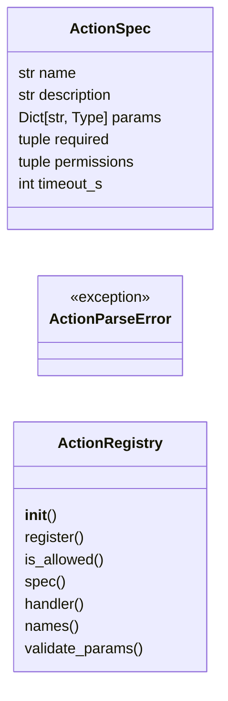
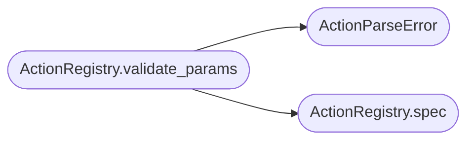

# `lazyownbt.actions`

> Source: [lazyownbt/actions.py:1](../../lazyownbt/actions.py#L1) | language `py` | coverage 45.5% | [API index](../index.md)

Registro cerrado de acciones permitidas y parser de parámetros.

Contrato: SEC-002 — Ejecución segura de comandos.

## Contents

- **Classes:** [`ActionSpec`](#actionspec), [`ActionRegistry`](#actionregistry)
- **Exceptions:** [`ActionParseError`](#actionparseerror)
- **Constants:** [`DEFAULT_ACTIONS`](#default_actions)

## Type Diagram



## Call Graph

Solid arrows stay in this module, dashed arrows leave it.



## Classes

<a id="actionspec"></a>

### `ActionSpec`

`class` `dataclass` | [lazyownbt/actions.py:13](../../lazyownbt/actions.py#L13)

Decorators: `@dataclass(frozen=True)`

```python
class ActionSpec
```

Especificación declarativa de una acción ejecutable.

**Attributes**

| Name | Type | Default | Description |
|---|---|---|---|
| [`name`](#actionspec-name) | `str` |  |  |
| [`description`](#actionspec-description) | `str` |  |  |
| [`params`](#actionspec-params) | `Dict[str, Type]` | `field(default_factory=dict)` |  |
| [`required`](#actionspec-required) | `tuple` | `()` |  |
| [`permissions`](#actionspec-permissions) | `tuple` | `()` |  |
| [`timeout_s`](#actionspec-timeout_s) | `int` | `30` |  |

---

<a id="actionregistry"></a>

### `ActionRegistry`

`class` | [lazyownbt/actions.py:28](../../lazyownbt/actions.py#L28)

```python
class ActionRegistry
```

Registro cerrado de acciones permitidas (SEC-002.2).

**Members**

| Member | Kind | Summary |
|---|---|---|
| [`__init__`](#actionregistry-__init__) | constructor |  |
| [`register`](#actionregistry-register) | method |  |
| [`is_allowed`](#actionregistry-is_allowed) | method |  |
| [`spec`](#actionregistry-spec) | method |  |
| [`handler`](#actionregistry-handler) | method |  |
| [`names`](#actionregistry-names) | method |  |
| [`validate_params`](#actionregistry-validate_params) | method | Valida y coerciona parámetros (SEC-002.3). |

<a id="actionregistry-__init__"></a>

#### `ActionRegistry.__init__`

`constructor` | [lazyownbt/actions.py:31](../../lazyownbt/actions.py#L31)

```python
def __init__(self) -> None
```

*Called by:* [`create_app`](lazyownbt.web.py.md#create_app)

<a id="actionregistry-register"></a>

#### `ActionRegistry.register`

`method` | [lazyownbt/actions.py:35](../../lazyownbt/actions.py#L35)

```python
def register(self, spec: ActionSpec, handler: Callable[..., Any]) -> None
```

**Parameters**

| Name | Type | Default | Description |
|---|---|---|---|
| `spec` | `ActionSpec` |  |  |
| `handler` | `Callable[..., Any]` |  |  |

**Raises**

- `ValueError`: (raised in the body, not documented)

<a id="actionregistry-is_allowed"></a>

#### `ActionRegistry.is_allowed`

`method` | [lazyownbt/actions.py:41](../../lazyownbt/actions.py#L41)

```python
def is_allowed(self, name: str) -> bool
```

**Parameters**

| Name | Type | Default | Description |
|---|---|---|---|
| `name` | `str` |  |  |

**Returns:** `bool`

<a id="actionregistry-spec"></a>

#### `ActionRegistry.spec`

`method` | [lazyownbt/actions.py:44](../../lazyownbt/actions.py#L44)

```python
def spec(self, name: str) -> Optional[ActionSpec]
```

**Parameters**

| Name | Type | Default | Description |
|---|---|---|---|
| `name` | `str` |  |  |

**Returns:** `Optional[ActionSpec]`

*Called by:* [`ActionRegistry.validate_params`](#actionregistry-validate_params)

<a id="actionregistry-handler"></a>

#### `ActionRegistry.handler`

`method` | [lazyownbt/actions.py:47](../../lazyownbt/actions.py#L47)

```python
def handler(self, name: str) -> Optional[Callable[..., Any]]
```

**Parameters**

| Name | Type | Default | Description |
|---|---|---|---|
| `name` | `str` |  |  |

**Returns:** `Optional[Callable[..., Any]]`

<a id="actionregistry-names"></a>

#### `ActionRegistry.names`

`method` | [lazyownbt/actions.py:50](../../lazyownbt/actions.py#L50)

```python
def names(self) -> List[str]
```

**Returns:** `List[str]`

<a id="actionregistry-validate_params"></a>

#### `ActionRegistry.validate_params`

`method` | [lazyownbt/actions.py:53](../../lazyownbt/actions.py#L53)

```python
def validate_params(self, name: str, params: Dict[str, Any]) -> Dict[str, Any]
```

Valida y coerciona parámetros (SEC-002.3).

**Parameters**

| Name | Type | Default | Description |
|---|---|---|---|
| `name` | `str` |  |  |
| `params` | `Dict[str, Any]` |  |  |

**Returns:** `Dict[str, Any]`

**Raises**

- [`ActionParseError`](#actionparseerror): (raised in the body, not documented)

*Calls:* [`ActionParseError`](#actionparseerror), [`ActionRegistry.spec`](#actionregistry-spec)

---

## Exceptions

<a id="actionparseerror"></a>

### `ActionParseError`

`exception` | [lazyownbt/actions.py:24](../../lazyownbt/actions.py#L24)

```python
class ActionParseError(ValueError)
```

Bases: `ValueError`

Error de validación de parámetros.

---

## Constants

<a id="default_actions"></a>

### `DEFAULT_ACTIONS`

`constant` | [lazyownbt/actions.py:85](../../lazyownbt/actions.py#L85)

```python
DEFAULT_ACTIONS: List[ActionSpec]
```

---
