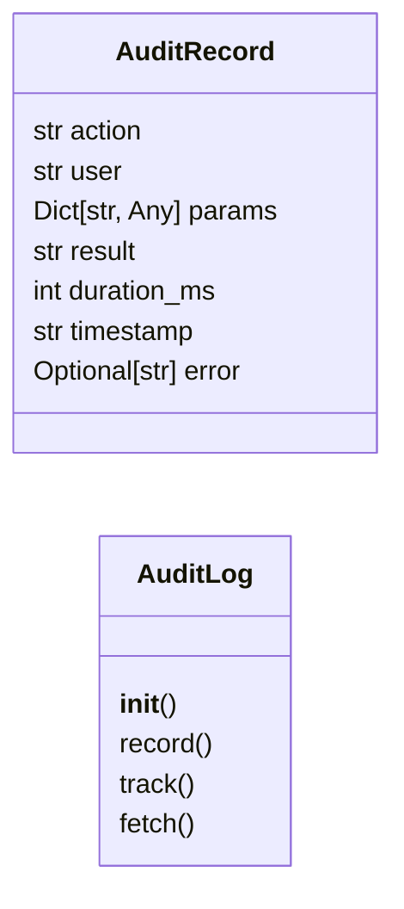
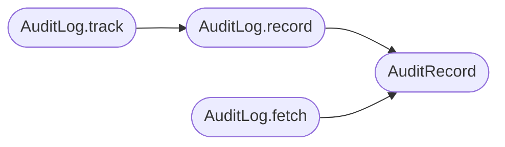

# `lazyownbt.audit`

> Source: [lazyownbt/audit.py:1](../../lazyownbt/audit.py#L1) | language `py` | coverage 42.9% | [API index](../index.md)

Registro de auditoría de acciones.

Contrato: SEC-002.5 — Toda invocación de acción debe quedar registrada.

## Contents

- **Classes:** [`AuditRecord`](#auditrecord), [`AuditLog`](#auditlog)

## Type Diagram



## Call Graph

Solid arrows stay in this module, dashed arrows leave it.



## Classes

<a id="auditrecord"></a>

### `AuditRecord`

`class` `dataclass` | [lazyownbt/audit.py:23](../../lazyownbt/audit.py#L23)

Decorators: `@dataclass(frozen=True)`

```python
class AuditRecord
```

**Attributes**

| Name | Type | Default | Description |
|---|---|---|---|
| [`action`](#auditrecord-action) | `str` |  |  |
| [`user`](#auditrecord-user) | `str` |  |  |
| [`params`](#auditrecord-params) | `Dict[str, Any]` |  |  |
| [`result`](#auditrecord-result) | `str` |  |  |
| [`duration_ms`](#auditrecord-duration_ms) | `int` |  |  |
| [`timestamp`](#auditrecord-timestamp) | `str` |  |  |
| [`error`](#auditrecord-error) | `Optional[str]` | `None` |  |

---

<a id="auditlog"></a>

### `AuditLog`

`class` | [lazyownbt/audit.py:33](../../lazyownbt/audit.py#L33)

```python
class AuditLog
```

Log de auditoría respaldado por SQLite.

**Members**

| Member | Kind | Summary |
|---|---|---|
| [`__init__`](#auditlog-__init__) | constructor |  |
| [`record`](#auditlog-record) | method |  |
| [`track`](#auditlog-track) | method | Context manager que mide tiempo y registra resultado/errores. |
| [`fetch`](#auditlog-fetch) | method |  |

<a id="auditlog-__init__"></a>

#### `AuditLog.__init__`

`constructor` | [lazyownbt/audit.py:38](../../lazyownbt/audit.py#L38)

```python
def __init__(self, db_path: str) -> None
```

**Parameters**

| Name | Type | Default | Description |
|---|---|---|---|
| `db_path` | `str` |  |  |

*Called by:* [`create_app`](lazyownbt.web.py.md#create_app)

<a id="auditlog-record"></a>

#### `AuditLog.record`

`method` | [lazyownbt/audit.py:77](../../lazyownbt/audit.py#L77)

```python
def record(self, action: str, user: str, params: Dict[str, Any], result: str, duration_ms: int, error: Optional[str] = None) -> AuditRecord
```

**Parameters**

| Name | Type | Default | Description |
|---|---|---|---|
| `action` | `str` |  |  |
| `user` | `str` |  |  |
| `params` | `Dict[str, Any]` |  |  |
| `result` | `str` |  |  |
| `duration_ms` | `int` |  |  |
| `error` | `Optional[str]` | `None` |  |

**Returns:** `AuditRecord`

*Calls:* [`AuditRecord`](#auditrecord)

*Called by:* [`AuditLog.track`](#auditlog-track)

<a id="auditlog-track"></a>

#### `AuditLog.track`

`method` `generator` | [lazyownbt/audit.py:113](../../lazyownbt/audit.py#L113)

Decorators: `@contextmanager`

```python
def track(self, action: str, user: str, params: Dict[str, Any]) -> Iterator[Dict[str, Any]]
```

Context manager que mide tiempo y registra resultado/errores.

**Parameters**

| Name | Type | Default | Description |
|---|---|---|---|
| `action` | `str` |  |  |
| `user` | `str` |  |  |
| `params` | `Dict[str, Any]` |  |  |

**Returns:** `Iterator[Dict[str, Any]]`

*Calls:* [`AuditLog.record`](#auditlog-record)

<a id="auditlog-fetch"></a>

#### `AuditLog.fetch`

`method` | [lazyownbt/audit.py:133](../../lazyownbt/audit.py#L133)

```python
def fetch(self, limit: int = 100) -> List[AuditRecord]
```

**Parameters**

| Name | Type | Default | Description |
|---|---|---|---|
| `limit` | `int` | `100` |  |

**Returns:** `List[AuditRecord]`

*Calls:* [`AuditRecord`](#auditrecord)

---
