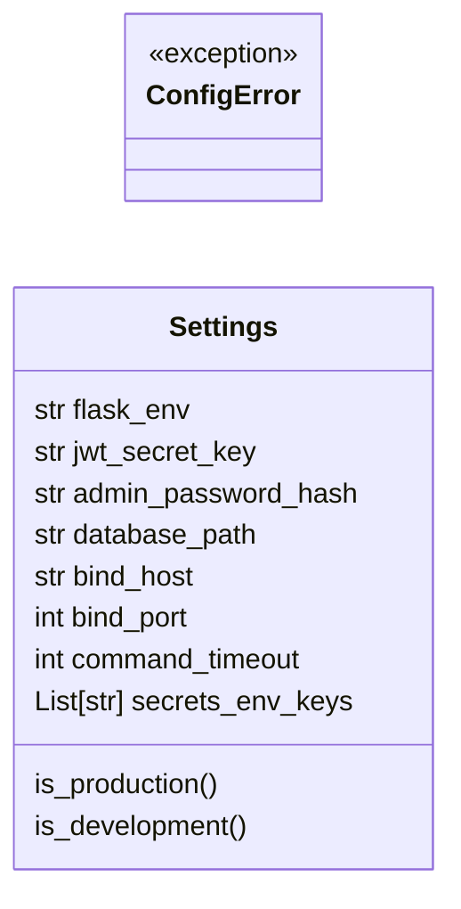
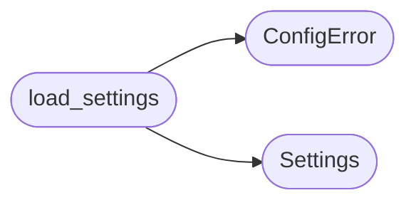

# `lazyownbt.config`

> Source: [lazyownbt/config.py:1](../../lazyownbt/config.py#L1) | language `py` | coverage 66.7% | [API index](../index.md)

Carga de configuración desde variables de entorno y .env.

Contrato: CFG-001 — Configuración desde entorno.

## Contents

- **Classes:** [`Settings`](#settings)
- **Exceptions:** [`ConfigError`](#configerror)
- **Functions:** [`load_settings`](#load_settings)
- **Constants:** [`SECRETS_ENV_KEYS`](#secrets_env_keys)

## Type Diagram



## Call Graph

Solid arrows stay in this module, dashed arrows leave it.



## Classes

<a id="settings"></a>

### `Settings`

`class` `dataclass` | [lazyownbt/config.py:104](../../lazyownbt/config.py#L104)

Decorators: `@dataclass(frozen=True)`

```python
class Settings
```

Configuración inmutable de la aplicación.

**Attributes**

| Name | Type | Default | Description |
|---|---|---|---|
| [`flask_env`](#settings-flask_env) | `str` |  |  |
| [`jwt_secret_key`](#settings-jwt_secret_key) | `str` |  |  |
| [`admin_password_hash`](#settings-admin_password_hash) | `str` |  |  |
| [`database_path`](#settings-database_path) | `str` |  |  |
| [`bind_host`](#settings-bind_host) | `str` |  |  |
| [`bind_port`](#settings-bind_port) | `int` |  |  |
| [`command_timeout`](#settings-command_timeout) | `int` |  |  |
| [`secrets_env_keys`](#settings-secrets_env_keys) | `List[str]` | `field(default_factory=lambda: list(SECRETS_ENV_KEYS))` |  |

**Members**

| Member | Kind | Summary |
|---|---|---|
| [`is_production`](#settings-is_production) | property |  |
| [`is_development`](#settings-is_development) | property |  |

<a id="settings-is_production"></a>

#### `Settings.is_production`

`property` | [lazyownbt/config.py:117](../../lazyownbt/config.py#L117)

Decorators: `@property`

```python
def is_production(self) -> bool
```

**Returns:** `bool`

<a id="settings-is_development"></a>

#### `Settings.is_development`

`property` | [lazyownbt/config.py:121](../../lazyownbt/config.py#L121)

Decorators: `@property`

```python
def is_development(self) -> bool
```

**Returns:** `bool`

---

## Exceptions

<a id="configerror"></a>

### `ConfigError`

`exception` | [lazyownbt/config.py:28](../../lazyownbt/config.py#L28)

```python
class ConfigError(RuntimeError)
```

Bases: `RuntimeError`

Error de configuración.

Falla ruidosamente con mensaje accionable.

---

## Functions

<a id="load_settings"></a>

### `load_settings`

`function` | [lazyownbt/config.py:125](../../lazyownbt/config.py#L125)

```python
def load_settings() -> Settings
```

Carga y valida la configuración.

Falla ruidosamente (CFG-001.3).

**Returns:** `Settings`

**Raises**

- [`ConfigError`](#configerror): (raised in the body, not documented)

*Calls:* [`ConfigError`](#configerror), [`Settings`](#settings)

*Called by:* [`create_app`](lazyownbt.web.py.md#create_app), [`run`](lazyownbt.web.py.md#run), [`build_app`](main.py.md#build_app)

---

## Constants

<a id="secrets_env_keys"></a>

### `SECRETS_ENV_KEYS`

`constant` | [lazyownbt/config.py:18](../../lazyownbt/config.py#L18)

```python
SECRETS_ENV_KEYS: List[str]
```

---
