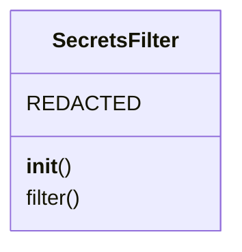
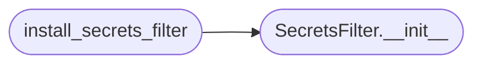

# `lazyownbt.security`

> Source: [lazyownbt/security.py:1](../../lazyownbt/security.py#L1) | language `py` | coverage 66.7% | [API index](../index.md)

Filtros de seguridad y helpers criptográficos.

Contrato: SEC-001 — Manejo seguro de secretos.

## Contents

- **Classes:** [`SecretsFilter`](#secretsfilter)
- **Functions:** [`install_secrets_filter`](#install_secrets_filter), [`verify_password`](#verify_password)

## Type Diagram



## Call Graph

Solid arrows stay in this module, dashed arrows leave it.



## Classes

<a id="secretsfilter"></a>

### `SecretsFilter`

`class` | [lazyownbt/security.py:13](../../lazyownbt/security.py#L13)

```python
class SecretsFilter(logging.Filter)
```

Bases: `logging.Filter`

Filtro de logging que redacta valores de secretos.

Cubre el contrato SEC-001.6.

**Attributes**

| Name | Type | Default | Description |
|---|---|---|---|
| [`REDACTED`](#secretsfilter-redacted) |  | `'[REDACTED]'` |  |

**Members**

| Member | Kind | Summary |
|---|---|---|
| [`__init__`](#secretsfilter-__init__) | constructor |  |
| [`filter`](#secretsfilter-filter) | method |  |

<a id="secretsfilter-__init__"></a>

#### `SecretsFilter.__init__`

`constructor` | [lazyownbt/security.py:21](../../lazyownbt/security.py#L21)

```python
def __init__(self, env_keys: Iterable[str])
```

**Parameters**

| Name | Type | Default | Description |
|---|---|---|---|
| `env_keys` | `Iterable[str]` |  |  |

*Called by:* [`install_secrets_filter`](#install_secrets_filter)

<a id="secretsfilter-filter"></a>

#### `SecretsFilter.filter`

`method` | [lazyownbt/security.py:35](../../lazyownbt/security.py#L35)

```python
def filter(self, record: logging.LogRecord) -> bool
```

**Parameters**

| Name | Type | Default | Description |
|---|---|---|---|
| `record` | `logging.LogRecord` |  |  |

**Returns:** `bool`

---

## Functions

<a id="install_secrets_filter"></a>

### `install_secrets_filter`

`function` | [lazyownbt/security.py:51](../../lazyownbt/security.py#L51)

```python
def install_secrets_filter(logger: logging.Logger, env_keys: Iterable[str]) -> None
```

Instala el SecretsFilter en un logger.

**Parameters**

| Name | Type | Default | Description |
|---|---|---|---|
| `logger` | `logging.Logger` |  |  |
| `env_keys` | `Iterable[str]` |  |  |

*Calls:* [`SecretsFilter.__init__`](#secretsfilter-__init__)

*Called by:* [`create_app`](lazyownbt.web.py.md#create_app)

---

<a id="verify_password"></a>

### `verify_password`

`function` | [lazyownbt/security.py:59](../../lazyownbt/security.py#L59)

```python
def verify_password(plain: str, hashed: str) -> bool
```

Compara una contraseña contra un hash bcrypt (SEC-001.4).

**Parameters**

| Name | Type | Default | Description |
|---|---|---|---|
| `plain` | `str` |  |  |
| `hashed` | `str` |  |  |

**Returns:** `bool`

---
