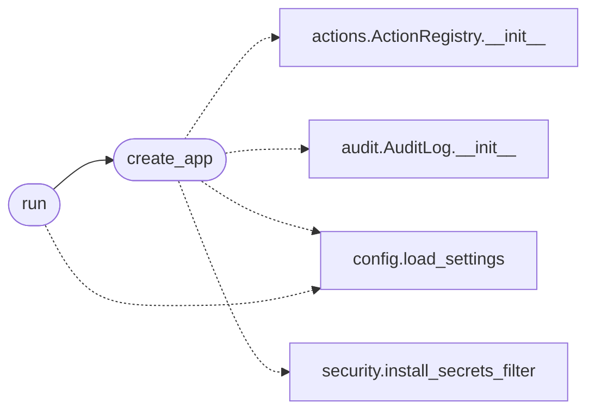

# `lazyownbt.web`

> Source: [lazyownbt/web.py:1](../../lazyownbt/web.py#L1) | language `py` | coverage 100.0% | [API index](../index.md)

Factory de la aplicación Flask (dashboard PurpleTeam).

Reemplaza al `main.py` monolítico. Cumple los contratos:
- SEC-001: secretos desde entorno
- SEC-002: ejecución segura de comandos (sin subprocess dinámico)
- SEC-003: modo producción con HTTPS, bind loopback, debug off

## Contents

- **Functions:** [`create_app`](#create_app), [`run`](#run)

## Call Graph

Solid arrows stay in this module, dashed arrows leave it.



## Functions

<a id="create_app"></a>

### `create_app`

`function` | [lazyownbt/web.py:66](../../lazyownbt/web.py#L66)

```python
def create_app(settings: Settings | None = None, *, registry: ActionRegistry | None = None, audit: AuditLog | None = None, debug: bool = False) -> Flask
```

Crea y configura la app Flask.

**Parameters**

| Name | Type | Default | Description |
|---|---|---|---|
| `settings` | `Settings \| None` | `None` |  |
| `registry` | `ActionRegistry \| None` | `None` |  |
| `audit` | `AuditLog \| None` | `None` |  |
| `debug` | `bool` | `False` |  |

**Returns:** `Flask`

*Calls:* [`ActionRegistry.__init__`](lazyownbt.actions.py.md#actionregistry-__init__), [`AuditLog.__init__`](lazyownbt.audit.py.md#auditlog-__init__), [`load_settings`](lazyownbt.config.py.md#load_settings), [`install_secrets_filter`](lazyownbt.security.py.md#install_secrets_filter)

*Called by:* [`run`](#run), [`build_app`](main.py.md#build_app)

---

<a id="run"></a>

### `run`

`function` | [lazyownbt/web.py:236](../../lazyownbt/web.py#L236)

```python
def run() -> None
```

Punto de entrada CLI: respeta SEC-003.1 y SEC-003.2.

**Raises**

- `SystemExit`: (raised in the body, not documented)

*Calls:* [`load_settings`](lazyownbt.config.py.md#load_settings), [`create_app`](#create_app)

---
