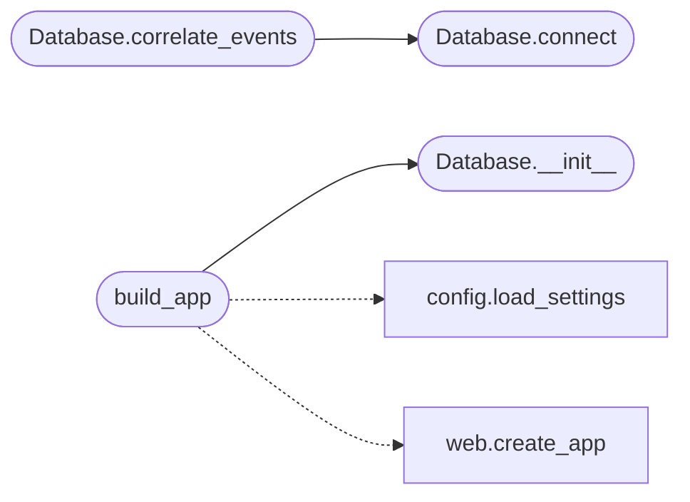

# `main`

> Source: [main.py:1](../../main.py#L1) | language `py` | coverage 40.0% | [API index](../index.md)

LazyOwn PurpleTeam Dashboard — entry point.

Versión endurecida (SEC-001, SEC-002, SEC-003):
  - Sin secretos hardcodeados (Settings desde entorno / .env).
  - Login con hash bcrypt vía lazyownbt.security.
  - Sin ``subprocess -c``: las acciones pasan por `[`ActionRegistry`](lazyownbt.actions.py.md#actionregistry)` con
    lista cerrada de comandos y argv validado.
  - CSP sin hashes hardcodeados (estilos servidos desde ``static/css/``).
  - Bind loopback por defecto; ``debug=True`` solo en ``FLASK_ENV=development``.
  - ``app.run(...)`` final delega en [`lazyownbt.web.run`](lazyownbt.web.py.md#run) para
    respetar los mismos contratos.

Mantiene las rutas históricas (``/alerts``, ``/events``,
``/api/correlate/<id>``) sobre la base de datos SQLite, pero las
declaraciones sensibles (auth, JWT, Talisman, ``/login``,
``/commands``, ``/healthz``, error handlers) viven en
`[`lazyownbt.web`](lazyownbt.web.py.md)` y se reusan vía [`create_app`](lazyownbt.web.py.md#create_app).

## Contents

- **Classes:** [`Database`](#database)
- **Functions:** [`build_app`](#build_app)

## Call Graph

Solid arrows stay in this module, dashed arrows leave it.



## Classes

<a id="database"></a>

### `Database`

`class` | [main.py:42](../../main.py#L42)

```python
class Database
```

Acceso de solo-lectura a la base de datos SQLite del framework.

Cualquier tabla ausente se trata como "sin datos" en lugar de romper
el dashboard. Esto preserva el comportamiento de la versión anterior
cuando se despliega contra una BD aún no inicializada por ``app.py``.

**Members**

| Member | Kind | Summary |
|---|---|---|
| [`__init__`](#database-__init__) | constructor |  |
| [`connect`](#database-connect) | method |  |
| [`fetch_alerts`](#database-fetch_alerts) | method |  |
| [`fetch_events`](#database-fetch_events) | method |  |
| [`fetch_network_baseline`](#database-fetch_network_baseline) | method |  |
| [`fetch_file_hashes`](#database-fetch_file_hashes) | method |  |
| [`correlate_events`](#database-correlate_events) | method | Busca alertas ±5 min relacionadas con un evento. |

<a id="database-__init__"></a>

#### `Database.__init__`

`constructor` | [main.py:57](../../main.py#L57)

```python
def __init__(self, db_path: str) -> None
```

**Parameters**

| Name | Type | Default | Description |
|---|---|---|---|
| `db_path` | `str` |  |  |

*Called by:* [`build_app`](#build_app)

<a id="database-connect"></a>

#### `Database.connect`

`method` | [main.py:60](../../main.py#L60)

```python
def connect(self) -> sqlite3.Connection | None
```

**Returns:** `sqlite3.Connection | None`

*Called by:* [`Database.correlate_events`](#database-correlate_events)

<a id="database-fetch_alerts"></a>

#### `Database.fetch_alerts`

`method` | [main.py:106](../../main.py#L106)

```python
def fetch_alerts(self, limit: int = 100, severity: str | None = None) -> list[dict[str, Any]]
```

**Parameters**

| Name | Type | Default | Description |
|---|---|---|---|
| `limit` | `int` | `100` |  |
| `severity` | `str \| None` | `None` |  |

**Returns:** `list[dict[str, Any]]`

<a id="database-fetch_events"></a>

#### `Database.fetch_events`

`method` | [main.py:127](../../main.py#L127)

```python
def fetch_events(self, limit: int = 100) -> list[dict[str, Any]]
```

**Parameters**

| Name | Type | Default | Description |
|---|---|---|---|
| `limit` | `int` | `100` |  |

**Returns:** `list[dict[str, Any]]`

<a id="database-fetch_network_baseline"></a>

#### `Database.fetch_network_baseline`

`method` | [main.py:141](../../main.py#L141)

```python
def fetch_network_baseline(self, limit: int = 100) -> list[dict[str, Any]]
```

**Parameters**

| Name | Type | Default | Description |
|---|---|---|---|
| `limit` | `int` | `100` |  |

**Returns:** `list[dict[str, Any]]`

<a id="database-fetch_file_hashes"></a>

#### `Database.fetch_file_hashes`

`method` | [main.py:148](../../main.py#L148)

```python
def fetch_file_hashes(self, limit: int = 100) -> list[dict[str, Any]]
```

**Parameters**

| Name | Type | Default | Description |
|---|---|---|---|
| `limit` | `int` | `100` |  |

**Returns:** `list[dict[str, Any]]`

<a id="database-correlate_events"></a>

#### `Database.correlate_events`

`method` | [main.py:155](../../main.py#L155)

```python
def correlate_events(self, event_id: int) -> dict[str, Any]
```

Busca alertas ±5 min relacionadas con un evento.

**Parameters**

| Name | Type | Default | Description |
|---|---|---|---|
| `event_id` | `int` |  |  |

**Returns:** `dict[str, Any]`

*Calls:* [`Database.connect`](#database-connect)

---

## Functions

<a id="build_app"></a>

### `build_app`

`function` | [main.py:260](../../main.py#L260)

```python
def build_app(settings: Settings | None = None) -> Flask
```

Construye la app final reutilizando [`create_app`](lazyownbt.web.py.md#create_app).

**Parameters**

| Name | Type | Default | Description |
|---|---|---|---|
| `settings` | `Settings \| None` | `None` |  |

**Returns:** `Flask`

*Calls:* [`load_settings`](lazyownbt.config.py.md#load_settings), [`create_app`](lazyownbt.web.py.md#create_app), [`Database.__init__`](#database-__init__)

---
