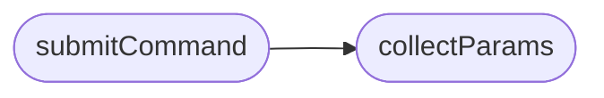

# `static/js/commands.js`

> Source: [static/js/commands.js:1](../../static/js/commands.js#L1) | language `js` | coverage 25.0% | [API index](../index.md)

LazyOwnBT — formulario de comandos.

## Contents

- **Functions:** [`renderParams`](#renderparams), [`collectParams`](#collectparams), [`submitCommand`](#submitcommand)

## Call Graph

Solid arrows stay in this module, dashed arrows leave it.



## Functions

<a id="renderparams"></a>

### `renderParams`

`function` | [static/js/commands.js:34](../../static/js/commands.js#L34)

```javascript
function renderParams(action, host)
```

**Parameters**

| Name | Type | Default | Description |
|---|---|---|---|
| `action` |  |  |  |
| `host` |  |  |  |

---

<a id="collectparams"></a>

### `collectParams`

`function` | [static/js/commands.js:67](../../static/js/commands.js#L67)

```javascript
function collectParams(action)
```

**Parameters**

| Name | Type | Default | Description |
|---|---|---|---|
| `action` |  |  |  |

*Called by:* [`submitCommand`](#submitcommand)

---

<a id="submitcommand"></a>

### `submitCommand`

`function` `async` | [static/js/commands.js:80](../../static/js/commands.js#L80)

```javascript
async function submitCommand(e)
```

**Parameters**

| Name | Type | Default | Description |
|---|---|---|---|
| `e` |  |  |  |

*Calls:* [`collectParams`](#collectparams)

---
