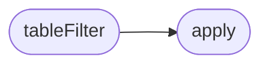

# `static/js/table-filter.js`

> Source: [static/js/table-filter.js:1](../../static/js/table-filter.js#L1) | language `js` | coverage 33.3% | [API index](../index.md)

LazyOwnBT — filtro de tabla en cliente (vanilla JS).

## Contents

- **Functions:** [`tableFilter`](#tablefilter), [`apply`](#apply)

## Call Graph

Solid arrows stay in this module, dashed arrows leave it.



## Functions

<a id="tablefilter"></a>

### `tableFilter`

`function` | [static/js/table-filter.js:6](../../static/js/table-filter.js#L6)

```javascript
function tableFilter(tableId, inputId)
```

**Parameters**

| Name | Type | Default | Description |
|---|---|---|---|
| `tableId` |  |  |  |
| `inputId` |  |  |  |

*Calls:* [`apply`](#apply)

---

<a id="apply"></a>

### `apply`

`function` | [static/js/table-filter.js:15](../../static/js/table-filter.js#L15)

```javascript
function apply()
```

*Called by:* [`tableFilter`](#tablefilter)

---
