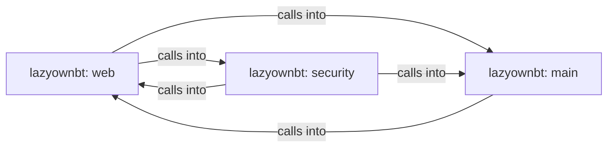

## Details

Static architecture map of 23 files (js, py, sh) in 3 components: lazyownbt: web, lazyownbt: main, lazyownbt: security. Structure is extracted statically without LLM calls; component prose may be enriched locally.

### lazyownbt: web (1)

lazyownbt: web groups 5 files (py) around ActionSpec, ActionParseError, ActionRegistry, __init__, register. Registro cerrado de acciones permitidas y parser de parámetros.

**Related Classes/Methods**:

- <a href="../lazyownbt/actions.py#L13-L23">lazyownbt/actions.py::ActionSpec</a>
- <a href="../lazyownbt/actions.py#L24-L27">lazyownbt/actions.py::ActionParseError</a>
- <a href="../lazyownbt/actions.py#L28-L30">lazyownbt/actions.py::ActionRegistry</a>
- <a href="../lazyownbt/actions.py#L31-L34">lazyownbt/actions.py::__init__</a>
- <a href="../lazyownbt/actions.py#L35-L40">lazyownbt/actions.py::register</a>
- <a href="../lazyownbt/actions.py#L41-L43">lazyownbt/actions.py::is_allowed</a>
- <a href="../lazyownbt/actions.py#L44-L46">lazyownbt/actions.py::spec</a>
- <a href="../lazyownbt/actions.py#L47-L49">lazyownbt/actions.py::handler</a>

### lazyownbt: main (2)

lazyownbt: main groups 4 files (py) around ConfigError, _load_dotenv, _resolve_jwt_secret, _resolve_admin_password_hash, Settings. Carga de configuración desde variables de entorno y .env.

**Related Classes/Methods**:

- <a href="../lazyownbt/config.py#L28-L31">lazyownbt/config.py::ConfigError</a>
- <a href="../lazyownbt/config.py#L32-L38">lazyownbt/config.py::_load_dotenv</a>
- <a href="../lazyownbt/config.py#L39-L72">lazyownbt/config.py::_resolve_jwt_secret</a>
- <a href="../lazyownbt/config.py#L73-L103">lazyownbt/config.py::_resolve_admin_password_hash</a>
- <a href="../lazyownbt/config.py#L104-L116">lazyownbt/config.py::Settings</a>
- <a href="../lazyownbt/config.py#L117-L120">lazyownbt/config.py::is_production</a>
- <a href="../lazyownbt/config.py#L121-L124">lazyownbt/config.py::is_development</a>
- <a href="../lazyownbt/config.py#L125-L146">lazyownbt/config.py::load_settings</a>

### lazyownbt: security (3)

lazyownbt: security groups 3 files (py) around SecretsFilter, __init__, _redact, filter, install_secrets_filter. Filtros de seguridad y helpers criptográficos.

**Related Classes/Methods**:

- <a href="../lazyownbt/security.py#L13-L20">lazyownbt/security.py::SecretsFilter</a>
- <a href="../lazyownbt/security.py#L21-L24">lazyownbt/security.py::__init__</a>
- <a href="../lazyownbt/security.py#L25-L34">lazyownbt/security.py::_redact</a>
- <a href="../lazyownbt/security.py#L35-L50">lazyownbt/security.py::filter</a>
- <a href="../lazyownbt/security.py#L51-L58">lazyownbt/security.py::install_secrets_filter</a>
- <a href="../lazyownbt/security.py#L59-L66">lazyownbt/security.py::verify_password</a>
- <a href="../tests/conftest.py#L35-L39">tests/conftest.py::_make_jwt_secret</a>
- <a href="../tests/conftest.py#L40-L44">tests/conftest.py::jwt_secret</a>
